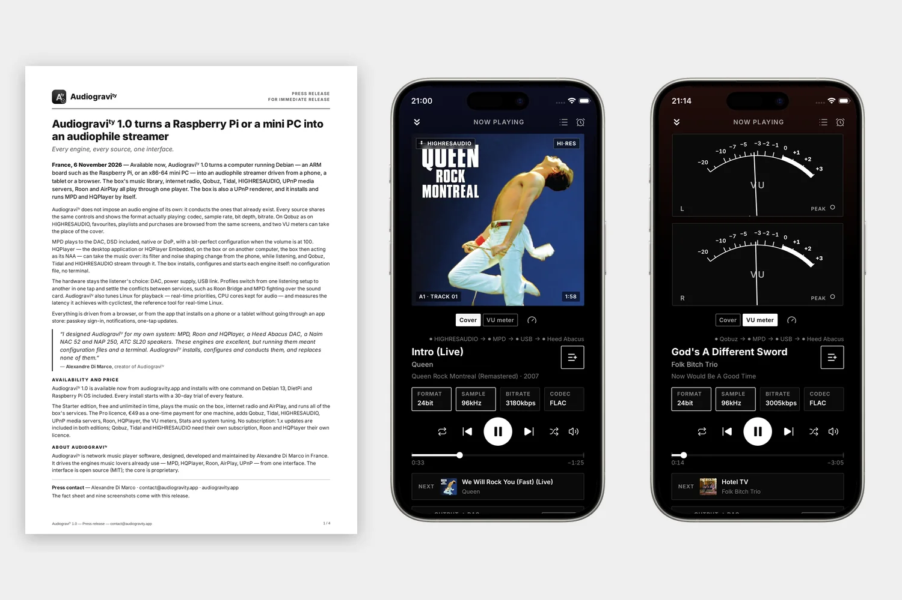

# Audiogravity 1.0: the press release

Audiogravity 1.0 came out on 6 November 2026. Its press release is here, in English and
in French, for anyone who writes about hi-fi and streaming: a page on what it does, a fact sheet,
and nine screenshots of the app.

## Download

- [The press release, in English](../../press/Audiogravity-1.0-press-release.pdf) — PDF, 4 pages,
  1.2 MB.
- <a href="../../press/Audiogravity-1.0-communique-de-presse.pdf" hreflang="fr" lang="fr">Le communiqué de presse, en français</a>
  — PDF, 4 pages, 1.2 MB.
- [The nine screenshots, full size](../../press/audiogravity-1.0-screenshots.zip) — a ZIP of PNG
  files, 6.2 MB.

## What it says

Audiogravity turns a computer running Debian — a Raspberry Pi, another ARM board or an
x86-64 mini PC — into an audiophile streamer driven from a phone, a tablet or a browser. The box's
music library, internet radio, Qobuz, Tidal, HIGHRESAUDIO, UPnP media servers, Roon and AirPlay
play through one player, which shows the format actually playing.

It brings no audio engine of its own: it installs and drives MPD and HQPlayer, and leaves the DAC,
the power supply and the rest of the hardware to the listener. The fact sheet goes through it area
by area — the sources, the three UPnP roles, the engines, the player, setup and tuning — and says
what each edition includes.

## The screenshots

Nine screens of the app, in its dark theme: an album from HIGHRESAUDIO playing, the VU meters in
place of the cover, the HIGHRESAUDIO catalogue, the signal path, Stats, the profiles, the player on
a phone held sideways, with and without its meters, and the showcase mode. Each one is named and
described in the press release.

## Contact

For a question, a detail to check or a screen that is not in the set, write to me at
[contact@audiogravity.app](mailto:contact@audiogravity.app).
