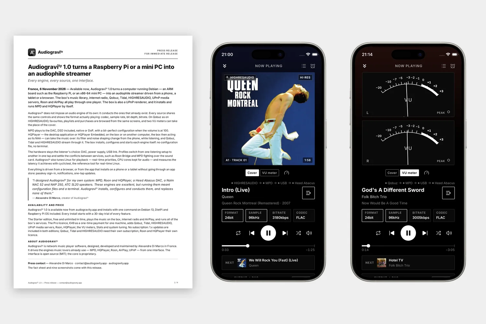
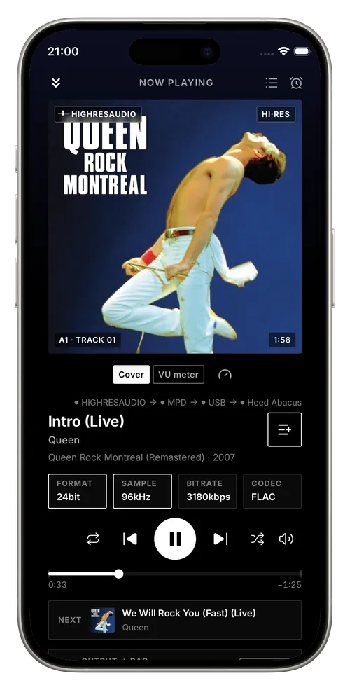
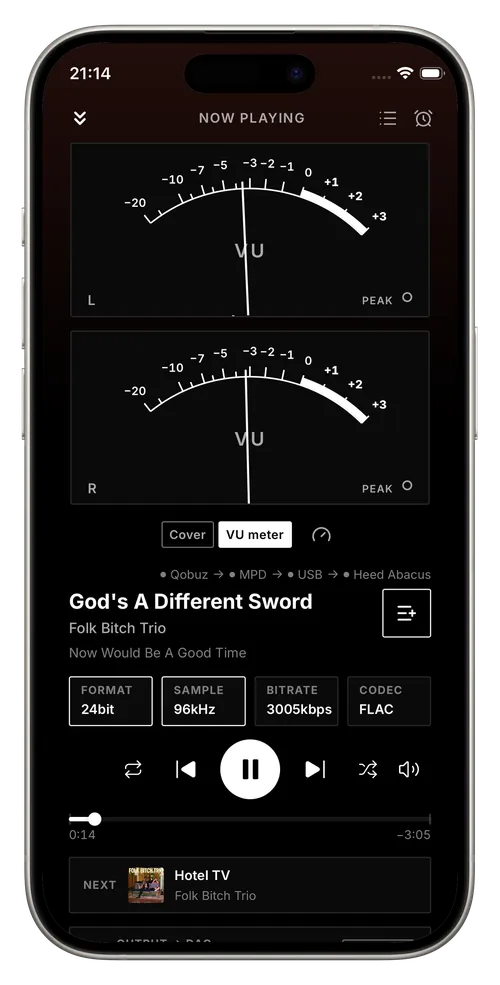
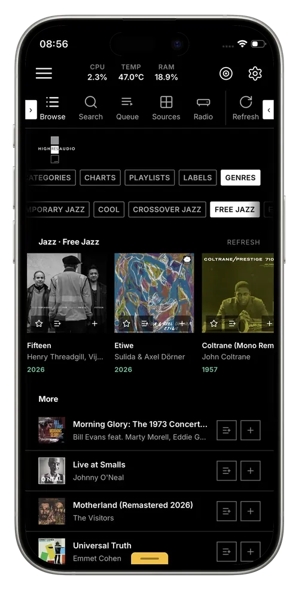
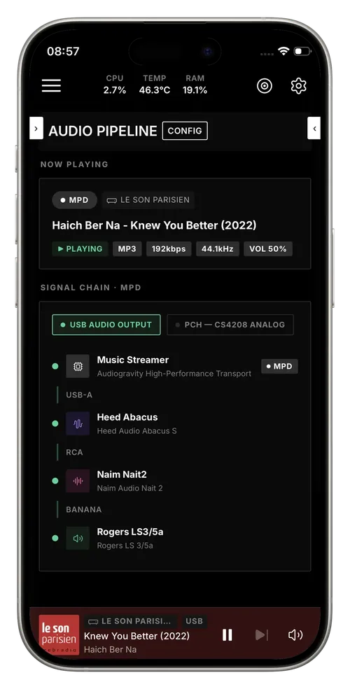
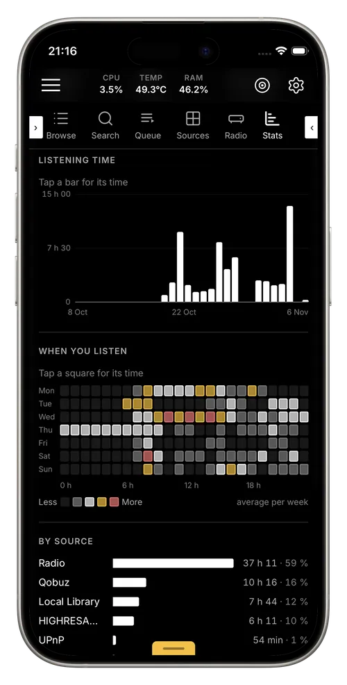
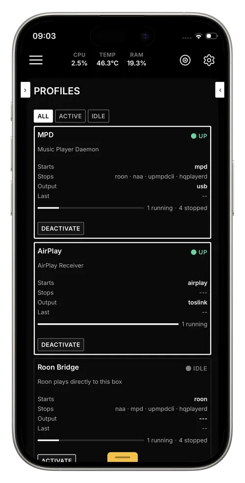
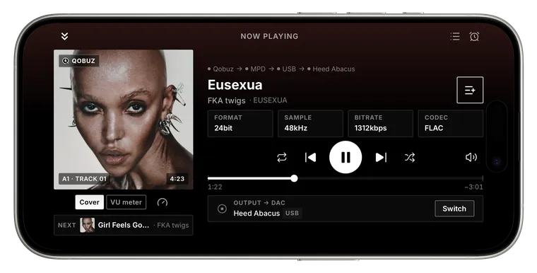
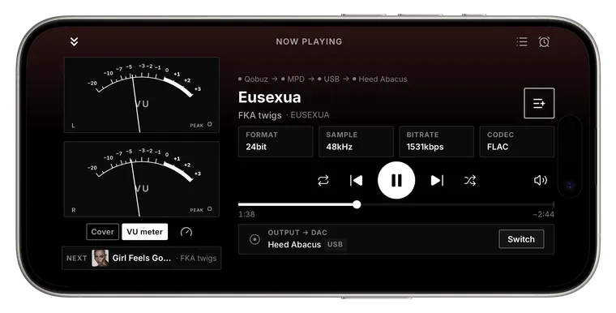
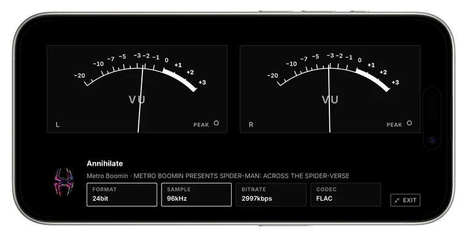

# Audiogravity 1.0: the press release

Audiogravity 1.0 came out on 6 November 2026. Its press release is here, in English and
in French, for anyone who writes about hi-fi and streaming: a page on what it does, a fact sheet,
and nine screenshots of the app.

## Download

- [The press release, in English](../../press/Audiogravity-1.0-press-release.pdf) — PDF, 4 pages,
  1.2 MB.
- <a href="../../press/Audiogravity-1.0-communique-de-presse.pdf" hreflang="fr" lang="fr">Le communiqué de presse, en français</a>
  — PDF, 4 pages, 1.2 MB.
- [The nine screenshots, full size](../../press/audiogravity-1.0-screenshots.zip) — a ZIP of PNG
  files, 6.2 MB.

## What it says

Audiogravity turns a computer running Debian — a Raspberry Pi, another ARM board or an
x86-64 mini PC — into an audiophile streamer driven from a phone, a tablet or a browser. The box's
music library, internet radio, Qobuz, Tidal, HIGHRESAUDIO, UPnP media servers, Roon and AirPlay
play through one player, which shows the format actually playing.

It brings no audio engine of its own: it installs and drives MPD and HQPlayer, and leaves the DAC,
the power supply and the rest of the hardware to the listener. The fact sheet goes through it area
by area — the sources, the three UPnP roles, the engines, the player, setup and tuning — and says
what each edition includes.

## The screenshots

Nine screens of the app, in its dark theme, with the captions the press release gives them. Each
one opens full size; the ZIP above holds them as PNG files, numbered in the same order.

<figure><figcaption><strong>1. Now playing, HIGHRESAUDIO</strong> — Queen, Rock Montreal, in 24-bit / 96 kHz FLAC; the source, the engine and the DAC show above the title.</figcaption></figure>
<figure><figcaption><strong>2. VU meters</strong> — two needles in place of the cover; the title and the format stay shown below (Pro).</figcaption></figure>
<figure><figcaption><strong>3. The HIGHRESAUDIO catalogue</strong> — categories, charts, playlists, labels and genres, browsed from the box's library.</figcaption></figure>
<figure><figcaption><strong>4. The signal path, live</strong> — from the source to the DAC, the amplifier and the speakers, with the format of what plays.</figcaption></figure>
<figure><figcaption><strong>5. Stats</strong> — listening time per day, the hours you listen, and each source's share (Pro).</figcaption></figure>
<figure><figcaption><strong>6. Profiles</strong> — each listening setup starts the services it needs and stops the others, in one tap.</figcaption></figure>

<figure><figcaption><strong>7. Held sideways</strong> — the player fits on one screen: cover, title, format, controls and output.</figcaption></figure>
<figure><figcaption><strong>8. Held sideways, with the VU meters</strong> — the two needles take the place of the cover (Pro).</figcaption></figure>
<figure><figcaption><strong>9. Showcase mode</strong> — the VU meters and the track playing with its format, full screen (Pro).</figcaption></figure>

## Contact

For a question, a detail to check or a screen that is not in the set, write to me at
[contact@audiogravity.app](mailto:contact@audiogravity.app).
