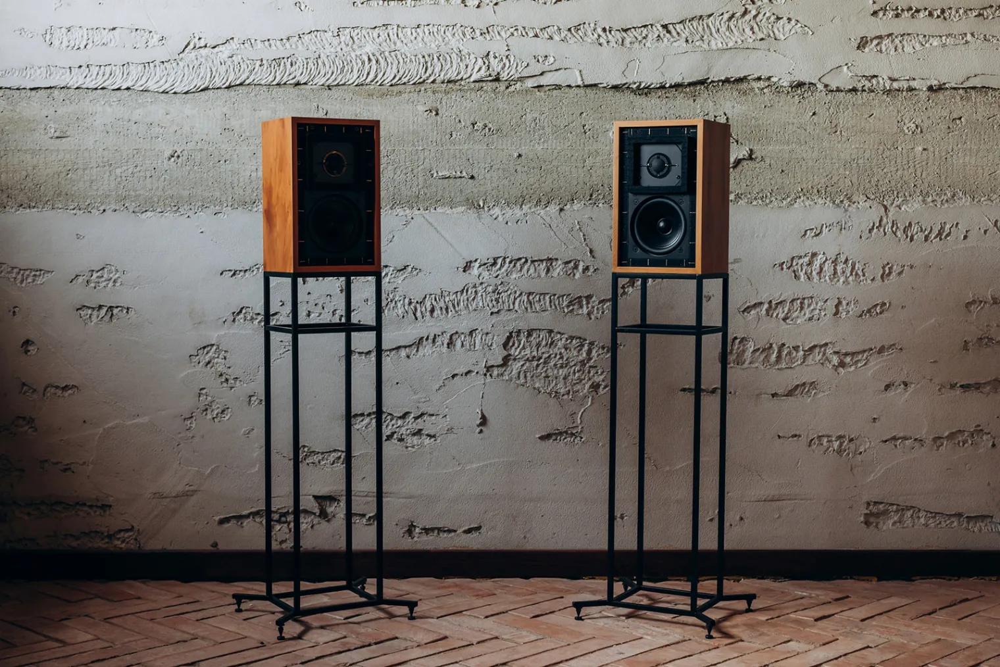

# The BBC LS3/5A: the little monitor that became a legend

The LS3/5A is a loudspeaker a foot tall that the BBC designed in the 1970s for the control rooms
of its outside-broadcast vans. It was never meant for the home, yet for decades audiophiles have
treated it as the reference among small speakers: "for the better part of a quarter-century widely
regarded as the best minimonitor in the world," The Absolute Sound wrote in 2016, and for
Stereophile, in 2020, "the most influential minimonitor in history". In 2020, three firms were making
it again, and the same reviewers who praise it also say what it cannot do. Here is what they heard,
where they disagree, its versions, and what drives it best.

Checked on 2026-11-02 against the reviews of Stereophile (1977, 1989, 2007, 2019, 2020, 2021) and
The Absolute Sound (2016), and the BBC's design report of 1976.

*A pair of Rogers LS3/5A on OUTAUDIO's Model 10 x 10 stands. Photo: Olga Krakowska, for
[OUTAUDIO](https://outaudio.eu/en/speaker-stands-model-10-x-10/).*

## How a monitor for vans became a legend

The BBC needed to check the sound "where space is at a premium and where headphones are not
considered satisfactory": the production section of a television van. Its Research Department
designed a small two-way sealed box around two KEF drive units, the B110 bass unit and the T27
tweeter; when KEF changed them, the design was revised and named LS3/5A. From 1975 it was licensed
to British makers, Rogers first.

The team, John Atkinson wrote in Stereophile in 1989, was "probably the finest collection of British
speaker design talent", and "there were no commercial constraints placed on the design". The
speaker found its public almost by accident. In 1977, J. Gordon Holt reviewed these "diminutive
little sleepers" for Stereophile, at $430 a pair: "the apparent audible size of these tiny speakers
is almost laughable; we had the feeling that it just could not possibly be." Holt's "original rave",
Paul Seydor wrote in The Absolute Sound, introduced it to American audiophiles: "A cult — indeed, an
icon — was born."

More than 60,000 pairs were made up to 1988, 43,000 of them by Rogers. In 1989 Atkinson noted that it
was "virtually unknown for a speaker to be still available, virtually unchanged, 14 years" after its
launch; in 2007 he asked why almost every speaker of the 1960s and 1970s sounds dated "whereas the
LS3/5a remains a competitive design". Herb Reichert, of Stereophile, used a pair of Rogers as his
everyday speakers from 1989 to 2015; in 2021 he counted "almost 40 continuous years" with the
LS3/5A, and wrote that "its popularity has never abated".

## The sound

**The midrange and voices.** This is what it is loved for. Atkinson called it "one of the least
colored midbands around": the inner voices of an orchestra came through "in the correct musical
relationship with the lead", and of all the speakers in his group, it alone conveyed "the tonal
differences between different pianos". On a cathedral choir, "the delicacy of imaging and the
natural tonality of the voices" drew him "into both the recorded acoustic and the music". Seydor
put first "a midrange of quite extraordinary richness and presence, with an almost palpable
thereness, particularly on voices and acoustic instruments"; its lower midrange, "plainly the glory
of the speaker", is "rich, seductive, and yes even a little 'magical.'" Reichert credits his Falcon
pair with "critical levels of timbral accuracy and speech intelligibility".

**The image, and the size of the sound.** Atkinson's soundstage was "wide and deep, but, more
important, absolutely stable with frequency", a centre voice as narrow as he had heard. Reichert's
Falcons throw "a wall-penetrating, precisely mapped, extraordinarily detailed soundstage". And the sound
is bigger than the box: Holt's "almost laughable" size; Seydor's "less of the miniaturization
effect"; Art Dudley, in 2020, found the scale "shockingly good for such a tiny speaker".

**The bass, and its illusion.** There is no deep bass: the response is 6 dB down at 68 Hz, Atkinson
measured, and none of the three versions Dudley heard in 2019 "came close to reproducing
fundamentals lower than 70 or 80Hz". A hump in the upper bass makes up for it. Holt found the
speakers "not thin-sounding", with a balance close to a large system's when they stand out in the
room, and the bass detail "astonishing" from such small woofers. Dudley calls it "the archetypal LS3/5a
trick": the bass sounds deeper and more powerful "than those tiny woofers could ever manage". Not
everyone is fooled. Atkinson heard an upper bass "underdamped", a cello "too gruff", and quoted the
writer Chris Rogers on its "boomy midrange"; Seydor, listening critically, found the bass "rather
glutinous, sluggish, and lacking in real definition".

**The treble.** Holt heard a slight rise that adds "a bit more sibilance to voices, a bit more
shimmer to cymbals, and a bit more overall airiness", without sizzle. Atkinson found it "wispy",
with a slight "spitch" to sibilants and cymbals turned to white noise. Seydor heard Sinatra with "a
little too much baritone in his baritone", made more nasal by a peak near 1 kHz, and a presentation
that turns bright above it. On the new Rogers of 2019, Dudley heard "no sonic edge" at all, except on
modern digital pop, which turned brittle.

**Dynamics and level.** Its weak point, for everyone. Atkinson heard "a consistent diluting of the
dynamic contrasts", and a sound that hardens above 90 dB; in 2007, he found it "a little 'slow' on
rock music". Reichert lists its shortcomings in three lines: "It cannot play loud. It compresses
macrodynamics. It can sound grainy."

**Legend and reality.** Seydor, who used LS3/5As for years, warns that most critics "overstate its
virtues and minimize, if hardly mention its deficiencies". The BBC graded it a second-grade monitor,
for checking programmes, not engineering them; and its versions differ: "no version of the speaker
throughout its long history has sounded quite like any other version". The reviewers above did not
hear the same speaker either: Holt and Atkinson heard Rogers of the 1970s, Atkinson then a new 11-ohm
pair and a Stirling, Reichert his Rogers and then Falcons, Seydor a Falcon, Dudley a Falcon, two
Grahams and a new Rogers.

## Its versions

**15 or 11 ohms.** By 1987, KEF's bass units varied so much that many were rejected. KEF reworked
the drive units and the crossover, without meaning to change the sound: a simple resistive divider
replaced a transformer, and the impedance fell to 11 ohms, from the 16 ohms Stereophile gives the
original (the BBC's report says 15). The name stayed LS3/5A. Atkinson compared the two in March 1989:
the new one was less nasal, slightly warmer, slightly less compressed, with a sweeter treble; an old
and a new speaker still made a decent stereo pair, and "if you have an old pair and are happy with
the sound, I wouldn't bother changing". For the faithful, Seydor writes, the 11-ohm version could
never sound as good as the 15-ohm; yet when the critic Ken Kessler compared LS3/5As "from every
conceivable vintage and manufacturer" in 2001, an 11-ohm Harbeth won.

**The makers.** Rogers, Swisstone, Chartwell, Spendor, Harbeth, Audiomaster, RAM and Goodmans made
it under licence, and KEF sold its own version in the 1990s; "gather a bunch of LS3/5a enthusiasts
together", Seydor writes, and the argument over which sounds best begins. Rogers made it from 1975
to early 1993.

**After KEF.** KEF stopped making the B110 and T27 around 2000. Stirling Broadcast then had Derek
Hughes, son of Spendor's founders, match the original's sound with SEAS and Scan-Speak drive units:
the LS3/5a V2. Atkinson, in 2007, found it lived up to "the reputation of its illustrious ancestor and
even, perhaps, improves" on it, with a slightly more forward treble.

**Its return.** In 2020, three firms were making it again:

- **Falcon Acoustics, from 2014, 15 ohms.** The B110 and T27 made again to their original
  specification, by the firm of the former KEF engineer who had designed them. Dudley heard the most
  open of the three, with the most air; Seydor, the classic LS3/5A sound, with more edge in the
  presence region. Its Gold Badge of 2021, for Reichert, "might be the best LS3/5a ever produced for
  general consumption".
- **Graham Audio's Chartwell LS3/5A, 2019, 11 ohms.** Dudley's favourite, for its "natural momentum
  and flow" and its "natural, colorful, well-balanced sound".
- **Rogers, again, from 2019, 15 ohms.** For Dudley, in 2020, closer to the Falcon, with "the
  clearest, most explicit, and most temporally involving bass range of any minimonitor of my
  experience".

Graham also makes the LS3/5, the BBC's first version, before the A: the richest-sounding of the
three Dudley heard, the least like a monitor.

**Its rivals.** In 1989, Atkinson found the Celestion SL600 and the Acoustic Energy AE1 "clear
winners" for transparency, treble smoothness and dynamics, at more than twice its price; the Spica
TC-50 was its "natural competition". For Seydor, "the best LS3/5a ever made" is not an LS3/5A but
Harbeth's HL-P3 of 1991, now the P3ESR: more accurate, with more bass and more dynamic range.

## Valves, or a NAIT 2

Atkinson measured its sensitivity at "a fraction over 82dB/W/m" and drew the paradox: "Low-powered
amplifiers will not drive the speaker to very high levels, yet the limited dynamic headroom means
that high-powered amplifiers are to be avoided." Its high impedance asks for little current. Its
admirers' answer has long been valves: Atkinson recommended "high-quality tube amplifiers", Reichert
finds it "completely happy with low-power class-A amplifiers — especially tubes", and "many staunch
3/5a enthusiasts", Seydor notes, "insist that only with tube amplification does the speaker sound its
best".

Dudley heard otherwise. Reviewing the Falcon and the Grahams in 2019, he drove them with a rebuilt
chrome-bumper Naim NAIT 2: from that 18-watt amplifier into 83 dB speakers, "the sense of power I
heard … was no illusion", and on Mahler's Second "the combination simply sang". He praised the
Graham's "compatibility (too mild a word!) with the Naim NAIT 2". With his own 20-watt Shindo valve
amplifier, the Falcons sounded "engagingly colorful but lacking in snap: music sounded good, but never
magical" — though the Grahams took better to it. In 2020 he called the NAIT 2 "undeniably
complementary" to the LS3/5A.

Here, a NAIT 2 drives a pair of 11-ohm Rogers. The amplifier's story is in
[The Naim NAIT 2](naim-audio-nait-2). Naim's manual for it asks for speaker cables at least 3.5 m
long, and of equal length.

## Setting them up

- **Out in the room.** Holt placed them on 30-inch stands, "right out near the center of the floor";
  near a wall they give too much bass, and in a corner they are "intolerably boomy". Atkinson used
  24-inch stands "well out in the room", and warned that near the wall behind, the upper-bass hump
  turns "thick and muddy". Dudley set his 44 inches from the wall behind, on 24-inch stands, aimed at
  the listening seat.
- **On the stand.** Atkinson and Dudley fixed them with Blu-Tack, rather than on their small rubber
  feet.
- **The grille stays on.** It is acoustically transparent, Atkinson wrote, "and is intended to be
  left on".
- **Close up.** It was designed for listening at short range; Reichert finds it "extremely neutral
  and open-sounding when listened to in the nearfield".

## The facts

From the BBC's report of 1976:

| | LS3/5A, 1976 |
|---|---|
| Size, weight | 31 × 19 × 16 cm, about 5.3 kg |
| Impedance | 15 ohms nominal; 11 ohms after the revision of the late 1980s |
| Drive units | KEF B110 bass unit, KEF T27 20 mm dome; crossover at about 3 kHz |
| Cabinet | Closed, a little under 5 litres, 12 mm birch plywood with beech fillets |
| Power, level | Up to 50 W, for peaks of 98 dB at 1.5 m |
| Sensitivity | About 82 dB, measured by Stereophile in 1989; 83 dB for today's versions |

What a pair cost: $430 in the United States in 1977, $650 in 1989; $1,695 for the Stirling in 2007;
about $3,000 for today's Falcon and Graham, $3,350 for the new Rogers in 2020. Falcon's Kingswood
Warren edition of 2019, 50 pairs at $8,000, sold out in eight days.

## Sources

- Stereophile: J. Gordon Holt, [March 1977](https://www.stereophile.com/content/bbc-ls35a-loudspeaker);
  John Atkinson, [February 1989](https://www.stereophile.com/content/bbc-ls35a-loudspeaker-1989-rogers-version)
  and its [part 2](https://www.stereophile.com/content/bbc-ls35a-loudspeaker-1989-rogers-version-part-2),
  [measurements](https://www.stereophile.com/content/bbc-ls35a-loudspeaker-1989-measurements),
  [follow-up of March 1989](https://www.stereophile.com/content/bbc-ls35a-loudspeaker-1989-follow)
  on the 11-ohm version, and [April 2007](https://www.stereophile.com/content/bbc-ls35a-loudspeaker-stirling-ls35a-v2-2007)
  on the Stirling, the licensees and the 60,000 pairs; Art Dudley,
  ["Listening #199"](https://www.stereophile.com/content/listening-199-falcon-graham-ls35a), 2019-06-27,
  and its [page 2](https://www.stereophile.com/content/listening-199-falcon-graham-ls35a-page-2), on
  the Falcon and the two Grahams driven by a NAIT 2, and
  ["Listening #208"](https://www.stereophile.com/content/listening-208-rogers-ls35a-page-2),
  2020-04-01, on the new Rogers; Herb Reichert,
  ["Falcon Gold Badge LS3/5a"](https://www.stereophile.com/content/falcon-gold-badge-ls35a-loudspeaker),
  2021-03-24.
- The Absolute Sound: Paul Seydor, ["Falcon Acoustics BBC LS3/5a"](https://www.theabsolutesound.com/?p=21240),
  2016-06-20, with his account of the LS3/5A's history, its versions and Ken Kessler's comparison.
- BBC Research Department, H.D. Harwood, M.E. Whatton and R.W. Mills, [*The design of the miniature monitoring loudspeaker type LS3/5A*](https://downloads.bbc.co.uk/rd/pubs/reports/1976-29.pdf), Report 1976/29, October 1976.
- The NAIT 2's cable advice: the sources of [The Naim NAIT 2](naim-audio-nait-2).
- The photograph: © 2023 Olga Krakowska, for OUTAUDIO, maker of the [Model 10 x 10 speaker stands](https://outaudio.eu/en/speaker-stands-model-10-x-10/).
