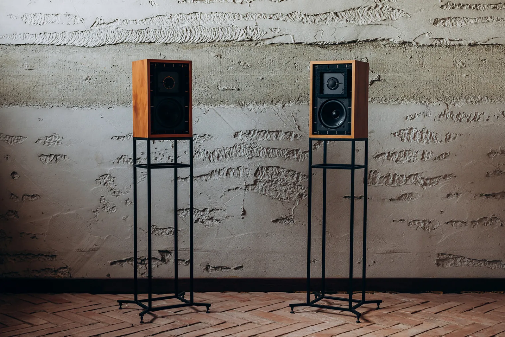

# The BBC LS3/5A: a monitor made for outside-broadcast vans, and its 11-ohm Rogers version

The LS3/5A is a small loudspeaker the BBC designed for the cramped control rooms of its
television vans, then licensed to British makers from 1975. More than 60,000 pairs were made up
to 1988, 43,000 of them by Rogers. A revision in 1987 lowered its impedance from 15 to 11 ohms
without changing its name. Here is the speaker, what the 11-ohm version changed, and what a Rogers
pair of it asks of a Naim NAIT 2 and a streamer.

Checked on 2026-10-31 against the BBC's design report of October 1976, and John Atkinson's
reviews and measurements in Stereophile, from 1989 and 2007.

*A pair of Rogers LS3/5A on OUTAUDIO's Model 10 x 10 stands. Photo: Olga Krakowska, for
[OUTAUDIO](https://outaudio.eu/en/speaker-stands-model-10-x-10/).*

## A monitor for a van

The BBC needed to check the sound "where space is at a premium and where headphones are not
considered satisfactory": the production section of a television mobile control room, where the
producer listens at a lower level than the sound mixer. No commercial speaker would do, so its
Research Department designed one, from a small speaker it had built for acoustic scaling tests.
The first version, the LS3/5, served in the vans. When the maker of its drive units, KEF, changed
them, the design was revised with the BBC's Designs Department: that is the LS3/5A.

From the BBC's report:

| | LS3/5A, 1976 |
|---|---|
| Size, weight | 31 × 19 × 16 cm, about 5.3 kg |
| Impedance | 15 ohms nominal |
| Drive units | KEF B110 bass unit, KEF T27 20 mm dome; crossover at about 3 kHz |
| Cabinet | Closed, a little under 5 litres, 12 mm birch plywood with beech fillets |
| Power, level | Up to 50 W, for peaks of 98 dB at 1.5 m |

The BBC measured that level in a room with a reverberation time of 0.4 s.

The wood matters: harder fillets, Parana pine for one, let a resonance of the bass unit colour
the sound, and the BBC specified birch and beech. In 1976 the speaker was made by the BBC's own
Equipment Department and three commercial licensees. Rogers' version came first, in 1975, and
stayed in production until early 1993.

## The 11-ohm version

By 1987, KEF's bass units varied too much, and many were rejected. KEF ran a programme to make
the speaker more consistent, without changing its sound, and from then on supplied makers with
matched kits of drive units and crossovers. Atkinson reported the result in Stereophile in March
1989:

- **11 ohms.** More uniform tweeters let a simple resistive divider replace the transformer that
  matched the tweeter's level to the bass unit's. The impedance fell to 11 ohms, from the 16 ohms
  Stereophile gives the original (the BBC's report says 15); its lowest points are just below
  8 ohms.
- **A new surround.** The bass unit's neoprene surround became PVC, to tame a slight peak around
  1 kHz.
- **The sound.** Compared with his 1978 pair: less nasal, slightly warmer, slightly less
  compressed, a sweeter treble. A new speaker and an old one still made a good stereo pair, and
  his advice to owners of an old pair was not to bother changing.

The name stayed LS3/5A. Since Rogers stopped in early 1993, a Rogers 11-ohm pair dates from those
last five years or so.

## What it sounds like

Atkinson's measurements of a Rogers pair, an original one from 1978, describe a speaker of strong
character:

- **No low bass**: the closed box is tuned to a high 93 Hz, and the response is 6 dB down at
  68 Hz; a hump around 160 Hz, which he heard as a slightly congested upper bass, stands in for
  it. Close to the wall behind it, that hump turns thick and muddy.
- **A clean midrange and a stable image**: "one of the least colored midbands around", and a
  deep, wide, precisely drawn stereo stage.
- **Limits**: a treble that tilts up in its top two octaves, and a sound that hardens above
  90 dB. He recommended it with good valve amplifiers, for music with a limited dynamic range,
  chamber music for one.

## Driving it from a NAIT 2

The LS3/5A's paradox, in Atkinson's words: low-powered amplifiers "will not drive the speaker to
very high levels, yet the limited dynamic headroom means that high-powered amplifiers are to be
avoided". The NAIT 2 sits at the small end:

- **An easy load.** At 11 ohms, never much below 8, the speaker asks for little current. The
  NAIT 2's limit is its power, 13 W per channel into 8 ohms by Naim's figures, rather less into
  11.
- **A low sensitivity**, about 82 dB as Atkinson measured it on his 1978 pair. Roughly scaled
  from the BBC's own
  figure, a fifth to a quarter of its 50 W gives peaks 6 to 7 dB lower, about 91 to 92 dB at
  1.5 m: enough to reach the level where the speaker itself hardens, not much more.
- **The treble.** The NAIT 2's line inputs are nearly 2 dB down at 20 kHz, where the LS3/5A tilts
  up: on paper, one tempers the other.
- **Placement.** On stands, well away from the wall behind, as Atkinson used them.
- **Cable.** Naim's manual for the NAIT 2 asks for speaker cables at least 3.5 m long, and of
  equal length.

## And a streamer

With a streamer, the chain runs from a computer to a DAC, the Heed Abacus here, into the NAIT 2's
Aux input, then to the speakers. Three points along the way:

- **The DAC's USB volume** stays at 0 dB, or its DSD stops: see
  [The Heed Abacus](heed-abacus).
- **The cable into the NAIT 2** has RCA plugs at the DAC's end and a 5-pin DIN plug wired for a
  Naim input at the other, and the NAIT's knob does its work in the first part of its travel: the
  DAC's 2.1 V is far more than the 75 mV its line inputs expect. See
  [A streamer into an amplifier with DIN inputs](../guides/streamer-din-amplifier-inputs).
- **The streamer's volume** stays at 100 %, the level being set on the NAIT 2: the music then
  reaches the DAC as it is in the file.

The amplifier's story is in [The Naim NAIT 2](naim-audio-nait-2).

## Sources

- BBC Research Department, H.D. Harwood, M.E. Whatton and R.W. Mills, [*The design of the miniature monitoring loudspeaker type LS3/5A*](https://downloads.bbc.co.uk/rd/pubs/reports/1976-29.pdf), Report 1976/29, October 1976.
- Stereophile, John Atkinson: [February 1989](https://www.stereophile.com/content/bbc-ls35a-loudspeaker-1989-rogers-version) and its [part 2](https://www.stereophile.com/content/bbc-ls35a-loudspeaker-1989-rogers-version-part-2), [measurements](https://www.stereophile.com/content/bbc-ls35a-loudspeaker-1989-measurements) and [follow-up of March 1989](https://www.stereophile.com/content/bbc-ls35a-loudspeaker-1989-follow) on the 11-ohm version; [2007](https://www.stereophile.com/content/bbc-ls35a-loudspeaker-stirling-ls35a-v2-2007) for the licensees and the 60,000 pairs.
- The NAIT 2's power, its treble and Naim's cable advice: the sources of [The Naim NAIT 2](naim-audio-nait-2).
- The photograph: © 2023 Olga Krakowska, for OUTAUDIO, maker of the [Model 10 x 10 speaker stands](https://outaudio.eu/en/speaker-stands-model-10-x-10/).
