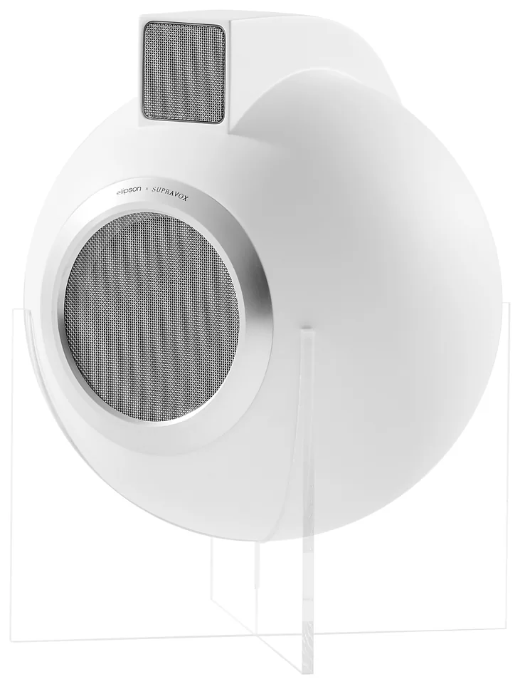
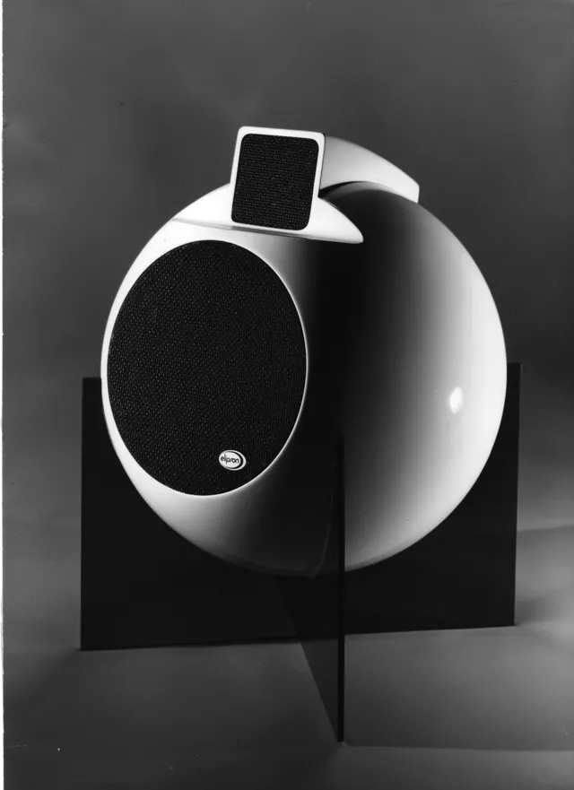
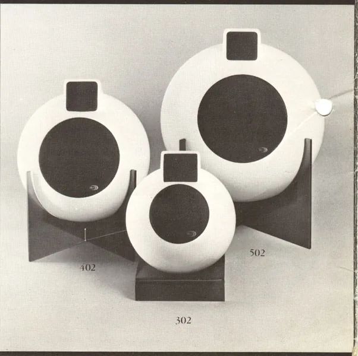

# The Elipson 402 Tribute: the French sphere of 1966, made again

In 1966 Elipson, a French firm that had been casting its loudspeakers in plaster since the early
1950s, launched the 402: a white sphere 40 cm across with two drive units, hence its name. It
became the brand's emblem, a design, ON-mag wrote in 2024, that "anyone with a slight interest in
sound has seen at least once in their life". In 2024 Elipson made it again, in France, with drive
units by Supravox, the French maker that had supplied the original: the 402 Tribute. The Ear called
it "a fitting homage to a great speaker" in 2025, and Elipson's page shows a Diapason d'or and Haute
Fidélité's *Meilleur achat* (best buy). Here is how it was heard, what to drive it with, how it is
built, and the story of the original.

Checked on 2026-11-27 against The Ear (2018, 2025), Son-Vidéo's test (2024), ON-mag (2024),
Elipson's data sheet, manual and history pages, and Joseph Léon's patent of 1962.

*A 402 Tribute on the low stand it comes with. Photo: Elipson.*

## How it sounds

Two reviews of the Tribute can be read online. Jason Kennedy reviewed a pair for The Ear, a British
online magazine, in June 2025. Valentin Lefort tested a pair in December 2024 for the blog of Son-Vidéo, a French
retailer that sells it, and whose founders, Philippe Carré and Éric James, are the two men who took
Elipson over in 2008, by both firms' own histories. Diapason's and Haute Fidélité's reviews are in
print, and not quoted here. (Lefort writes in French; translations mine.)

- **Space.** Kennedy heard "a spacious soundstage populated by instruments with body and substance
  and a musical flow that felt effortless"; Bill Frisell's *Shenandoah* "does escape the boxes well".
  For Lefort the stage is "remarkably broad, with a real sense of depth", the music unfolding
  "holographically"; on Queen's *Bohemian Rhapsody* the choirs "seem to spread well beyond the
  speakers".
- **Dynamics.** Kennedy noted "the impressive dynamic capabilities of this speaker, a result no doubt
  of their high sensitivity which is apparently a Supravox signature", and found that turning it up
  "only makes the sound better, there is no sense of compression". Lefort heard "very great dynamics"
  on the same Queen.
- **Bass.** Patti Smith's *About a Boy* had "decent bass girth" for Kennedy, and came "in powerful
  style". For Lefort the bass is "firm, punchy and impactful", "without trying to be bottomless", and
  never spills into the other registers.
- **Tone and treble.** Kennedy found "plenty of shine" when the music asks for it, the bells and
  percussion of Bugge Wesseltoft's *Render* "open and realistic in tone", and the fiddles of Erland
  Apneseth rendered "with an even handedness that encouraged more tweaking of the volume control".
  He credits the ease at high level partly to "the absence of any upper midrange peakiness". Lefort
  sums up "a rich and opulent midrange" and "treble of crystalline clarity", but the keyboards' bright
  treble on a pop track can "sometimes flirt with a slight brightness in some very busy passages", and his
  one reservation on the sound is "a slightly incisive treble with some bright-leaning electronics".
- **It shows its amplifier.** "Revealing yet relaxed", Kennedy writes, typical of the bigger Elipsons
  he has heard: they "tell you what is on the recording rather than giving a more sparkly rendition of
  it". Of two live albums he played, they made plain that the older one was "not as transparent
  sounding" and "clearly compressed". The mellow sound he first heard, he found, "was as much to do
  with the amplifiers as the speakers". Lefort calls it a speaker "of great transparency", which
  reflects "the full sound of the amplifier it is used with".

Both heard a large, open, dynamic sound from a speaker that says a lot about what drives it, and both
steer it towards a warm amplifier. Kennedy had expected little: "I initially thought that the
Elipson 402 Tribute was a cool marketing ploy, the resurrection of a classic model from the archives
that would garner some publicity but not come to much by the standards of modern loudspeakers." His
verdict: "this is a speaker that has both style and substance, if you like the looks there isn't much
real competition at the price."

How the original 402 sounded is told today by Elipson alone: "remarkable neutrality" and "exceptional
spatial distribution", a speaker "praised by the professionals of the time for its acoustic
qualities". I found no review from its day to read.

## What to drive it with

- **Almost any amplifier.** It is rated at 90 dB and 8 ohms, "a generous 90dB at 8 Ohms load that
  almost any amplifier will drive", Kennedy writes; Lefort pairs it with amplifiers "even of modest
  power". It takes up to 60 W, by Elipson's data sheet.
- **A warm one, rather than a bright one.** Kennedy began with a Townshend Allegri Reference
  pre-amplifier and a Moor Amps Angel 6 power amplifier, then tried a Soulnote A1 integrated, "a
  bright and fast sounding amp with a useful 80 watts on tap". It brought out the speakers' speed and
  "a more upbeat, pacy delivery", and he turned them out a little, "so that the drivers weren't
  directly facing the listening seat". He preferred "the warmer sound of the (notably more pricey)
  pre/power amps", with which he could "play all manner of music without any sense of forwardness in
  the sound".
- **Valves or transistors.** Lefort used Cayin's Soul 170i and CS-805A valve amplifiers "for a warm,
  rich listen", and Naim's SuperNait 3 and Hegel's H190v "for more dynamics and impact"; with a warm
  amplifier such as the Soul 170i or the SuperNait, the listening stays "always smooth and creamy".
  His source was an Eversolo DMP-A8 network player, streaming Qobuz in high resolution and playing DSD
  files from the local network.

## Setting them up

- **The stands.** Each sphere sits in an acrylic cradle. The low one, supplied, is 28 cm high and
  lifts the sphere 8 cm, to 54 cm in all; the high one, sold separately, is 88 cm high and lifts it
  72 cm (data sheet). On the low stand, on the floor, Elipson's manual tilts the sphere up towards the
  listener, the more so the closer the seat: a little beyond 5 m, steeply at 2 m. On the high stand,
  for a seat more than 2 m away, it stays level. Kennedy turned each sphere so that its drive unit
  "sits at the midpoint between two of the stand's arms", and levelled it with a round spirit level on
  top. Lefort found the high stand graceful, though "slightly reinforced stability could further
  improve mechanical damping".
- **In the room**, by Elipson's manual: the two speakers and the seat in an equilateral triangle, both
  speakers at the same distance from the wall behind them and from the walls beside them, and never in a corner,
  where the bass rises artificially, "masking the speed and melodic tracking (articulation) of this
  register". Then the spacing: further apart for a wide stage, closer for voices that stay sharply
  placed. Then the distance from the wall behind, in steps of 10 cm, between depth of image (far) and
  the deepest bass (near). Then the toe-in, a little at a time: left parallel, they may have to come
  closer together; turned in by more than 30°, they can go further apart.
- **Running in.** Several weeks, says the manual, or 150 to 200 hours in a row at moderate level,
  with Elipson's running-in CD or a radio station.

## How it is built

- **The sphere**, 40 cm across, is moulded in one piece from resin loaded with silica, Lefort writes,
  without a trace of assembly. It is "heavy and inert", Kennedy found, and spherical inside as well,
  "which means that there are no parallel sides for sound to bounce across". It weighs 15 kg, and
  comes in satin white only (The Ear).
- **Why a sphere.** Joseph Léon, who ran Elipson, found the sphere "the most accomplished solution for
  perfect sound propagation, as it is free of any harmful diffraction", by Elipson's page on the 402.
  Sharp edges diffract the sound, Kennedy explains, "which can undermine imaging"; curved cabinets
  have long been popular in the high end, "but the 402 could well have been the first example". He
  sees in its separate tweeter housing a model for the tweeter pod of Bowers & Wilkins's 802.
- **The drive units**, both by Supravox, which, Kennedy writes, "has been building field coil drivers
  for longer than most". The mid/bass unit is 165 mm across, with a cellulose-pulp cone of exponential
  curve; the ring around it bears both names. The tweeter, a 29 mm ring-type dome with a damped
  chamber behind it, sits in a crest on top of the sphere, under a square grille: "a style choice",
  Kennedy found, not the sign of a planar driver. Lefort traces the crest to Elipson's Legacy 3230,
  and wrote in May 2024 that the tweeter is "entirely decoupled from the cabinet". A
  port opens at the back, by the single pair of terminals. Elipson does not give the crossover
  frequency (The Ear).
- **The tweeter, set back.** Elipson aligns the two drive units in time, so that their sound reaches
  the ear together. By its own measurements, with the tweeter's face flush with the plane of the
  mid/bass unit, their two impulses are 0.082 ms apart, 28 mm of travel; with the tweeter set back by
  28 mm, 38 mm in all counting the mid/bass unit's frame, they coincide. For the principle Elipson
  cites its patent no. 1 339 664, a "sound reproducer" that Joseph Léon filed on 31 August 1962. The
  original 402's tweeter was already set off the baffle and offset "for time-phase alignment".
- **The crossover** is wired point to point, with components by the Danish firm Jantzen Audio and
  Axon internal wiring (data sheet), and built at Elipson's factory in Saint-Fargeau, in the Yonne
  (manual). Lefort writes that it is "assembled entirely by hand".

## The original 402

Elipson began as Multimoteur, a small maker of electric motors for toys founded in 1938. Joseph Léon,
an engineer trained at the Arts et Métiers, joined it in 1946 and ran it from 1948; its sound
research turned to reflectors and resonators, and in 1951 the firm took the name Elipson, from
*ellipse* and *son*, sound. Its famous BS50, a ball with an elliptical reflector, was made for the
first son et lumière show, at the Château de Chambord, and the French broadcaster, the ORTF, equipped
itself with Elipson's AS268 monitors. (Elipson's history.)

A tribute to Joseph Léon by Édouard Pastor, which Elipson quotes, describes the workshop at Vitry in
the 1950s and 1960s:

> A visitor who had not been warned might have thought he was in the studio of a modern sculptor. In
> white dust, under the glass roofs of a classic artist's studio, skilled moulders worked under the
> direction of M. Nicolas, who had come from Tuscany for the purpose. A mould gave only 150 pieces,
> and only some fifty speakers left the workshop each day. (…) I remember noticing a mould four
> metres long that had been used only once! At the back of the workshop, a mountain of abandoned
> prototypes, shaped like antique amphorae, rabbits' ears, eggs and spheres, objects all meant to
> carry sound, lay there, beautiful, useless, poetically white.

The 402 came in 1966, in a family of spheres: the 302, drawn from the compact 1302, the 402, and the
502, larger, with better bass (Elipson). Its shell was cast in staff, a plaster: "concrete and
plaster", Son-Vidéo writes, gypsum for The Ear. Supravox made drive units for it, by Elipson and The
Ear, though not for every one (see *Buying one*). It was the 402, Elipson
writes, that took the brand into homes, bringing music lovers a quality "described as
'professional'". Its catalogue of 1977 said of all its shapes: "Elipson's forms were imposed by
technique. They serve the perfect reproduction of sound, high fidelity. Simply."

*An original 402. Photo: Elipson archives.*

<ol class="man-timeline" aria-label="The Elipson 402 and its remake, by year">
<li><time datetime="1938">1938</time>

<strong>Multimoteur</strong> — electric motors for toys

</li>
<li><time datetime="1951">1951</time>

<strong>Elipson</strong> — Multimoteur takes the name

</li>
<li><time datetime="1962">1962</time>

<strong>Patent no. 1 339 664</strong> — filed by Joseph Léon, cited by Elipson for the time alignment

</li>
<li class="is-subject"><time datetime="1966">1966</time>

<strong>402</strong>, with the 302 and the 502 — a shell cast in staff

</li>
<li><time datetime="1968">1968</time>

<strong>4050</strong> — the sound system of the Grenoble Olympics, by Elipson; “a forerunner to the Bowers &amp; Wilkins 800 series designs of the nineties”, The Ear wrote

</li>
<li><time datetime="2008">2008</time>

<strong>Philippe Carré and Éric James</strong> — take Elipson over; the sphere lives on in the Planet L and Planet M

</li>
<li class="is-subject"><time datetime="2023">2023</time>

<strong>402 Tribute</strong> — first shown at the Paris Audio Video Show

</li>
<li class="is-subject"><time datetime="2024">2024</time>

<strong>402 Tribute</strong> — shown at High End in Munich, on sale from 10 September

</li>
</ol>

The Tribute is not Elipson's first remake: the BS50 came back before it, as the BS50 Tribute. Elipson
now belongs to AV Industry (manual); in 2018 The Ear called Son-Vidéo "this wing of AV Industry", and
Elipson "their first acquisition".

*The 402, 502 and 302 on a printed page. Image: Elipson archives.*

## Buying one

- **New.** €4,449 a pair in France, with the low stands, and €999 a pair for the high stands, on
  Elipson's shop on 2026-11-27; £3,999 in the UK in 2025 (The Ear). ON-mag gave €4,450 at launch.
- **Second-hand.** Elipson's two-year warranty runs from the purchase from an approved dealer and
  covers the first owner only: it "is not transferable" (manual).
- **An original 402.** Two need not be alike inside. "The problem with these Elipsons is that there
  are as many versions of the crossover as there are different drive units", a collector wrote on the
  French forum Audiovintage in 2010: Supravox 215 with an Audax TW8B tweeter, Siare 21CPG3 with a
  Siare TWM, all Audax, all SEAS, Goodmans; and the openings cut in the sphere differ with the drive
  unit. The plaster of Elipson's early spheres is "somewhat fragile", Jörg Dames wrote for fairaudio
  in 2011.

## The facts

From Elipson's data sheet of 2024-02-19, unless another source is named:

| | 402 Tribute |
|---|---|
| Type | Two-way, bass reflex, port at the back |
| Mid/bass | Supravox, 165 mm, cellulose-pulp cone |
| Tweeter | 29 mm ring-type dome, damped rear chamber |
| Crossover | Wired point to point; Jantzen Audio components, Axon wiring |
| Sensitivity | 90 dB, 1 W, 1 m; "90dB @ 2.83v/1m" by The Ear |
| Impedance | 8 ohms |
| Power | 60 W RMS |
| Response | 45 Hz to 25 kHz, ±3 dB |
| Cabinet | A sphere 40 cm across, resin loaded with silica |
| Size, weight | 46 cm high, 40 cm across; 54 × 43 cm on the low stand; 15 kg without stand |
| Stands | Low, supplied: 28 cm high, lifts it 8 cm. High, optional: 88 cm high, lifts it 72 cm. Both acrylic |
| Finish | Satin white (The Ear) |
| Made | Designed, developed and made in France (manual) |
| Price | €4,449 a pair (Elipson, 2026); £3,999 (The Ear, 2025) |

## Sources

- The Ear: Jason Kennedy, ["Elipson 402 Tribute, a fitting homage to a great speaker"](https://the-ear.net/review-hardware/elipson-402-tribute-a-fitting-homage),
  2025-06-26; ["AV Industry and Elipson: a French affair"](https://the-ear.net/features/av-industry-and-elipson-french-affair/),
  2018-07-20.
- Son-Vidéo's blog: Valentin Lefort, ["Test Elipson 402 Tribute : le retour d'une légende"](https://blog.son-video.com/2024/12/test-elipson-402-tribute-le-retour-dune-legende/),
  2024-12-12, updated 2024-12-17, and ["Elipson 402 Tribute : le renouveau d'une enceinte mythique !"](https://blog.son-video.com/2024/05/elipson-402-tribute-le-renouveau-dune-enceinte-mythique/),
  2024-05-27, in French. Son-Vidéo's [history](https://www.son-video.com/a-propos/historique) names
  its founders.
- ON-mag, ["Elipson 402 Tribute : une version remise au goût du jour de la célèbre enceinte boule des années 60"](https://on-mag.fr/index.php/topaudio/actualites-news/26396-elipson-402-tribute-une-version-remise-au-gout-du-jour-de-la-celebre-enceinte-boule-des-annees-60),
  2024-08-16, in French.
- Elipson: the [402 Tribute](https://www.elipson.com/enceintes/edition/402-tribute) page, with its
  prices and the press awards it shows; its [data sheet](https://51c4aa34-b543-40ba-89c6-e1c5473be0f3.usrfiles.com/ugd/51c4aa_dc370fc05edd4f51a62b23f58d89e118.pdf),
  updated 2024-02-19, and [manual](https://51c4aa34-b543-40ba-89c6-e1c5473be0f3.usrfiles.com/ugd/51c4aa_a5a43dd669834454afd0b8e1e48f31cb.pdf)
  of 2024, with the time-alignment measurements, the set-up advice and the warranty; its pages on
  [its history](https://www.elipson.com/la-marque/notre-histoire), with Édouard Pastor's tribute, and
  on [the 402](https://www.elipson.com/elipson-402), with the 1977 catalogue. All read on 2026-11-27,
  in French; the manual also in English.
- Joseph Henri Léon, French patent [FR 1 339 664](https://patents.google.com/patent/FR1339664A/fr),
  "Reproducteur de son", filed on 1962-08-31, published on 1963-10-11.
- Jörg Dames, ["Elipson Planet L"](https://6moons.com/audioreviews/elipson/1.html), fairaudio,
  November 2011, in 6moons's English translation.
- Audiovintage, ["Boules Elipson BS402 - Supravox 215 RTF 64 Alnico / TW8B"](https://www.audiovintage.fr/leforum/viewtopic.php?t=8649),
  the message of 2010-11-15 on the versions of the original, in French.
- The photographs: Elipson, from the press kit of the 402 Tribute on its
  [press page](https://www.elipson.com/presse).
