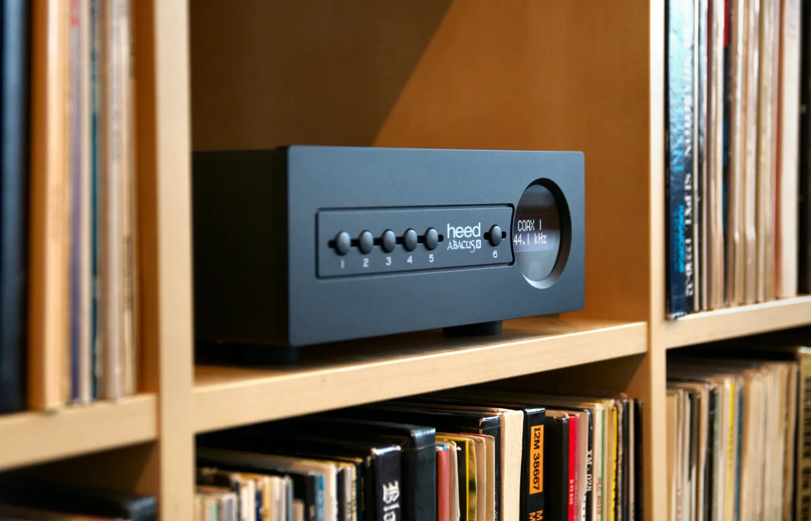
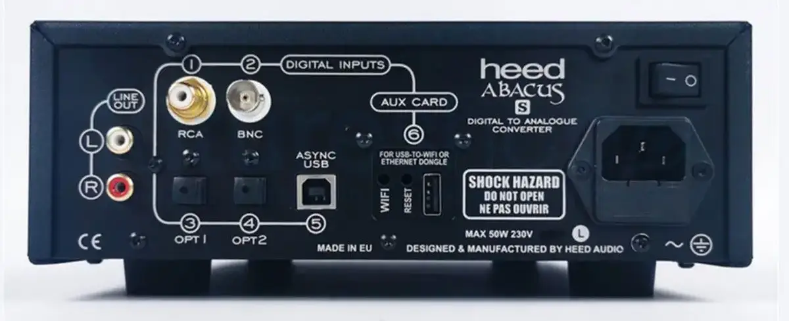
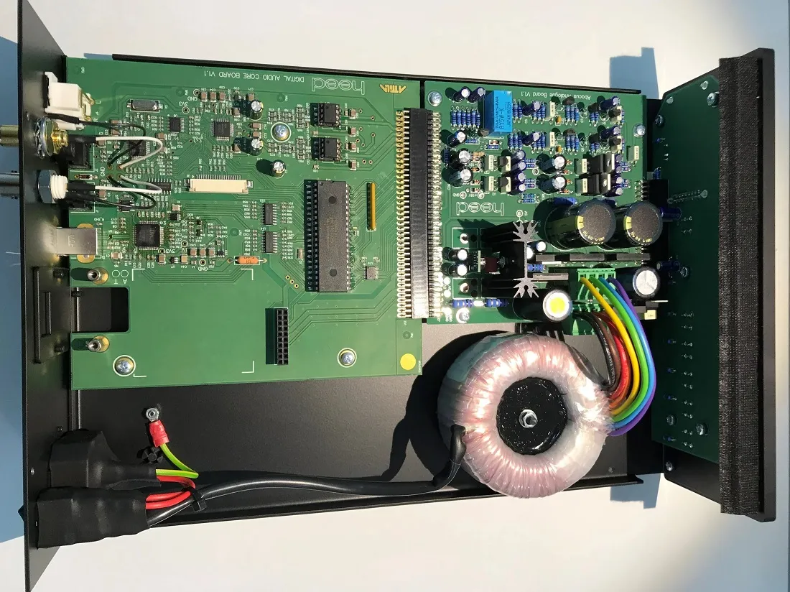

# The Heed Abacus: a Hungarian DAC, and the DSD it plays only at full volume

The Abacus is a DAC by Heed Audio of Budapest, whose manual is dated May 2017: five digital inputs
and a slot for a card, PCM up to 384 kHz and DSD128 over USB, a fixed output of 2.1 V. On a Linux
streamer it is a
USB DAC like any other, with one trap: its USB volume. Lowered below 0 dB, it stops DSD, whether
sent as DoP or native. Here is what it is, what Linux sees of it, and how to keep its DSD playing.

Checked on 2026-10-31 against Heed's owner's manual (version 1.0, May 2017), and on the unit
connected to my test box, an x86 PC under Debian 13 (Linux 6.12, alsa-utils 1.2.14, MPD 0.24.5).
The DSD trials date from 2026-10-18.

## Heed, and the Abacus

Heed Audio was born in Hungary in the early 1990s, with the first amplifier of its own design, the
Obelisk One; it celebrated its thirtieth anniversary in 2022. The Abacus came after the Thesis
range, with the Elixir integrated amplifier, and opened what Heed calls a new era for it.

From Heed's manual:

| | Heed Abacus |
|---|---|
| Inputs | Coaxial on RCA and BNC, two optical, USB, a card slot |
| Over S/PDIF | PCM from 32 to 192 kHz, 24 bits |
| Over USB | PCM up to 384 kHz, 32 bits; DSD64 and DSD128, native |
| Output | RCA, 2.1 V, no volume control |
| Settings | Four PCM filters; DSD direct, or through the converter |
| Size, weight | 22 × 8.7 × 32.5 cm, 4.5 kg, 50 VA at most |

With no volume control, its output goes to a pre-amplifier or an integrated amplifier, never
straight to a power amplifier. Its four filters are linear or minimum phase, with a fast or a slow
roll-off; DSD can go through the converter, or straight to its DAC stages.

## The streamer card, and the Abacus S



*An Abacus S among records. Photo: as published by
[Audio Connection](https://www.audioconnect.com/products/heed-abacus).*

The sixth input is a slot for an expansion card, fitted by a Heed dealer only. In 2019, Heed told
a reviewer that no card existed yet, but that it was working on a plug-in streamer that would make
the Abacus a streamer and DAC in one. That card is the **STR**: a network card, with an Ethernet
adaptor in the box and a Wi-Fi one as an option, both plugged into a USB socket on the card's
input. Heed sells the Abacus with that card as the **Abacus S**: Qobuz, Tidal Connect and Spotify
Connect, a UPnP renderer, and Roon Ready. In The Ear's review of 2025, the Abacus S cost £2,100,
and the Abacus without the card £1,650.



*The back of an Abacus S. Photo: as published by
[Future Shop](https://www.futureshop.co.uk/heed-audio-abacus-s-dac).*

On its back, the card's input is number 6, *AUX CARD*, marked "for USB-to-WiFi or Ethernet
dongle", with a *WIFI* and a *RESET* button beside the USB socket. The Abacus S's manual adds two
things worth knowing:

- **Formats.** Through the card, PCM up to 384 kHz in 32 bits, and DSD up to DSD256, native.
  Through the S's own USB input, PCM up to 384 kHz and DSD64 and DSD128 as DoP, where the original
  Abacus took them native.
- **A volume.** With the card, a player app can set a volume for the whole DAC: it is kept, and
  applies to every input. Without the network, the menu's *VOLUME*, *to max*, gives back the full
  level. Whether it stops DSD from the USB input, as the USB volume does below, was not tried.

Whether a first Abacus, such as the one here, takes the STR card is not said in what I found: a
Heed dealer, who fits it anyway, can tell.



*Inside an Abacus S. Photo: [hxosplus](https://hxosplus.gr/reviews/digital/heed-audio-abacus-s-review-test/),
from its review of October 2023.*

Inside, the digital board, marked *Digital Audio Core Board*, and the analogue board sit side by
side, with a toroidal transformer for the power supply.

## What Linux sees

The Abacus needs no driver on Linux: its USB receiver, an XMOS chip, presents itself as
`20b1:30ab XMOS Ltd Heed Abacus` and Linux's standard USB audio driver takes it. What it accepts,
with the Abacus's card number from `cat /proc/asound/cards` in place of `0`:

```bash
cat /proc/asound/card0/stream0
```

Among the lines it prints:

```text nocopy
  Interface 1
    Altset 1
    Format: S32_LE
    Rates: 44100, 48000, 88200, 96000, 176400, 192000, 352800, 384000
  Interface 1
    Altset 2
    Format: SPECIAL DSD_U32_BE
    Rates: 44100, 48000, 88200, 96000, 176400, 192000, 352800, 384000
```

The first is PCM in 32-bit words up to 384 kHz, as the manual says. The second is native DSD, 32
bits at a time: at 352,800 frames a second, that is DSD256. Linux reads more here than Heed
promises, DSD64 and DSD128; DSD256 was not tried. How to read such a list:
[What your USB DAC accepts on Linux](../guides/usb-dac-formats-linux).

## Its USB volume

The manual says the Abacus's output has no volume control, and its front panel has no knob. Its
USB receiver offers the computer one all the same: two controls named `Heed Abacus `, one for the
left and right channels and one more marked *Mono*, each from −127 to 0 dB in steps of 1 dB. The
name ends with a space, which must be typed between the quotes:

```bash
amixer -c 0 sget 'Heed Abacus ',0
```

```text nocopy
  Limits: Playback 0 - 127
  Front Left: Playback 127 [100%] [0.00dB] [on]
  Front Right: Playback 127 [100%] [0.00dB] [on]
```

Reading or setting it takes a member of the `audio` group, or `sudo`; otherwise `amixer` answers
`Invalid card number '0'.` Without the final space, it answers
`amixer: Unable to find simple control 'Heed Abacus',0`.

## Below 0 dB, DSD stops

On 2026-10-18, I lowered that volume to −10 dB and listened, through MPD 0.24.5, to a DSD128
album:

- **PCM** played quieter, and clean: the control works.
- **DSD as DoP** played nothing, and the Abacus's display read 352.8 kHz, the rate of the PCM that
  carries DoP: it no longer saw DSD in it.
- **Native DSD** showed DSD128 on the display, and played with noise.

At 0 dB, both play normally. One of Roon's founders explained the likely cause in 2015, about USB
DACs in general: "Some devices implement volume controls in a suboptimal way–often as a digital
volume stage prior to the DAC." Such a stage recalculates every sample. PCM survives that, only no
longer bit-perfect; DSD does not. DoP loses the markers that tell the DAC it is DSD, and native DSD
turns to noise.

MPD's own volume does not do this: set to 30, then 5, during a DoP track with the Abacus at 0 dB,
it changed neither the level nor the sound. MPD's software volume leaves DSD alone (see
[DSD on a Linux streamer](../guides/dsd-native-dop-linux)).

## Keeping its DSD playing

- **Leave the USB volume at 0 dB**, and set the level on the amplifier. With PCM, below 0 dB, it
  plays, but no longer as the file is.
- **Check it before a DSD track** with the `sget` above: `[100%] [0.00dB]` on both channels.
- **Put it back** if something lowered it, a desktop's sound settings or a player that took the
  control as its volume:

```bash
amixer -c 0 sset 'Heed Abacus ',0 100%
amixer -c 0 sset 'Heed Abacus ',1 100%
```

- **In MPD**, do not make that control its volume: no `mixer_control "Heed Abacus "` in an output
  with `mixer_type "hardware"`. A software volume, or none, leaves the Abacus at 0 dB (see
  [Software or hardware volume on a Linux streamer](../guides/software-hardware-volume-linux)).

## With Audiogravi<sup>ty</sup>

While a DSD track plays, Audiogravi<sup>ty</sup> brings the DAC's own volume to its maximum, and
puts it back when the DSD ends; the player's volume shows a padlock meanwhile. **Full DAC volume
during DSD**, in MPD's **Guided** view, turns that off, for a DAC that lowers DSD properly: not for
the Abacus. The details are in the manual:
[Outputs & engines → DSD](../manual/06-outputs-engines#dsd-as-dsd-as-dop-or-converted-to-pcm).

## Sources

- Heed Audio, *Abacus owner's manual*, version 1.0, May 2017: [Internet Archive copy of 2019-09-14](https://web.archive.org/web/20190914071602/http://heedaudio.com/downloads/Heed_Abacus_manual_1.0_EN.pdf). Heed's history: [About](https://heedaudio.com/about/), read on 2026-10-31.
- Heed Audio, *Abacus S owner's manual*: [Internet Archive copy of 2025-05-04](https://web.archive.org/web/20250504031552/https://heedaudio.com/downloads/Heed_Abacus_S_manual_EN.pdf), for the STR card, its formats and its volume.
- The photographs of the Abacus S: the front as published by [Audio Connection](https://www.audioconnect.com/products/heed-abacus) and the back by [Future Shop](https://www.futureshop.co.uk/heed-audio-abacus-s-dac), both read on 2026-10-31; the inside from hxosplus, ["Heed Audio Abacus S Review"](https://hxosplus.gr/reviews/digital/heed-audio-abacus-s-review-test/), 2023-10-05.
- The streamer card in the works: The Audiophile Man, ["Abacus DAC From Heed: The Digital Gentleman"](https://theaudiophileman.com/abacus-dac-review-heed/), 2019-03-21. The Abacus S, its services and its prices: The Ear, ["Heed Abacus S Takes Its Own Route To The Musical Parts That Matter"](https://the-ear.net/review-hardware/heed-abacus-s-the-parts-that-matter/), 2025-09-22.
- The unit on my test box, read on 2026-10-31: `/proc/asound/card0/stream0`, `lsusb`, and `amixer` from alsa-utils 1.2.14, under Linux 6.12.
- The DSD trials: listened to on 2026-10-18 on the same box, MPD 0.24.5 playing to the Abacus directly (`hw:0,0`).
- Roon on USB volume: [Force Max Volume / Disable Volume Control](https://community.roonlabs.com/t/force-max-volume-disable-volume-control/3489), Roon's forum, 2015-09-08, the answer of a founder of Roon Labs.
