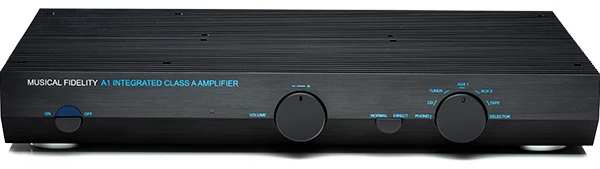
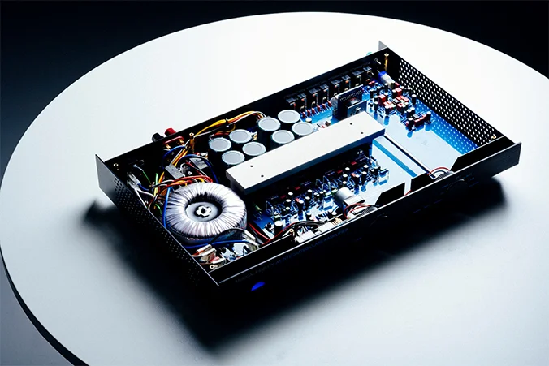
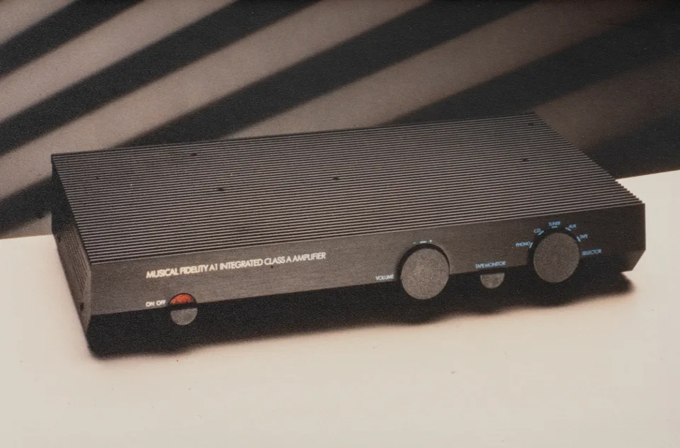

# The Musical Fidelity A1: the class A integrated of 1985, made again

In 1985 Musical Fidelity, a British firm three years old, launched the A1: a slim integrated
amplifier of about 20 watts a channel, designed by Tim de Paravicini, biased into class A, and topped
by one long ribbed heatsink. At £189 its rivals were the Cyrus Two and Naim's first NAIT, What Hi-Fi?
recalls. It ran so hot that it made the headlines of the Daily Mirror, and early ones failed; but for
Herb Reichert, in Stereophile, "it was the A1's all-natural sonics—not its top-plate
temperature—that made it an instant classic". David Price, who has owned one for decades, calls it
"about the nearest that most contemporary hi-fi buyers could get to a good valve amplifier". In 2023
Musical Fidelity, by then in Austrian hands, made it again on the original circuit, and Reichert's
verdict was "a timeless classic, as good as it was, but better". Here is how the new one was heard,
next to an original when the reviewer had one, what the measurements show, what to drive with it,
how it is built, and the story of the first.

Checked on 2026-11-27 against the reviews of Stereophile, Hi-Fi News, StereoNET, What Hi-Fi?, The
Ear and hi-fi+ (2023–2024), with Stereophile's and Hi-Fi News's measurements, Musical Fidelity's
product page, information sheet and manual (2023), and Mark Hennessy's pages on the original.

*The A1 of 2023. Photo: Musical Fidelity.*

## How it sounds

I read six reviews of the new A1, all in English: Herb Reichert's in Stereophile
(September 2024), with John Atkinson's measurements; Jamie Biesemans's in Hi-Fi News (February 2024),
with Paul Miller's; David Price's for StereoNET (September 2023); What Hi-Fi?'s (August 2023), whose
reviewers had a serviced A1 of 1985 on hand; Phil Wright's for The Ear (July 2024); and Ed Selley's
for hi-fi+ (October 2024). Price owns an original, and What Hi-Fi? listened to both side by side.
What Hi-Fi? gave it four stars, StereoNET its Applause award, and EISA named it its Enthusiasts
Amplifier for 2024–2025. The six agree more than they differ.

- **Warm, and close to valves.** "Although calling the sound offered by the A1 'warm' might come over
  as lazy journalism, this reissued amplifier does deliver your music with a nearly tube-like,
  organic presentation," Biesemans writes. For Price it is "warm-sounding in tonal terms, to put it
  mildly", "a character amplifier", "one that is bought for its specially authored view of the
  recording", and not a class A in the manner of Sugden, "where the music is clinically precise and
  tonally neutral to a fault". What Hi-Fi? heard "more smoothness, warmth and physicality to the sound
  than is typically the fashion these days": "It could hardly be described as neutral but we like it
  anyway."
- **The midrange.** Against Pass Labs' INT-25, at $8,100, Reichert found the A1 less clean and less
  detailed, "but oh my, save me from the Devil, the A1 has that supersaturated toaster-glowing
  'electrostatic midrange'". For Wright, "the midrange was just gorgeous".
- **Treble.** Wright found it "typically Class A, silky but not overly smooth. Like adding a knob of
  butter to a sauce"; it tamed the coarse edges of bright recordings, and "if you like your meat raw
  that may not be a good thing". Price played Supertramp's *Oh Darling*, mastered "sharp enough
  to blow your wig off via most amplifiers": Simaudio's MOON 250i and Naim's NAIT XS3 and NAIT 50 make
  it sound fierce, "and are right to do so"; the A1 renders it "in an exquisitely luxurious and silky
  way". Biesemans heard "some softness to the top-end, depending on the loudspeakers with which it's
  used", Selley "slightly rolled-off frequency extremes".
- **Flow.** Price: "a great sense of timing. Music just seems to flow along, demanding very little
  from the listener." Selley: "the key to what made the Musical Fidelity A1 such a favourite was its
  exceptionally unmechanical sense of power delivery, which is replicated perfectly in the new
  version". Even fed by a $250 Onkyo CD player, it played Monk "in an exceedingly natural, undigital,
  unmechanical, nontransistory way" for Reichert.
- **Space.** Reichert: "recordings presented like View-Master slides, with deep, conspicuously
  dimensional space and supersaturated color"; the Pass placed sounds more precisely, "but color was
  less saturated". What Hi-Fi? found "an expansive and nicely layered soundstage that stretches beyond
  our speakers", and Biesemans "huge width and depth". "Coloured and not entirely accurate the A1's
  presentation might be, but all is forgiven when it makes music so expansive and expressive," he
  concludes.
- **Detail is not its strength.** What Hi-Fi?: "newer rivals, even something much cheaper like
  Cambridge Audio's CXA81, manage to tell us more about the recording". Reichert found the Pass clearer
  "in the top two octaves" and more controlled "in the bottom three octaves". Wright's PrimaLuna EVO
  300H, a £6,500 hybrid, "sounded better" across the board; but the A1 beat Musical Fidelity's own
  M2si, at £699, on detail and on the soundstage.
- **Power is its limit.** Price's torture track, Simple Minds' *New Gold Dream*, "has a super-strong
  bass guitar line that's hell for any amplifier under about 50W per channel", and the A1 struggled
  with it much as the NAIT 50 had. His advice: "unless you're running speakers in the 95dB and above
  sensitivity range – Klipschs, JBLs, etc. – then this amplifier really isn't gutsy enough for loud,
  dense rock music played at high volumes". What Hi-Fi? agrees that "more conventional rivals pull
  ahead when it comes to outright punch and attack", and Biesemans found the dynamics "a bit
  suppressed" when Sons of Kemet gave it their all. Not everyone reached the limit: The Cult's *Big
  Neon Glitter* "pounds along with a level of bite and attack" for Selley, and Reichert heard "an equal
  sense of limitless, strain-free headroom" from speakers of 83 dB and of 93 dB.
- **The new against the old.** Price: the 2023 A1 "retains the former's sugary-sweet tonality and
  lovely sense of timing", with bass "fractionally tighter" and a better-defined soundstage; "the
  downside is that the new A1 lacks a smidgeon of the original's euphony and charm, which is a polite
  way of saying that the 2023 amplifier is more neutral". His verdict: "better than the original in
  pretty much every respect". What Hi-Fi?, side by side: "considerably cleaner and clearer", the bass
  "tauter and more tuneful", and "all the original's charm remains undimmed".
- **The phono stage.** Among the integrated amplifiers Reichert has "owned, repaired, or reviewed",
  none had a moving-magnet stage that impressed him more. He sets it beside Rogue Audio's Sphinx V3 as
  "two of the most refined, rich, human-sounding phono stages ever included in a humbly priced
  integrated", the Sphinx being the more transparent; the moving-coil input suited a Hana Umami Blue
  (0.4 mV) better than a Denon DL-103. What Hi-Fi? found that it "isn't the most transparent we've heard
  but is pretty competitive for the money"; for Selley it is "realistically the best way to enjoy the
  performance".

## What the measurements show

Atkinson for Stereophile and Miller for Hi-Fi News both found more power than the 25 W rated, much
less into 4 ohms, and distortion that is mostly second harmonic.

- **Power.** At 1 % distortion, 30 W a channel into 8 ohms and 16 W into 4 ohms for Atkinson, 34 W and
  18 W for Miller, who reached 30 W into 4 ohms at 3 %. Musical Fidelity gives no figure for 4 ohms.
  Atkinson: "It will work best with loudspeakers whose impedance remains above 4 ohms".
- **How much of it is class A.** Musical Fidelity says "25W Pure Class A power". Miller works it out
  from the bias current, about 0.8 A, at "roughly 10W/8ohm per channel", beyond which the amplifier
  slides into class AB. He had found the same of the original when he tested it in 1987: "a true
  Class A rating closer to 10W than 20W/8ohm".
- **Distortion.** It rises with power, from 0.026 % at 1 W to 0.14 % at 10 W and 0.27 % at 25 W
  (Miller): "While this is 'high' for a typical transistor amp, the harmonics are simple second-order
  and – more important still – are very uniform with frequency." Atkinson calls the second harmonic
  "subjectively benign".
- **Output impedance.** The specified damping factor of 150 "suggests an output impedance of about
  0.05 ohms", Reichert notes. Miller measured 0.33 ohm and Atkinson 0.5 ohm, enough to tilt the
  response by ±0.4 dB with a load that behaves like a loudspeaker.
- **Noise.** Some hum from the power supply shows in both labs' results: "a hint of 'warming' hum
  punching through the A-weighting curve", Miller writes.
- **The phono stage.** Atkinson ends on "the excellent phono stage, which offers low noise and
  distortion and high overload margins in both MM and MC modes". His sample's MC input measured about 18 kΩ at 1 kHz, not the 1 kΩ
  specified, and its RIAA response rose by 2 dB at 10 Hz.
- **A faulty sample.** On Atkinson's A1 the left channel stayed silent when he switched from Direct
  to Normal, until he had pressed the button in and out several times, and the right channel
  distorted with the volume at maximum. He assumed this was "specific to the review sample". Miller reports nothing of the kind.

## What to drive with it

- **Speakers: easier than its watts suggest.** Musical Fidelity's information sheet aims it at "small
  to mid-sized rooms, carefully set up with a pair of great two-way speakers". Simon Quarry, the
  engineer who remade it, had thought it needed speakers of 89 dB or more. "But I was proven wrong."
  Musical Fidelity's own LS3/5A, at 82 dB, "partnered excellently", and the pair "filled the large and
  loud listening room at the Munich High End Show with no real problem". What Hi-Fi? tried the same
  speakers: "surprisingly well", the A1 staying "surprisingly listenable even as its dynamics compress".
  Reichert drove GoldenEar's BRX, a hard load by Stereophile's measurements, "loud (90dB average at
  2m), bell-clear, and liquid-smooth with no noticeable strain". For loud rock, Price's 95 dB stands.
- **Pairings the reviewers liked.** Klipsch's RP-600M II, at $499 a pair, "an instant smash hit" for
  Reichert; the Falcon LS3/5a and the DeVore Fidelity O/93, his own; MoFi's SourcePoint 8, "an ideal
  partner" for Wright, who had first heard the A1 driving Klipsch Cornwalls at the distributor's;
  Neat's Petite Classic, 87 dB and 6 ohms, "an unadulterated joy" for Selley, and DeVore's O/Baby;
  Monitor Audio's Platinum 100 3G and DALI's Rubicon 2 for Biesemans; Cambridge Audio's Aeromax 6, of
  90 dB, for Price.
- **Direct mode, with a modern source.** A DAC or a network player puts out 2 V or more, and the A1's
  gain was set in the 1980s. The Direct button bypasses the gain stage ahead of the volume control and
  lowers the gain by about 10 dB: 24.1 dB against 35.7 dB by Miller's measurement, still full power
  from 885 mV. The volume control then works over more of its travel. "Few brands take advantage of the
  high 2V+ output of modern line-level sources," Miller writes. Price ran a Chord Hugo TT2 into it in
  Direct, which "gave the best results"; for Reichert it sounded "more textural and tactile and
  possibly more transparent—but also less gain-fired bold", for What Hi-Fi? it brought "small benefits
  in overall transparency". With his Falcons it moved Reichert's listening level from 10 o'clock to
  between 11 and 1, "more ideal (for a log pot)".
- **Its pre-amplifier alone.** Through the Pre Out into a First Watt SIT-4 power amplifier, Reichert
  found the A1's pre-amplifier "at least 90% as transparent" as HoloAudio's Serene, his reference, and
  concluded that "the A1's signature boldness and tactility are spawned largely in the preamp
  section".
- **What it does not have.** No digital input, no Bluetooth, no balanced input, no headphone socket.
  The manual suggests a headphone amplifier on the fixed Tape Out; the Pre Out feeds a power amplifier
  or a subwoofer.

## Living with it

- **The heat.** "The whole top of the A1 is a heat sink," the manual warns: 55 to 65 °C in a room at
  20 °C, about the heat of "a 75 watt light bulb". The reviewers measured 59 °C after an hour
  (Atkinson), 60 °C (Reichert, Selley), 63 °C at idle (Miller), and "just short of 73°C" (Wright),
  "more than the 70°C needed to cook an egg properly". It cools as it plays: about 40 °C after half an
  hour at 10 W a channel, Miller found, the current going to the speakers instead of the heatsink.
- **Its place.** At least 50 mm clear behind and 250 mm above, and nothing on top, ever (manual).
  Selley set his Chord Qutest beside it, "rather than being gradually baked on the top".
- **What it draws.** 92 W at idle and 100 W at full output, Miller measured, 130 W at most by Musical
  Fidelity's figures: a class A amplifier draws the most when it plays nothing. Wright reckoned it
  cost him "3-4 pence per hour".
- **Switching on.** The speakers must be connected first, and the volume at zero (manual).
- **The phono input.** A push button at the back sets MM or MC: MC for cartridges from under 100 µV to
  about 800 µV, MM above that, and a high-output MC on whichever sounds better. Switch it only with the
  volume down or another input selected, as it sits "at the beginning of an amplification chain of more
  than 80dB". An external phono stage goes into a line input, never into Phono (manual).
- **The remote.** Volume and mute only, and mute only from the remote. It turns a motorised ALPS
  potentiometer that can be heard doing so: "a loudish motor" for Biesemans, "a graunching noise" for
  Wright, who soon "found myself missing the quirk with other amplifiers".

## How it is built

- **The circuit.** Discrete and symmetrical, "top-and-bottom" as Quarry puts it, with two output
  transistors a channel bolted to an alloy block under the top plate. It is biased into class A and,
  in Musical Fidelity's words, "slides (NOT switches)" into class B when the music asks for more
  current than the standing current, so that "speakers that dip in impedance are still allowed yet
  more output current if required" (Quarry).
- **What changed in 2023.** The brief, Quarry told What Hi-Fi?, "was to remake the original with as
  few changes as possible". The main capacitors are now rated for the heat, the output transistors are
  newer, the signal-path capacitors polypropylene and the resistors metal film; the transformer has a
  winding for each channel, and each channel twice the supply capacity. The case grew from 408 to
  440 mm wide (Mark Hennessy, Quarry), with vents in its sides, and the alloy block is now fixed to
  the chassis as well as bonded to the top plate: in the earliest A1s it was "simply held in place on
  the PCB by the transistors' legs", Miller writes. Quarry could bias it "a bit higher than some of
  the later originals". The tape monitor button became the Direct switch, and a motorised ALPS RK
  potentiometer made the remote possible.
- **Not quite the original pre-amplifier.** Musical Fidelity's page says the pre-amplifier "is the same
  as the original 1985 design". Not entirely, Quarry told What Hi-Fi?: the original's active volume
  control, which amplified the mismatch between the two tracks of its potentiometer, "was deemed
  problematic … so it was abandoned for conventional volume control". Hennessy, who has serviced and
  documented the original, had deduced as much from the new product page and manual.
- **The phono stage.** Its first stage works in current mode. For moving coil, Heinz Lichtenegger,
  Musical Fidelity's owner, explained to Reichert, "we switch the transistor's emitter resistor to a
  lower one", which raises the gain to 60 dB and lowers the input resistance to about 1 kΩ at once.
- **Made in Taiwan**, by Stereophile's specifications.
- **Is it really class A?** The argument is as old as the A1. Hennessy measured a standing current of
  700 mA on his A1 of 1990, which by the usual sums gives "almost exactly 8 watts of class A
  operation into 8Ω"; Dave Berriman found 0.71 A on a Mark 3 for Hi-Fi News in January 1994, "enough
  for up to about 8W of pure Class A". De Paravicini disagreed: "the two halves of the circuit are
  additive", he told Hennessy, and as proof the heatsink cooled by more than 10 degrees at full
  output. Musical Fidelity itself, Hennessy notes, always said "strongly biased into class A" —
  "apart from the lettering on the front panel (!)".

*An A1 of 2023 without its top plate, which is its heatsink: the transformer, the reservoir
capacitors, and across the middle the alloy block the output transistors are bolted to. Photo:
Musical Fidelity.*

## The original A1

Antony Michaelson, a clarinettist, founded Musical Fidelity in 1982 after leaving Michaelson &
Austin, which had sold Tim de Paravicini's EL34 valve amplifiers in the late 1970s. De Paravicini had
designed for Luxman in Japan from 1972, then founded EAR in England in 1977. The A1 was not Musical
Fidelity's first amplifier: a pre-amplifier, a power amplifier and a dearer integrated came before
it (What Hi-Fi?). De Paravicini "spent two years developing a prototype", he told Price, and
Michaelson had a British industrial design firm engineer it for production. It came out in 1985;
1984 by some accounts, Hennessy's and The Ear's among them.

Its rivals ran cooler: the Cyrus Two and the NAIT at its price (What Hi-Fi?), and for Reichert
"Audiolab's 8000A, Creek's 4040, A&R Cambridge's A60, and NAD's 3020". De Paravicini had designed it
to run at 65 °C on the heatsink, Price writes, "and it's true, the healthy ones do. It's just that
ageing components, dust and sub-optimal placement soon conspire to make mayhem." Its electrolytic
capacitors were rated for 85 °C rather than 105 °C (What Hi-Fi?, Hennessy), and on his own A1
Hennessy found the heatsink compound covering only 10 to 20 % of the joint between the transistors'
block and the top plate, a lack of quality control he believes "has been the cause of many premature
failures". In 1989 Reichert bought a pair of LS3/5As from a man who had driven them with an A1, and
who showed him his banana plugs, "partially melted from the A1's heat".

How it sounds today, by What Hi-Fi?, on a serviced sample of 1985: "a determinedly smooth,
full-bodied balance that is likeable but not particularly accurate", detail "broadly on a par with a
decent budget amplifier of today", bass "weighty" but "pretty soft and lacks grip"; and yet "a
physical presence that most amplifiers, be they budget or mid-priced, still lack today". "Some reviews
of the time suggested that it sounded a lot like a valve amplifier, and we can understand those
sentiments." I found no review from its day to read online.

*An original A1 in a Musical Fidelity press photograph of the 1980s. Photo: Musical Fidelity; the
print was photographed by What Hi-Fi?.*

It changed as it went, by Hennessy's account. The earliest have no vents in their sides and a top in
two parts; by 1990 the Mark II had a one-piece top, vented sides and radial reservoir capacitors; a
Mark 3 then rose to 25 W. In parts of Europe it was sold as the A1-X, and in Germany a tuned version as
the David. In 1991 came two limited editions with an external power supply: the Collectors Edition,
of which 24 are said to have been made, and the Final Edition, 200 of them, which is in fact a B200, a
different circuit with MOSFET outputs and 40 W. The A1 was made until the early 1990s; it listed at
£300 in the summer of 1991.

The A1 of 2008 shares only the name and the look: a different circuit, a USB DAC, an LCD display, a
moving-magnet input only. Miller measured "2x40W/8ohm and 2x65W/4ohm but not in Class A", and calls
it "an aberration"; for Price it was "short-lived" and "bore scant resemblance to the 1985 original".

Michaelson retired in 2018 and sold the brand to Heinz Lichtenegger's Audio Tuning, the Austrian
parent of Pro-Ject. The A1 had been "one of his first major successes as a budding distributor in
Austria", Quarry says, and bringing it back fulfilled "one of his hi-fi dreams". De Paravicini died on
17 December 2020. Quarry, who had joined Musical Fidelity in 2001, was sent "an old, battered A1", repaired it
to the original specification, and used it as his guide.

<ol class="man-timeline" aria-label="The Musical Fidelity A1 and its remake, by year">
<li><time datetime="1972">1972</time>

<strong>Tim de Paravicini</strong> — goes to Japan to design for Luxman

</li>
<li><time datetime="1977">1977</time>

<strong>EAR</strong> — founded by de Paravicini in England

</li>
<li><time datetime="1982">1982</time>

<strong>Musical Fidelity</strong> — founded by Antony Michaelson

</li>
<li class="is-subject"><time datetime="1985">1985</time>

<strong>A1</strong> — £189, designed by de Paravicini

</li>
<li><time datetime="1987">1987</time>

<strong>Hi-Fi News's test</strong> — by Paul Miller: “closer to 10W than 20W” in class A

</li>
<li><time datetime="1990">1990</time>

<strong>A1 Mark II</strong> — on Hennessy's A1 of that year: one-piece top, vented sides; then a Mark 3 of 25 W

</li>
<li><time datetime="1991">1991</time>

<strong>Collectors Edition and Final Edition</strong> — the last A1s, with an external supply

</li>
<li><time datetime="2008">2008</time>

<strong>A new A1</strong> — the look only, not class A

</li>
<li><time datetime="2018">2018</time>

<strong>Audio Tuning</strong> — Heinz Lichtenegger buys Musical Fidelity

</li>
<li><time datetime="2020">2020</time>

<strong>Tim de Paravicini</strong> — dies on 17 December

</li>
<li class="is-subject"><time datetime="2023">2023</time>

<strong>A1</strong> — the original circuit, remade by Simon Quarry

</li>
<li class="is-subject"><time datetime="2024">2024</time>

<strong>EISA Enthusiasts Amplifier</strong> — for 2024–2025

</li>
</ol>

## Buying one

- **New.** £1,499 from Henley Audio, the British distributor, on 2026-11-27. It was launched at £1,499,
  €1,599 and $1,699 (What Hi-Fi?, 2023-08-04) and cost $1,779 in the United States in 2024, with a
  five-year warranty there (Stereophile). Black only.
- **An original.** "If you are feeling a little brave you can still pick up an early one for not much
  money. It will likely give you plenty of enjoyment provided you are willing to put up with its
  quirks," What Hi-Fi? writes. Things to know, from Hennessy's service notes: the 85 °C electrolytic
  capacitors; the heatsink compound between the transistors' block and the top plate, to be renewed
  whenever that joint is opened; and the top plate itself, without which the amplifier cannot run for
  more than a few seconds. The Final Edition is a different amplifier, and so is the A1 of 2008.

## The facts

| | A1 (2023) |
|---|---|
| Type | Integrated, transistors; discrete, symmetrical; class A sliding into class B |
| Power | 25 W into 8 ohms; measured 30 and 34 W, and 16 and 18 W into 4 ohms, at 1 % |
| Class A | 25 W by Musical Fidelity; about 10 W by Hi-Fi News's reckoning from the bias |
| Output impedance | Damping factor 150 specified; 0.33 and 0.5 ohm measured |
| Gain | 42 dB Normal, 32 dB Direct; 35.7 and 24.1 dB measured (Hi-Fi News) |
| Line inputs | Five, RCA; 25 kΩ specified, 6.8 kΩ measured at 1 kHz (Stereophile) |
| Phono | MM (5 mV, 50 kΩ, 100 pF, 40 dB) or MC (450 µV, 1 kΩ, 60 dB) |
| Outputs | Tape Out (fixed), Pre Out (variable), one pair of speaker terminals |
| Remote | Volume and mute |
| Power drawn | 130 W at most; 92 W idle, 100 W at full output measured (Hi-Fi News) |
| Size, weight | 440 × 68.3 × 283.3 mm; 10.5 kg |
| Made | Taiwan (Stereophile) |
| Price | £1,499 (Henley Audio, 2026); £1,499, €1,599 and $1,699 at launch in 2023 |

## Sources

- Stereophile: Herb Reichert, ["Musical Fidelity A1 integrated amplifier"](https://www.stereophile.com/content/musical-fidelity-a1-integrated-amplifier),
  2024-09-27, with [page 2](https://www.stereophile.com/content/musical-fidelity-a1-integrated-amplifier-page-2),
  the [specifications](https://www.stereophile.com/content/musical-fidelity-a1-integrated-amplifier-specifications)
  and John Atkinson's [measurements](https://www.stereophile.com/content/musical-fidelity-a1-integrated-amplifier-measurements);
  Jonathan Scull and John Atkinson, ["Tim de Paravicini, RIP"](https://www.stereophile.com/content/tim-de-paravacini-rip),
  2020-12-18.
- Hi-Fi News: Jamie Biesemans, ["Musical Fidelity A1 Integrated Amplifier"](https://www.hifinews.com/content/musical-fidelity-a1-integrated-amplifier),
  2024-02-19, with [page 2](https://www.hifinews.com/content/musical-fidelity-a1-integrated-amplifier-page-2),
  and Paul Miller's ["A Class Act"](https://hifinews.com/node/133763) and
  [lab report](https://www.hifinews.com/content/musical-fidelity-a1-integrated-amplifier-lab-report).
- StereoNET: David Price, ["Musical Fidelity A1 (2023) Integrated Amplifier Review"](https://stereonet.com/uk/reviews/musical-fidelity-a1-2023-integrated-amplifier-review),
  2023-09-10.
- What Hi-Fi?: ["Musical Fidelity A1 review"](https://www.whathifi.com/reviews/musical-fidelity-a1),
  2023-08-10; Ketan Bharadia, ["That Was Then... Musical Fidelity A1 (1985)"](https://www.whathifi.com/features/that-was-then-musical-fidelity-a1-1985),
  2023-08-11, with the photograph of the original, and
  ["We speak to the designer behind the new Musical Fidelity A1 amplifier"](https://www.whathifi.com/features/we-speak-to-the-designer-behind-the-new-musical-fidelity-a1-amplifier),
  2023-08-10, Simon Quarry's interview;
  ["Musical Fidelity's revived A1 amplifier is official"](https://www.whathifi.com/news/musical-fidelitys-revived-a1-amplifier-is-official-new-price-bigger-case-same-retro-design),
  2023-08-04, with the launch prices.
- The Ear: Phil Wright, ["Musical Fidelity A1, hotter than July"](https://the-ear.net/review-hardware/musical-fidelity-a1-hotter-than-july/),
  2024-07-31.
- hi-fi+: Ed Selley, ["Musical Fidelity A1 integrated amplifier"](https://hifiplus.com/articles/musical-fidelity-a1-integrated-amplifier/),
  2024-10-22.
- Musical Fidelity: the [A1](https://www.musicalfidelity.com/products/a1/a1-2) page, its
  [information sheet](https://www.musicalfidelity.com/uploads/catalogerfiles/a1-2/5_MF-A1-EN.pdf) and
  [manual](https://www.musicalfidelity.com/uploads/catalogerfiles/a1-2/4_A1_Integrated_2023_manual_issue_4.pdf),
  4th issue, 2023-09-19, all read on 2026-11-27; ["A1 wins EISA Award 2024"](https://www.musicalfidelity.com/news/81/15/A1-wins-EISA-Award-2024),
  2024-08-15.
- Henley Audio, the [A1](https://www.henleyaudio.co.uk/products/MF-A1) page, with its price, read on
  2026-11-27.
- Mark Hennessy, the original A1's [introduction](https://markhennessy.co.uk/mf_a1/introduction.htm),
  [technical notes](https://markhennessy.co.uk/mf_a1/technical.htm) and
  [related models](https://markhennessy.co.uk/mf_a1/others.htm), read on 2026-11-27.
- Wikipedia, ["Musical Fidelity"](https://en.wikipedia.org/wiki/Musical_Fidelity), for the firm's
  founding.
- The photographs: Musical Fidelity, from the A1's page; the original's, a Musical Fidelity press
  photograph, in the copy What Hi-Fi? published with "That Was Then...".
