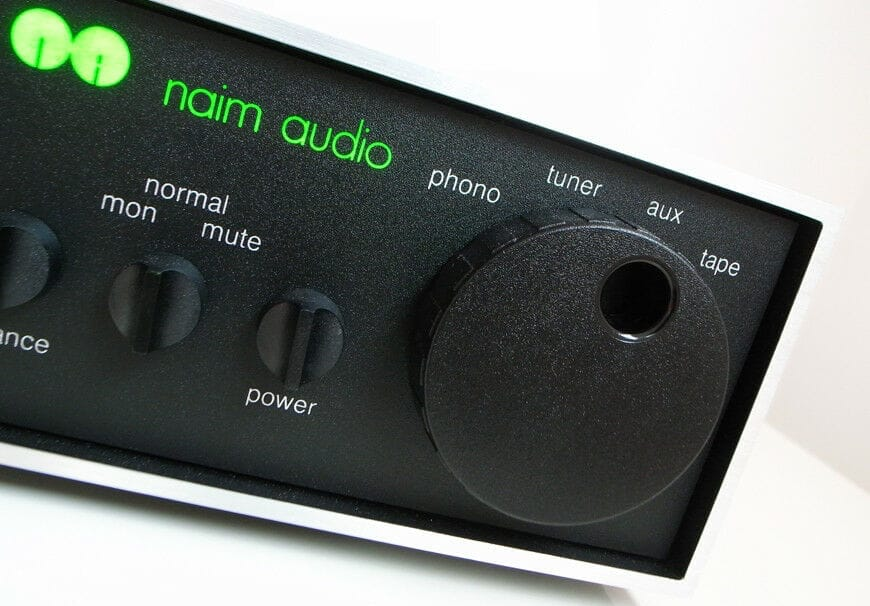
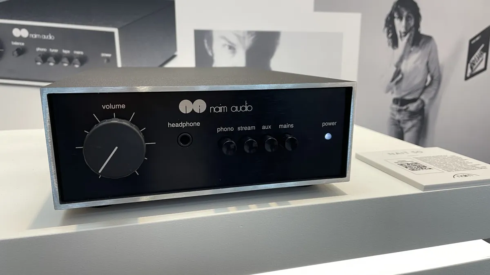

# The Naim NAIT 2: the small amplifier that became a reference

The NAIT 2 is the integrated amplifier Naim Audio made from 1988 to 1993: a box the size of a
shoebox, a few watts, no remote, no headphone socket. From its first reviews to the latest, the
specialist press has treated it, and the NAITs around it, as a reference among affordable integrated
amplifiers. Hi-Fi World called the NAIT the "quintessentially British affordable audiophile
amplifier"; Robert Harley, who
first heard the NAIT 2 for Stereophile in 1989, wrote in 2018 that no other product "has brought
more musical pleasure to more listeners for less money". In 2016, Stereophile listened to a rebuilt
one again. Here is what they heard, where they disagree, how it compares with its rivals and its
successors, and what to pair it with.

Checked on 2026-11-02 against the reviews of Stereophile (1989, 1990, 2016), Hi-Fi World (2007) and
The Absolute Sound (2018), and Naim's owner's manual.

## Why it became a reference

The first NAIT came out in 1983 at £253. It "became an instant classic", Hi-Fi World wrote in 2007:
it "sounded quite unlike any other integrated of its day", and started the trend for "super
integrateds", between entry-level amplifiers and pre-power combinations. For Harley, the cheap
solid-state amplifiers of the time were "hard, bright, grainy, flat"; the NAIT "gushed glorious
music".

It came from a firm with firm ideas. Art Dudley, in Stereophile, sums up its views of the time:
"Shopping for amplifiers based on output power is foolish", and soundstaging was American
"nonsense". When Sam Tellig asked Julian Vereker, Naim's founder, why the NAIT was so low-powered,
Vereker told him a more powerful version had been tried while he was on holiday: "It sounded awful."

The NAIT 2 replaced it in 1988. Dudley credits its redesign to James Barrington-Brown, who gave it
Naim's own quasi-complementary output stage and the firm's first two-sided circuit board; Hi-Fi
World says it was voiced by Roy George, Naim's technical director. The reviews "poured in", Dudley
writes, "and not from only the UK press". For Harley, "none of the Nait's enchantment was lost in the
translation; the Nait 2 actually improved upon its legendary predecessor."

What the reviewers said of its standing:

- **Stereophile, 1989:** "the most musically satisfying amplifier of the group", Harley wrote, after
  comparing it with three rivals.
- **Stereophile, 1990:** Tellig could not "name a better-sounding integrated amp at the price".
- **Hi-Fi World, 2007:** any NAIT, "new or old", would still be the reviewer's "top recommended
  integrated amplifier" between £500 and £900, and the old ones "brilliant second-hand buys".
- **Stereophile, 2016:** Dudley put vintage Naim with the old products whose makers now do even
  better, "and yet the old product retains its hold on buyers' imaginations".
- **The Absolute Sound, 2018:** the NAIT "may be" Naim's "most iconic product", and the NAIT line has
  won more of the magazine's Editors' Choice awards than any other product in its history.

## The sound

**Timing.** Dudley found the NAIT 2's "uncanny way with musical timing" worthy of the praise Naim
amplifiers get for it: "praise well deserved". Its momentum held even in slow music: in the Andante of Schubert's "Trout" Quintet, the
system "didn't lose one iota of its momentum", and when the pace picked up, "my brain felt as if it
were hot-wired to the musicians' intentions." Bass lines became legible: on Procol Harum's *Home*,
Robin Trower's bass was "completely distinguished from the same notes played on the piano". Hi-Fi
World, comparing four NAITs, called the first three "characterful, with a swaggering tunefulness" —
"think of them as Keith Richards".

**Voices and words.** Next to the first NAIT, Hi-Fi World heard "obviously higher resolution to the
vocals", a fuller, deeper sound, and the timbre of instruments "brilliantly". Dudley noticed the
words: with the NAIT 2, "the words — and their meanings — simply leaped out", disc after disc.

**Tone.** Harley heard "no trace of edge or harshness": timbres "soft, warm, and liquid, very much
like tube amplifiers", with "a slight loss of detail in the high end" that he preferred. Tellig found
it "sweet, smooth, spacious", and said it sounded "a lot like a Krell" — "a 15Wpc Krell integrated
amplifier... if D'Agostino dared to think small." Dudley, next to his valve amplifiers, heard
textures "of a thicker, less stringy sort" — "little rounded nubs, not little spikes" — and a sound
slightly brighter overall, "but not bright per se".

**Bass.** Hi-Fi World found it "wonderfully tuneful", the most tuneful of the four NAITs, over
quieter backgrounds. Dudley heard it "far tighter, with more precise attacks and cleaner decays" than
through his own amplifier. Harley, in 1989, did not: next to its rivals it lacked "weight and
authority", and was "slightly mushy".

**Space.** Here the reviewers disagree most. Harley's first impression was of a soundstage "huge,
open, three-dimensional, and transparent", the speakers tending "to disappear into the music"; Tellig
found it "above all" spacious. Hi-Fi World heard "a slight lack of 'air'" next to the first NAIT.
Dudley found its sense of scale "less than grand", and the NAIT 2 "definitely not an ideal product
for listeners who crave being able to hear the air surrounding the players" — with an upside: "solid,
not puffy".

**Its limits.** It does not play loud. Harley found it underpowered at moderate to high levels;
Tellig said it could not do justice to the Spica Angeli in his main listening room: "Not enough
ooomph."

They did not hear it in the same conditions. Harley and Tellig heard new units, in 1989 and 1990,
Harley against three other amplifiers; Hi-Fi World heard a 1988 chrome-bumper unit against the other
NAITs, from a Naim CD player into Kudos C1 standmounts; Dudley heard a 1990 NAIT 2 rebuilt with new
transistors and capacitors, into Quad electrostatics, against his own electronics.

## Against its rivals, and the NAITs that followed

**In 1989**, Harley compared it with the Arcam Alpha 2, the Creek 4140 and the Audiolab 8000A. For
soundstaging and tonal balance, the NAIT 2 was "the clear winner"; for power and bass, it lost. "It
is the amplifier I would choose for overall musical satisfaction if price were no consideration," he
wrote, having noted its "relatively high price", $795, and pointed readers on a budget to cheaper
pre- and power amplifier pairs.

**In 2007**, Hi-Fi World heard the NAIT, NAIT 2, NAIT 3 and NAIT 5i one after the other:

| | What Hi-Fi World heard |
|---|---|
| NAIT, 1983 | The best musical timing, "precision tempos" |
| NAIT 2, 1988 | The most tuneful bass, a much quieter background than the NAIT |
| NAIT 3, 1993 | The clearest, the most free-flowing; treble "a touch sharp" on female voices |
| NAIT 5i, 2003 | The most refined, and more immediate: "more of a Mick Jagger" |

The reviewer was "torn between Naits 2 and 3", and found the test "debunked the myth about the first
Nait being the best". For Harley, reviewing it for The Absolute Sound in 2008, the 5i was "the
best-sounding Nait yet".

Every NAIT by the year it came out. The filled dots are the NAIT 2's two looks.

<ol class="man-timeline" aria-label="The NAIT models, by year of introduction">
<li><time datetime="1983">1983</time>

<strong>NAIT</strong>, the first — replaced by the NAIT 2 in 1988

</li>
<li class="is-subject"><time datetime="1988">1988</time>

<strong>NAIT 2</strong>, chrome bumper — olive from 1989

</li>
<li class="is-subject"><time datetime="1989">1989</time>

<strong>NAIT 2</strong>, olive — replaced by the NAIT 3 in 1993

</li>
<li><time datetime="1993">1993</time>

<strong>NAIT 3</strong> — replaced by the NAIT 5 in 2000

</li>
<li><time datetime="1995">1995</time>

<strong>NAIT 3R</strong>, with remote — replaced by the NAIT 5 in 2000

</li>
<li><time datetime="2000">2000</time>

<strong>NAIT 5</strong> — replaced by the NAIT 5i in 2003

</li>
<li><time datetime="2003">2003</time>

<strong>NAIT 5i</strong> — revised in 2007

</li>
<li><time datetime="2007">2007</time>

<strong>NAIT 5<em>i</em></strong>, its “i” in italics — replaced by the NAIT 5si in 2013

<strong>SUPERNAIT</strong> — replaced by the SUPERNAIT 2 in 2013

</li>
<li><time datetime="2008">2008</time>

<strong>NAIT XS</strong> — replaced by the NAIT XS 2 in 2013

</li>
<li><time datetime="2013">2013</time>

<strong>NAIT 5si</strong>

<strong>SUPERNAIT 2</strong> — replaced by the SUPERNAIT 3 in 2019

<strong>NAIT XS 2</strong> — replaced by the NAIT XS 3 in 2019

</li>
<li><time datetime="2019">2019</time>

<strong>SUPERNAIT 3</strong>

<strong>NAIT XS 3</strong>

</li>
<li><time datetime="2023">2023</time>

<strong>NAIT 50</strong>, a limited edition of 1,973 units

</li>
</ol>

On 31 October 2026, Naim's website listed the NAIT 5si, NAIT XS 3, SUPERNAIT 3 and NAIT 50 among
its discontinued products, and its catalogue had no integrated amplifier left.

### The NAIT 50, the small NAIT's return

*The NAIT 50 at the High End show in Munich, in May 2023. Photo: What Hi-Fi?, from its
[news of 18 May 2023](https://www.whathifi.com/news/naim-launches-special-anniversary-edition-nait-50-amp-but-youll-have-to-move-fast-to-get-one).*

For its fiftieth anniversary in 2023, Naim brought back the first NAIT's looks in the NAIT 50: the
same small chrome-bumper case, a moving-magnet phono stage and line inputs on 5-pin DIN sockets, 25 W
per channel into 8 Ω and a headphone output. Naim made 1,973 of them, after the year it was founded.

## What to pair it with

- **Speakers:** small and reasonably efficient, "preferably in a small room", was Tellig's advice.
  The pairings the reviewers heard: Monitor Audio 7 standmounts in Tellig's living room, Kudos C1
  standmounts at Hi-Fi World, Quad electrostatics at Dudley's — the memory of a NAIT 2 on Quad ESLs,
  he wrote, had brought him "to the brink of buying a used Nait 2". Here, a NAIT 2 drives a pair of
  Rogers LS3/5A: what they ask of it is in [The BBC LS3/5A](bbc-ls3-5a#valves-or-a-nait-2).
- **A turntable:** its phono stage takes a moving-magnet cartridge, at 47 kΩ. Tellig played his
  records through it from a Rega RB300 arm; Dudley plugged an EMT TSD 15 pickup, which he usually
  runs through a step-up transformer, straight into it: apart from some bass weight, "it sounded
  great".
- **Speaker cable:** Naim's manual asks for its own cable, at least 3.5 m a side and of equal
  lengths, and warns that some other types may damage the amplifier.
- **Warm-up:** Dudley switched it on well before listening, knowing "the breed's tendency to sound its
  best only when fully warmed up".
- **A DAC:** it goes into Aux, through a cable with a 5-pin DIN plug at the NAIT's end:
  [A streamer into an amplifier with DIN inputs](../guides/streamer-din-amplifier-inputs).

## Buying and servicing one

- **Which look.** Chrome bumper, from 1988 to 1989: a black aluminium case with shiny edges, as in
  the photograph above. Olive, from 1989: a black case and a green front panel. Naim told Hi-Fi World
  that the olive case brought "no performance improvement", contrary to the rumours.
- **Its age.** Its serial number gives the year it was made: see
  [How old is your Naim?](naim-serial-numbers).
- **Mains voltage.** Each unit was built for one mains voltage; check it on a NAIT 2 bought in
  another country.
- **A pre-amplifier conversion.** Naim could convert a NAIT 2 into a pre-amplifier for its NAP 90 or
  NAP 140 power amplifiers; a converted unit no longer drives speakers on its own.
- **A CD version.** On some units, a line input takes the place of the phono stage behind the RCA
  sockets.
- **Servicing.** After more than thirty years, its capacitors may need replacing. In 2007, Naim
  charged from about £145 to £250 for a full rebuild, Hi-Fi World wrote. In the United States in 2016, AV
  Options' standard rebuild cost $1,195: 14 transistors, the four output ones among them, 32
  capacitors, three potentiometers, six resistors, the speaker sockets and the feet. For owners who do
  it themselves, hi-fi AF published
  [a step-by-step guide](../../docs/archive/hifiaf-nait2-recap-guide/index.html) in 2020; its site
  has closed, and the link opens a copy kept on this site.
- **Prices.** In 2007, Hi-Fi World put a second-hand olive unit from £345 and a chrome-bumper one at
  about £445.

## The facts

From Naim's manual, unless another source is named:

| | NAIT 2 |
|---|---|
| Phono | Moving magnet, RCA sockets: 2.5 mV, 47 kΩ |
| Tuner, Aux, Tape | 5-pin DIN sockets: 75 mV, 47 kΩ |
| Loudspeakers | 4 mm banana sockets |
| Size | 205 × 76 × 276 mm |
| Power, Naim's figures | 13 W into 8 Ω, 19.5 W into 4 Ω |
| Clipping, measured | 21 W into 8 Ω, 33.5 W into 4 Ω |
| Price in the US, 1989 | $795 |

Naim never printed a power figure in its manual, which speaks instead of "a very large peak current
capacity". Its figures came out in Hi-Fi World in 2007; Stereophile measured where it clips in 1989.
In between, the NAIT 2 was given 15 W, or 18 W: "depending on what day someone asks you", Tellig
told Vereker. Inside, Harley found discrete transistors only, no op-amps, on a densely packed
two-sided board.

## Sources

- Stereophile: Robert Harley, September 1989 (Vol.12 No.9),
  [review](https://www.stereophile.com/content/naim-nait-integrated-amplifier-robert-harley-1989),
  [part 2](https://www.stereophile.com/content/naim-nait-integrated-amplifier-rh-1989-part-2) and
  [measurements](https://www.stereophile.com/content/naim-nait-integrated-amplifier-1989-measurements);
  Sam Tellig, April 1990 (Vol.13 No.4),
  [follow-up](https://www.stereophile.com/content/naim-nait-integrated-amplifier-sam-tellig-1990);
  Art Dudley, ["Listening #161"](https://www.stereophile.com/content/listening-161), 2016-05-05, and
  its [page 2](https://www.stereophile.com/content/listening-161-page-2): a rebuilt 1990 NAIT 2.
- Hi-Fi World, October 2007: Channa Vithana, "NAITology", the NAIT, NAIT 2, NAIT 3 and NAIT 5i heard
  one after the other, with Naim's power figures:
  [copy kept on this site](../../docs/archive/hifi-world-2007-naitology.pdf) (PDF, 4 MB, three pages).
- The Absolute Sound: Robert Harley,
  ["TAS Legacy: Naim Nait Integrated Amplifier"](https://www.theabsolutesound.com/articles/tas-legacy-naim-nait-integrated-amplifier),
  2018-01-16.
- Naim Audio, owner's manual covering the NAIT 2, with the NAC 62 and NAC 32-5 pre-amplifiers:
  inputs, sensitivities, mains and case size on pages 8–9, cables on pages 4–5 and 22.
- The models and their dates: [Naim NAIT](https://en.wikipedia.org/wiki/Naim_NAIT), Wikipedia, read
  on 2026-10-31, up to 2013; What Hi-Fi?,
  [8 July 2019](https://www.whathifi.com/news/naim-audio-launches-new-nait-and-supernait-integrated-amplifiers)
  and [18 May 2023](https://www.whathifi.com/news/naim-launches-special-anniversary-edition-nait-50-amp-but-youll-have-to-move-fast-to-get-one);
  the NAIT 50 on [Naim's product page](https://www.naimaudio.com/products/nait-50); what Naim no
  longer sells, its [catalogue](https://www.naimaudio.com/catalog/separates), read on 2026-10-31.
- The CD version and replacing the capacitors: "Nobeone's Guide to Servicing a Naim Nait 2", hi-fi
  AF, 2020: [copy kept on this site](../../docs/archive/hifiaf-nait2-recap-guide/index.html), made
  on 2026-10-31 from the
  [Internet Archive's copy of 2026-06-09](https://web.archive.org/web/20260609001657/https://www.hifiaf.com/nait2-recap-guide/).
- The NAIT 50's photograph: What Hi-Fi?, from its
  [news of 18 May 2023](https://www.whathifi.com/news/naim-launches-special-anniversary-edition-nait-50-amp-but-youll-have-to-move-fast-to-get-one).
