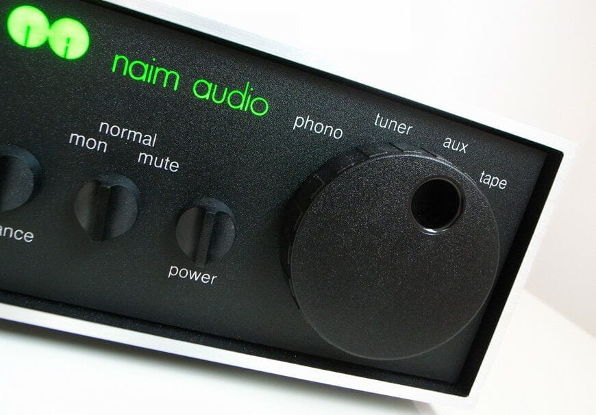

# The Naim NAIT 2: its figures, its sound, and the NAITs that followed

The NAIT 2 is the small integrated amplifier Naim Audio made from 1988 to 1993. Most units have
four inputs: a moving-magnet phono stage and three line inputs on 5-pin DIN sockets. Its power is
modest: Naim gives 13 W per channel into 8 ohms. Reviewers praised its sound, and advised small,
easy-to-drive speakers in a small room.

Checked on 2026-10-31 against Naim's owner's manual for the NAIT 2, Stereophile's 1989 review and
bench measurements, and Hi-Fi World's 2007 comparison of four NAITs.

## What it is

NAIT stands for **N**aim **A**udio **I**n**T**egrated amplifier, as Naim's own glossary spells it.
The first NAIT came out in 1983. Naim was then known for its separate pre-amplifiers and power
amplifiers, and the NAIT put that sound in one small, low-powered box.

The NAIT 2 replaced it in 1988, voiced by Naim's technical director Roy George. It kept the same
small "half-size" case: 205 mm wide, 76 mm high and 276 mm deep. There are two looks:

- **Chrome bumper**, 1988 to 1989: a black aluminium case with shiny edges, as in the photo above.
- **Olive**, from 1989: a black case with a green front panel. Naim told Hi-Fi World that the new
  case changed nothing in how it performs.

Compared with the first NAIT, it added a rotary input selector, a mute and tape-monitor switch, an
**Aux** input and a normal balance control. The first NAIT's balance control could only lower the
left channel.

Stereophile looked inside in 1989: discrete transistors only, with no op-amps, on a densely packed
double-sided board, and a heatsink bolted to the aluminium case.

## Inputs, outputs and figures

From Naim's manual, unless another source is named:

| | NAIT 2 |
|---|---|
| Phono | Moving-magnet cartridges, on RCA sockets: 2.5 mV, 47 kΩ |
| Tuner, Aux, Tape | 5-pin DIN sockets: 75 mV, 47 kΩ. The Tape socket carries the signal both ways, to record and to play back |
| Tape output | 75 mV, 1 kΩ |
| Loudspeakers | 4 mm banana sockets, one pair per channel |
| Mains | Built for one of 100, 110, 120, 200, 220 or 240 V, at 50 or 60 Hz |
| Power, Naim's figures | 13 W per channel into 8 Ω and 19.5 W into 4 Ω, published by Hi-Fi World in 2007 |
| Power, measured | Clipping at 21 W into 8 Ω and 33.5 W into 4 Ω, at 1 kHz (Stereophile, 1989) |

The manual itself gives no power figure. It says instead that the low continuous power is
"balanced by a very large peak current capacity". So there is no restriction on the type of
loudspeaker, but it adds: "please don't expect the impossible". The 20 W per channel often quoted
for the NAIT 2 is close to Naim's figure into 4 ohms, not into 8.

Some NAIT 2s are **"CD versions"**: behind the RCA sockets, a line input takes the place of the
phono stage. [hi-fi AF's servicing guide](../../docs/archive/hifiaf-nait2-recap-guide/index.html),
written on one of them, says these were reportedly made for the Japanese market. Naim's manual
describes only the phono version.

Stereophile also measured the frequency response through the line inputs. It was down nearly 2 dB
at 20 kHz. The phono stage rises slightly above 2 kHz. The net effect is that CDs, and a streamer,
sound a little softer through the NAIT 2 than records do.

## How it sounds, according to those who listened

- **Stereophile, September 1989.** Robert Harley compared it with the Arcam Alpha 2, the Creek 4140
  and the Audiolab 8000A. It had the best soundstage of the group, remarkable above all for its
  depth, and a smooth, warm tone, with a slight loss of detail at the top. It did not play very
  loud and lacked punch and control in the bass. He still called it "the most musically satisfying
  amplifier of the group".
- **Stereophile, April 1990.** Sam Tellig found it lacked power for the speakers in his main room.
  On smaller ones in his living room, it was sweet, smooth and above all spacious. His advice:
  small, reasonably efficient speakers, preferably in a small room.
- **Hi-Fi World, October 2007.** Channa Vithana heard four NAITs one after the other. Next to the
  first NAIT, the NAIT 2 had more detail in the voices, a fuller and deeper sound, more tuneful
  bass and quieter backgrounds, but a little less "air".

The praise of the NAIT's pace and timing most often quoted online comes from TNT-Audio's 2003
review. That review is about the **first** NAIT, not the NAIT 2.

## Loudspeakers and cables

- **Loudspeakers:** the NAIT 2 does best with speakers that are easy to drive. Both Stereophile
  reviewers found it short of power at high levels.
- **Speaker cable:** Naim's manual recommends its own speaker cable, at least 3.5 m long, with both
  lengths equal. Its 4 mm plugs come with the amplifier. It warns that the wrong cable will degrade
  the sound, and that some types may damage the amplifier.
- **Before plugging anything in:** switch the amplifier off and wait about a minute. The manual
  also asks for the mains earth to stay connected, whatever else is in the system.

## Connecting a streamer

The NAIT 2 has no digital input: a streamer reaches it through a DAC, or through its own analogue
output.

- **The input:** **Aux**, the one the manual names for a compact disc player. Tuner has the same
  sensitivity and works too. On a CD version, the RCA sockets are a line input as well, and take
  an ordinary RCA cable. On a phono version, do not connect a DAC to them: the phono stage is made
  for the 2.5 mV of a cartridge.
- **The cable:** RCA plugs at the DAC's end, a 5-pin DIN plug wired for a Naim input at the NAIT's.
- **The volume knob:** the line inputs are rated at 75 mV, far less than a DAC gives, so the knob
  does its work in the first part of its travel. That is expected, not a fault.

Which pins carry what, how much a DAC sends, where to set the volume and how to check both
channels: [A streamer into an amplifier with DIN inputs](../guides/streamer-din-amplifier-inputs).

## Buying one second-hand

- **Its age.** Its serial number gives the year it was made: see
  [How old is your Naim?](naim-serial-numbers).
- **Mains voltage.** Each unit was built for one mains voltage. Check which one before plugging in a
  NAIT 2 bought in another country.
- **Pre-amplifier conversion.** Naim's dealers could convert a NAIT 2 into a pre-amplifier only, to
  use with Naim's NAP 90 or NAP 140 power amplifiers. Stereophile reported in 1989 that Naim did not
  recommend it with the NAP 250 and that it could not be used with the NAP 135. A converted unit no
  longer drives speakers on its own, so ask the seller.
- **Which version.** Ask whether its RCA sockets are the phono input or the line input of a CD
  version.
- **Servicing.** After more than thirty years, its capacitors may need replacing. The manual asks
  for repairs to be done by a Naim dealer or by Naim. For owners who do it themselves, hi-fi AF
  published [a step-by-step guide](../../docs/archive/hifiaf-nait2-recap-guide/index.html) in
  2020, written with the help of a reader who had worked at Naim's factory. It covers both
  versions, with the parts list and the checks to make afterwards. Its site has closed: the link
  opens a copy kept on this site.

## The NAIT family

Every NAIT by the year it came out. The filled dots are the NAIT 2's two years.

<ol class="man-timeline" aria-label="The NAIT models, by year of introduction">
<li><time datetime="1983">1983</time>

<strong>NAIT</strong>, the first — replaced by the NAIT 2 in 1988

</li>
<li class="is-subject"><time datetime="1988">1988</time>

<strong>NAIT 2</strong>, chrome bumper — olive from 1989

</li>
<li class="is-subject"><time datetime="1989">1989</time>

<strong>NAIT 2</strong>, olive — replaced by the NAIT 3 in 1993

</li>
<li><time datetime="1993">1993</time>

<strong>NAIT 3</strong> — replaced by the NAIT 5 in 2000

</li>
<li><time datetime="1995">1995</time>

<strong>NAIT 3R</strong>, with remote — replaced by the NAIT 5 in 2000

</li>
<li><time datetime="2000">2000</time>

<strong>NAIT 5</strong> — replaced by the NAIT 5i in 2003

</li>
<li><time datetime="2003">2003</time>

<strong>NAIT 5i</strong> — revised in 2007

</li>
<li><time datetime="2007">2007</time>

<strong>NAIT 5<em>i</em></strong>, its “i” in italics — replaced by the NAIT 5si in 2013

<strong>SUPERNAIT</strong> — replaced by the SUPERNAIT 2 in 2013

</li>
<li><time datetime="2008">2008</time>

<strong>NAIT XS</strong> — replaced by the NAIT XS 2 in 2013

</li>
<li><time datetime="2013">2013</time>

<strong>NAIT 5si</strong>

<strong>SUPERNAIT 2</strong> — replaced by the SUPERNAIT 3 in 2019

<strong>NAIT XS 2</strong> — replaced by the NAIT XS 3 in 2019

</li>
<li><time datetime="2019">2019</time>

<strong>SUPERNAIT 3</strong>

<strong>NAIT XS 3</strong>

</li>
<li><time datetime="2023">2023</time>

<strong>NAIT 50</strong>, a limited edition of 1,973 units

</li>
</ol>

On 31 October 2026, Naim's website listed the NAIT 5si, NAIT XS 3, SUPERNAIT 3 and NAIT 50 among
its discontinued products, and its catalogue had no integrated amplifier left. It does not say
when each one stopped.

The same models, with what came next:

| Model | Introduced | Then |
|---|---|---|
| NAIT | 1983 | Replaced by the NAIT 2 in 1988 |
| NAIT 2, chrome bumper | 1988 | New olive look in 1989 |
| NAIT 2, olive | 1989 | Replaced by the NAIT 3 in 1993 |
| NAIT 3 | 1993 | Replaced by the NAIT 5 in 2000 |
| NAIT 3R, with remote | 1995 | Replaced by the NAIT 5 in 2000 |
| NAIT 5 | 2000 | Replaced by the NAIT 5i in 2003 |
| NAIT 5i | 2003 | Revised in 2007, its "i" now in italics |
| NAIT 5*i* | 2007 | Replaced by the NAIT 5si in 2013 |
| SUPERNAIT | 2007 | Replaced by the SUPERNAIT 2 in 2013 |
| NAIT XS | 2008 | Replaced by the NAIT XS 2 in 2013 |
| NAIT 5si | 2013 | Listed by Naim as no longer available on 2026-10-31 |
| SUPERNAIT 2 | 2013 | Replaced by the SUPERNAIT 3 in 2019 |
| NAIT XS 2 | 2013 | Replaced by the NAIT XS 3 in 2019 |
| SUPERNAIT 3 | 2019 | Listed by Naim as no longer available on 2026-10-31 |
| NAIT XS 3 | 2019 | Listed by Naim as no longer available on 2026-10-31 |
| NAIT 50 | 2023 | Limited to 1,973 units; listed by Naim as no longer available on 2026-10-31 |

## The NAIT 50, the small NAIT's return

For its fiftieth anniversary in 2023, Naim brought back the first NAIT's looks: the NAIT 50 has the
same small chrome-bumper case, 207 mm wide, 87 mm high and 321 mm deep. Naim made 1,973 of them,
after the year it was founded.

Its inputs follow the NAIT 2's: a moving-magnet phono stage on RCA sockets, and line inputs on 5-pin
DIN sockets, two of them instead of three. Its line inputs are just as sensitive: Naim gives 88 mV
as the level that drives it to clipping, so a DAC connects the same way, with the same short
travel of the volume knob. What is new is the power, 25 W per channel into 8 Ω, and a headphone
output on a 6.35 mm jack.

## Sources

- Naim Audio, owner's manual covering the NAIT 2, with the NAC 62 and NAC 32-5 pre-amplifiers: inputs, sensitivities, mains and case size on pages 8–9, cables and switching on pages 4–5 and 22.
- Stereophile: Robert Harley, September 1989 (Vol.12 No.9): [review](https://www.stereophile.com/content/naim-nait-integrated-amplifier-robert-harley-1989), [part 2](https://www.stereophile.com/content/naim-nait-integrated-amplifier-rh-1989-part-2), [specifications](https://www.stereophile.com/content/naim-nait-integrated-amplifier-specifications) and [measurements](https://www.stereophile.com/content/naim-nait-integrated-amplifier-1989-measurements); Sam Tellig, April 1990 (Vol.13 No.4): [follow-up](https://www.stereophile.com/content/naim-nait-integrated-amplifier-sam-tellig-1990).
- Hi-Fi World, October 2007: Channa Vithana, "NAITology", the NAIT, NAIT 2, NAIT 3 and NAIT 5i compared, with Naim's power figures.
- TNT-Audio, March 2003: Lucio Cadeddu, ["Naim Nait 1 – A living legend"](https://www.tnt-audio.com/ampli/nait_e.html), about the first NAIT.
- The models and their dates: [Naim NAIT](https://en.wikipedia.org/wiki/Naim_NAIT), Wikipedia, read on 2026-10-31, up to 2013; What Hi-Fi?, [8 July 2019](https://www.whathifi.com/news/naim-audio-launches-new-nait-and-supernait-integrated-amplifiers) for the NAIT XS 3 and SUPERNAIT 3, and [18 May 2023](https://www.whathifi.com/news/naim-launches-special-anniversary-edition-nait-50-amp-but-youll-have-to-move-fast-to-get-one) for the NAIT 50's launch.
- The NAIT 50: [Naim's product page](https://www.naimaudio.com/products/nait-50), read on 2026-10-31: inputs, clipping levels, power, size, the 1,973 units, and "no longer available".
- What Naim still sells: its [catalogue of separates](https://www.naimaudio.com/catalog/separates), read on 2026-10-31, with no integrated amplifier category, and its "Discontinued products" list, which holds the NAIT 5si, NAIT XS 3, SUPERNAIT 3 and NAIT 50; their own pages, [NAIT 5si](https://www.naimaudio.com/products/nait-5si), [NAIT XS 3](https://www.naimaudio.com/products/nait-xs3) and [SUPERNAIT 3](https://www.naimaudio.com/products/supernait-3), say "This product is no longer available".
- The CD version and replacing the capacitors: "Nobeone's Guide to Servicing a Naim Nait 2", hi-fi AF, 2020. [Copy kept on this site](../../docs/archive/hifiaf-nait2-recap-guide/index.html), with the readers' comments and the parts list, made on 2026-10-31 from the [Internet Archive's copy of 2026-06-09](https://web.archive.org/web/20260609001657/https://www.hifiaf.com/nait2-recap-guide/); hifiaf.com's domain pointed to no server that day. The parts list is a [shared Google Doc](https://docs.google.com/document/d/e/2PACX-1vTJ5mSLcx6uOe5Hf8Sb4L8_Ve5E5yYiQVvrwSFcujpuQA768BAOAgs_10uX2UvmKVzv1IJkw8bnnxfs/pub), still online on 2026-10-31.
