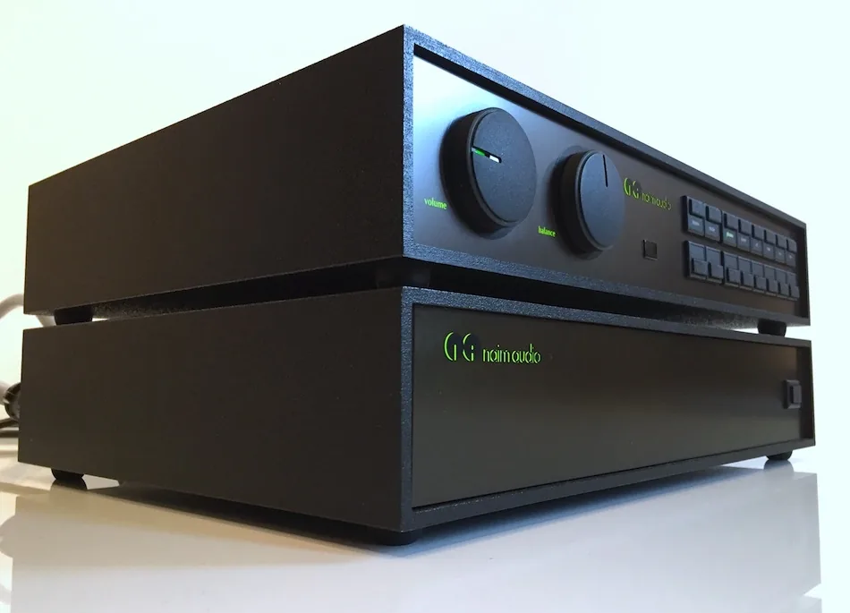
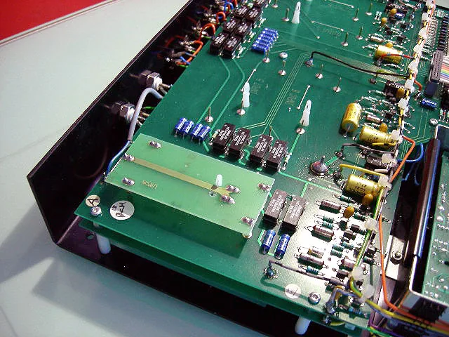
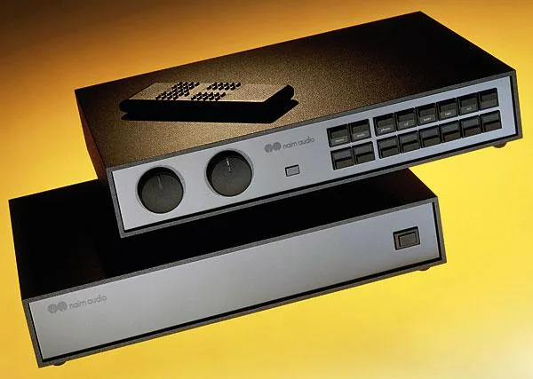

# The Naim NAC 52: the pre-amplifier at the top of Naim's range in the 1990s

The NAC 52 was Naim Audio's top pre-amplifier from 1990 to 2002: the pre-amplifier in one box, its
power supply in another, in what Naim calls its first "full width" case. Hi-Fi World called it "the
remarkable NAC 52" in 1991; a French review wrote that it had "embodied perfection" among Naim's
pre-amplifiers for nearly seven years. Naim drew its NAC 82 and NAC 102 from it, and in 2002 put two
pre-amplifiers in its place, the NAC 252 and, above it, the NAC 552. Here is how it was heard at the
heart of a Naim system, how it is built, what followed it, and what to pair it with.

Checked on 2026-11-15 against Laurent Thorin's review of a Naim system for a French magazine, Hi-Fi
World (1991, 1994, 1996, 2001), Hi-Fi News (1993, 2018, 2023), Hi-Fi Choice (1992–93), Stereophile
(1992, 2000, 2003) and Naim's product history.

*A NAC 52 on its power supply.*

## How it sounds

Few magazines reviewed Naim's amplifiers in those years: in 1993, Hi-Fi News's Martin Colloms wrote
that neither he nor his editor "could remember when HFN last reviewed a Naim amplifier". The fullest
account of the NAC 52's sound that can be read today is French. Laurent Thorin heard it at the heart
of a Naim system — the CDS II CD player, two NAP 135 mono power amplifiers and NBL loudspeakers, then
Naim's newest — which two of Naim's staff and its French distributor set up themselves at the
magazine, in "barely an hour". What he describes is the sound of that system, not of the
pre-amplifier alone. (In French; translations mine.)

- **Free and fast.** Naim's strength, he writes, "is to present recorded music without make-up",
  with "the very clear impression that there is no obstacle between the master tape and the ear".
  "The sound seems raw, so free is it", rid of "the slightest inertia that could slow the rhythm".
  It is a "nervy, ultra-fast system", and yet its liveliness gives the music "no caricatural
  tendency, no hint of exaggeration".
- **Rhythm and melody.** "Naims have always shown superb rhythmic tracking, the most successful there
  is", and this system keeps to the rule; it also brings out "the subtlest and least apparent
  melodies".
- **Transparency, and its price.** A "ruthless transparency": the system "acts like a magnifying
  glass", without ever giving "the impression of an artificial hyper-definition". It is "not really
  kind to approximate recordings", whose limits it shows at once, but it draws "the quintessence"
  from discs other systems would have led him to dismiss. Its view of timbres is "sometimes raw, but
  always perfectly faithful to reality": the Naim sound is not "necessarily 'pretty'", and he warns
  that it can "shock or put off".
- **Space.** The image is "by turns wide, deep, intimate or grandiose", as the recording asks.

What sets Naim apart, he concludes, is "the incredible impression of proximity, spontaneity and
immediacy of the music": "dynamics, presence and transparency are the three great foundations of the
Naim philosophy". His pull quote: "Hard not to become a die-hard of the brand when you listen to this
system!"

Andrew Everard, whose own system was built on a NAC 52, wrote in Hi-Fi News in 2023: "I have never
found the company's amps, going right back to the early '90s NAC 52/NAP 250, to sound overly bright,
even though there's no shortage of sheer boogie factor."

What the English press said of its standing:

- **Hi-Fi World, June 1991:** Naim's "top-of-the-range pre-amplifier", in its news of the CDS CD
  player, which looked like it.
- **Hi-Fi World, October 1991:** in its buyer's guide, Naim's range, "a legend in its own lifetime",
  "has always been hard to beat, even harder to criticise", from the NAC 62 at £405 "up the
  remarkable NAC 52 at £4535".
- **Hi-Fi News, April 1993:** reviewing the NAC 82, Martin Colloms noted that it carried "the full
  remote control first seen on the top-of-the range NAC 52 preamp".
- **Hi-Fi World, April 1994:** Malcolm Steward and Robert Wilson open their review of the NAC 82 on
  the system of one of them — a NAC 52 driving two NAP 250 power amplifiers through an electronic
  crossover into Naim's active SBL loudspeakers: "I've yet to discover another electronics package
  that delivers what I want from music."
- **Stereophile, 2000:** Paul Messenger, a Naim user for many years, did most of his
  listening for the magazine's review of Naim's NBL loudspeakers "using a Naim NAC52 preamplifier and
  Naim NAP135 monoblock power amplifiers".
- **Hi-Fi World, June 2001:** David Price calls it Naim's "range topping" pre-amplifier.

## How it is built

From the French review, unless another source is named:

- **Two boxes.** The NAC 52 has no power supply of its own: "so as not to pollute the extremely
  delicate signals" that pass through it, the supply sits in a separate case. Naim's product history
  pairs it with the 52 PS, made for it, from 1990, and with the SuperCap from 1995. The SuperCap
  holds a 530 VA toroidal transformer, four large capacitors and "no fewer than twelve regulators
  sorted by hand"; every stage of the 52 has its own regulated supply. A second transformer and
  regulator, apart, feed its switching and the decoding of its commands, which work only when a
  button or the remote is pressed, "so that no parasitic noise can mar the listening". Robert Harley, reviewing Naim's
  CDS player for Stereophile in 1992, found the player's supply "identical" in looks to the NAP 250
  power amplifier and to the NAC 52's supply.
- **Dual mono**, on high-density circuit boards with plated-through holes. The main board is
  decoupled from the chassis by soft springs, against vibration. Naim kept the idea: in the NAC 552,
  Stereophile wrote in 2003, four boards "float on spring suspensions", Naim's designers having
  concluded "that suspending the circuit boards on springs has an audibly positive effect".
- **Six inputs**, each with its own listen and record selection. When it is not in use, the
  monitoring loop can be taken out of the signal's path altogether. Three inputs and two outputs are
  set by plug-in cards.
- **The volume** goes through "very precise" rotary potentiometers "fitted with precious-metal
  wipers".
- **The controls**: a microprocessor, Hi-Fi World noted in 2001, and a remote control. The French
  review's system came with Naim's Flash, an aluminium handset with a liquid-crystal screen that ran
  both the CDS II and the 52.

Naim developed it, the review says, "as a pre-amplifier without compromise, with a great deal of
computer-aided design and intensive listening tests".

*Inside a NAC 52. Photo: Naim Audio.*

## What followed it

By Naim's product history, with what the press wrote of each:

<ol class="man-timeline" aria-label="The NAC 52 and what followed it, by year">
<li class="is-subject"><time datetime="1990">1990</time>

<strong>NAC 52</strong>, with its 52 PS supply — Naim's first pre-amplifier in a full-width case

</li>
<li><time datetime="1992">1992</time>

<strong>NAC 82</strong> — “a scaled down NAC 52”, with remote control, Hi-Fi Choice wrote

</li>
<li class="is-subject"><time datetime="1995">1995</time>

<strong>SuperCap</strong> — replaces the 52 PS

</li>
<li><time datetime="1996">1996</time>

<strong>NAC 102</strong> — “designed with experience gained in the development of the NAC 52”, Hi-Fi World wrote

</li>
<li><time datetime="2002">2002</time>

<strong>NAC 252</strong> — replaces the NAC 52

<strong>NAC 552</strong> — Naim's new top pre-amplifier

<strong>SuperCap-2</strong> — replaces the SuperCap

</li>
</ol>

*The NAC 82, "a scaled down NAC 52", on a NAP 180 power amplifier. Photo: as published by Hi-Fi
News with Martin Colloms's review of April 1993.*

## What to pair it with

- **Naim power amplifiers.** The French review heard it with two NAP 135 mono amplifiers, of 75 W
  into 8 ohms each, as Stereophile's Paul Messenger did; Hi-Fi World's reviewer of 1994 drove two
  NAP 250s with it. Hi-Fi News's Andrew Everard, in 2018, used "my NAC 52/NA 52PS/NAP 250 DR
  combination into PMC OB1 loudspeakers".
- **Naim's own cables.** Its sockets are DIN, which, the French reviewer noted, does not encourage
  tinkering: "Better still, it prevents it." One of Hi-Fi World's reviewers, in 1994, had wasted
  "countless hours toying with custom leads" without finding an arrangement "that betters the
  original".
- **A DAC or a streamer** goes into one of its line inputs, through a cable with a DIN plug at the
  52's end: [A streamer into an amplifier with DIN inputs](../guides/streamer-din-amplifier-inputs).
  Everard reviewed Naim's NDX 2 network player through his.

## Buying one

- **Its supply.** A NAC 52 does not play without its external supply: a 52 PS, from 1990 to 1995, or
  a SuperCap afterwards, by Naim's product history.
- **Its age.** Its serial number gives the year it was made: see
  [How old is your Naim?](naim-serial-numbers).
- **Prices.** £4,535 in the UK in 1991, by Hi-Fi World; 58,600 francs in France, by the French
  review.

## The facts

From the French review, unless another source is named:

| | NAC 52 |
|---|---|
| Made | 1990 to 2002, by Naim's product history |
| Power supply | External: the 52 PS to 1995, then the SuperCap (Naim) |
| Inputs | Six, each with its own listen and record selection |
| Configuration | Three inputs and two outputs set by plug-in cards |
| Circuit | Dual mono; the main board on soft springs |
| Control | Microprocessor (Hi-Fi World, 2001), remote control |
| SuperCap | 530 VA toroidal transformer, four large capacitors, twelve regulators |
| Price | £4,535 in the UK in 1991 (Hi-Fi World); 58,600 francs in France |

## Sources

- Laurent Thorin, "Naim Audio : Fatale attraction", in the "Approche système" pages of a French
  magazine, pages 80 to 87: the CDS II, the NAC 52, the NAP 135, the NBL and the Flash remote, then
  the system's sound; read on its printed pages, in French. They give neither the magazine's name
  nor its date; the CDS II and the NBL were then Naim's newest products.
- Hi-Fi World: [June 1991](https://www.worldradiohistory.com/UK/Hi-Fi-World/1991/Hi-Fi-World-1991-06.pdf),
  news of the CDS player; [October 1991](https://www.worldradiohistory.com/UK/Hi-Fi-World/1991/Hi-Fi-World-1991-10.pdf),
  buyer's guide; [April 1994](https://www.worldradiohistory.com/UK/Hi-Fi-World/1994/Hi-Fi-World-1994-04.pdf),
  Malcolm Steward and Robert Wilson, "Rhythm master", the NAC 82 and NAP 180;
  [October 1996](https://www.worldradiohistory.com/UK/Hi-Fi-World/1996/Hi-Fi-World-1996-10.pdf), news
  of the NAC 102; [June 2001](https://www.worldradiohistory.com/UK/Hi-Fi-World/2001/Hi-Fi-World-2001-06.pdf),
  David Price, the NAC 112 and NAP 150. Scans kept by World Radio History, read on 2026-11-15.
- Hi-Fi News: Martin Colloms, ["Naim NAC 82/NAP 180 Pre/Power Amps"](https://www.hifinews.com/content/naim-nac-82nap-180-prepower-amps),
  first published in April 1993, republished on 2023-07-07, with the photograph of the NAC 82 used
  here; Andrew Everard, ["Naim Audio NDX 2 network attached DAC"](https://www.hifinews.com/content/naim-audio-ndx-2-network-attached-dac-page-2),
  2018-09-01, page 2; Andrew Everard, ["Naim Audio NSS 333/NAC 332/NAP 350 DAC/Pre/Power System"](https://www.hifinews.com/content/naim-audio-nss-333nac-332nap-350-dacprepower-system-page-2),
  2023-12-04, page 2.
- Hi-Fi Choice, [*The Collection 1992–93*](https://www.worldradiohistory.com/UK/Hi-Fi-Choice/The-Collection/Hi-Fi%20Choice%20The%20Collection%201992-93.pdf),
  the NAC 82's photograph and its caption.
- Stereophile: Robert Harley, ["Naim NA CDS CD player"](https://www.stereophile.com/content/naim-na-cds-cd-player),
  first published in August 1992; Paul Messenger, ["Naim NBL loudspeaker"](https://www.stereophile.com/content/naim-nbl-loudspeaker),
  2000-10-25, and its [associated equipment](https://www.stereophile.com/content/naim-nbl-loudspeaker-associated-equipment);
  Michael Fremer, ["Naim NAC 552 preamplifier"](https://www.stereophile.com/content/naim-nac-552-preamplifier),
  2003-07-13, and its [page 2](https://www.stereophile.com/content/naim-nac-552-preamplifier-page-2).
- Naim, [product history](https://www.naimaudio.com/product-history): its timelines of
  [pre-amplifiers](https://media.focal-naim.com/naim/file_manager_files/pages/legal/product-history/preamplifiers1v3.pdf)
  and [power supplies](https://media.focal-naim.com/naim/file_manager_files/pages/legal/product-history/v2/naim-product-history-power-supplies-1.pdf),
  read on 2026-11-15; the years are read off their scales.
- The photograph of the inside of a NAC 52: Naim Audio. The photograph of the NAC 82: Hi-Fi News,
  above.
