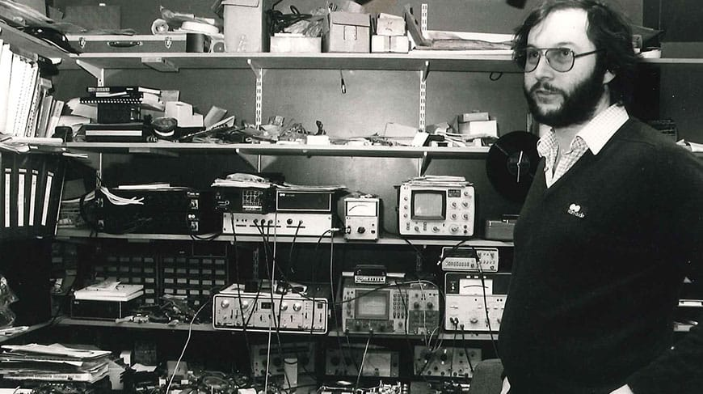

# How old is your Naim? Serial numbers and years, 1982 to 2022

Naim numbers what it makes, in one sequence since 1982. For years its website gave the numbers made
in each year, so that anyone buying a used amplifier could date it. It no longer does. Below is
Naim's last table, which stops at 2022, with its few oddities explained, and what to do for anything
newer.

Checked on 2026-10-31 against Naim's serial-number page, as the Internet Archive kept it on
2024-01-19 and as it reads today, and against Naim's community forum.

## Where to find the number

On the rear panel: the manual of Naim's integrated amplifiers asks owners to quote "the product
serial number (found on its rear panel)" whenever they write to the company. The table writes
every number with six digits; owners often drop the leading zero, so 71423 is 071423 below.

## The year of each number

Naim's own table, as its website published it until early 2024:

| Year | Serial numbers |
|---|---|
| 1982 | 000016–006933 |
| 1983 | 006944–011998 |
| 1984 | 011999–019752 |
| 1985 | 019753–026689 |
| 1986 | 026690–031999 |
| 1987 | 032000–041484 |
| 1988 | 041485–049945 |
| 1989 | 049946–060867 |
| 1990 | 060868–069924 |
| 1991 | 069925–076367 |
| 1992 | 076368–083272 |
| 1993 | 083273–093739 |
| 1994 | 093740–105143 |
| 1995 | 105144–117211 |
| 1996 | 117212–128626 |
| 1997 | 128627–139322 |
| 1998 | 139323–150454 |
| 1999 | 150455–161170 |
| 2000 | 161171–170622 |
| 2001 | 170623–180714 |
| 2002 | 180715–191709 |
| 2003 | 191710–201343 |
| 2004 | 201344–213180 |
| 2005 | 213181–227530 |
| 2006 | 227531–241340 |
| 2007 | 241341–252990 |
| 2008 | 252991–269940 |
| 2009 | 269941–285378 |
| 2010 | 285379–304155 |
| 2011 | 304156–322134 |
| 2012 | 322135–339631 |
| 2013 | 339632–363706 |
| 2014 | 363707–383862 |
| 2015 | 383863–399807 |
| 2016 | 399808–414048 |
| 2017 | 414049–430301 |
| 2018 | 430302–450416 |
| 2019 | 450417–465513 |
| 2020 | 465614–483205 |
| 2021 | 479206–504760 |
| 2022 | from 501092 |

Read it as Naim wrote it, oddities included:

- **Two gaps.** Numbers 006934 to 006943, and 465514 to 465613, belong to no year in the table.
- **Two overlaps.** 2020 ends at 483205 while 2021 starts at 479206, and 2021 ends at 504760
  while 2022 starts at 501092. A number in an overlap may be from either year. About the first
  one, a moderator of Naim's forum asked the company in 2023: Naim confirmed the numbers were
  correct. He put it down to numbers given to units whose building was held up by the parts
  shortages of those years. The forum threads read for this article give no reason for the second.
- **Statement.** The NAP S1 and NAC S1 are built to order, from numbers Naim holds back so that
  a whole Statement system carries consecutive ones. Their number can belong to an earlier year
  than the one they were built in.

## After 2022

Naim's table stops there, and its page no longer shows it: the Internet Archive still found it
there on 2024-01-19; today the page asks owners to contact Naim's service department instead. That
is also the advice of the forum's moderator: send the serial number to Naim, which can say when
the unit was built and whether it has been serviced at Naim. Its email address and phone number
are on [Naim's serial-number page](https://www.naimaudio.com/serial-numbers).

## An example: a NAIT 2

The NAIT 2 was made from 1988 to 1993, so its number should lie between 041485 and 093739. The one
taken apart in [hi-fi AF's servicing guide](../../docs/archive/hifiaf-nait2-recap-guide/index.html)
is number 71423: between 069925 and 076367, it was made in 1991. Its story is in
[The Naim NAIT 2](naim-audio-nait-2).

## Naim, before the numbers

The sequence starts in 1982, but Naim is older. Julian Vereker (1945–2000), a self-taught
designer, started designing amplifiers in 1969 and sold the first Naim amplifier, a power
amplifier, in December 1971. Naim Audio was incorporated in 1973, with Vereker and his co-founder
Shirley Clarke as its directors: its NAIT 50 of 2023 was made in 1,973 units for that year.
Vereker was appointed MBE in 1995, for services to British export.

## Sources

- Naim, [Serial numbers](https://www.naimaudio.com/serial-numbers), read on 2026-10-31: the advice to contact its service department, and the note on Statement serial numbers. Its table, in the [Internet Archive's copy of 2024-01-19](https://web.archive.org/web/20240119050152/https://www.naimaudio.com/serial-numbers).
- Naim, [Integrated amplifiers manual, issue 3B](https://dam.focal-naim.com/m/6d2ba0ea6c735cd8/original/Integrated-Amps-English-Issue-3B_0-pdf.pdf), page E2: the serial number "found on its rear panel".
- Naim community: ["Naim serial numbers per year"](https://community.naimaudio.com/t/naim-serial-numbers-per-year/29240), 2023, a moderator's answer on the 2020 and 2021 overlap; ["Serial Numbers"](https://community.naimaudio.com/t/serial-numbers/38889), 2025, on the table taken down and on asking Naim's support.
- The NAIT 2's years: Hi-Fi World, October 2007, "NAITology". The unit numbered 71423: its owner, in the readers' comments of hi-fi AF's servicing guide.
- Naim's beginnings: Naim, [Our history](https://www.naimaudio.com/our-history), read on 2026-10-31, for 1969 and the incorporation of 1973 with its two directors; [Wikipedia](https://en.wikipedia.org/wiki/Julian_Vereker), read the same day, for the first amplifier sold in December 1971 and the MBE. The 1,973 NAIT 50s and Naim's founding year: What Hi-Fi?, [18 May 2023](https://www.whathifi.com/news/naim-launches-special-anniversary-edition-nait-50-amp-but-youll-have-to-move-fast-to-get-one).
- The photograph of Julian Vereker: an archive photograph, its photographer not known.
