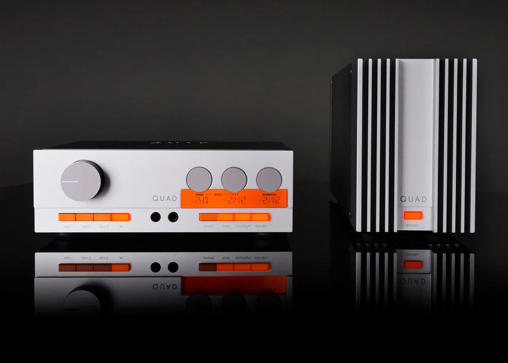

# The Quad 33 and 303: Quad's first transistor amplifiers, and their return in 2024

In 1967, Quad, the firm Peter Walker had founded in 1936, went from valves to transistors with a
pair: the 33 control unit, a pre-amplifier, and the 303 power amplifier. By Hi-Fi News' count,
120,000 33s were sold up to 1982, and 94,000 303s up to 1985. In 2024, Quad brought both names
back. Here is the pair as its manuals describe it, how a streamer can feed it through its DIN
sockets, and what the new versions changed.

Checked on 2026-10-31 against Quad's instruction books for the 33 and the 303, the 33's circuit
diagram, a history of the firm Quad wrote in 1982, and the reviews of 2025 in Hi-Fi News and
Stereophile, with Hi-Fi News' measurements of the originals.

## From valves to transistors

Quad is the brand of the Acoustical Manufacturing Company, which Peter Walker started in London in
1936 and moved to Huntingdon in 1941, after it was bombed out. The name came in 1951, with an
amplifier: QUAD, for *Quality Unit Amplifier Domestic*. Then came the Quad II valve amplifier, in
1953, and in 1957 the electrostatic loudspeaker known today as the ESL-57.

The 33 and the 303 followed in 1967, in Quad's words of 1982 its "first all-transistorised" units.
The 303's output stage, which Quad called the *Triples*, was its own design. It used only NPN power
transistors, and Quad wrote that it overcame the problems of thermal tracking in class B
amplifiers: keeping the output transistors' idle current steady as they warm up. In 1969, the 33,
the 303 and the FM3 tuner won a design award from the Council of Industrial Design, the later
Design Council. A 33 and a 303 together cost £98 in 1967.

## The 33 control unit

The 33 takes four sources, all on DIN sockets: a record player, two tuners, the second of which can
be any other source at radio level, and a tape recorder. Two boards plug into its back and match
its inputs to the equipment behind them:

- **The Disc Adaptor board**, inserted by one of its four edges, sets the record-player input for a
  low-output or a high-output magnetic cartridge, a ceramic one, or a spare position for special
  needs.
- **The Tape Adaptor board** offers three levels for recording and three for replay, on each
  channel, set by small screws moved on its underside.

On the front: the volume knob, which also switches it on, a balance control, bass and treble, and
a filter, a slope knob with buttons at 5, 7 and 10 kHz, against record surface noise. A Cancel
button takes the bass, treble and filter out of the circuit, as a reference. At the back, two mains
outlets, switched with the 33, feed the power amplifier and the FM tuner: the 33's volume knob
turns the whole system on.

From Quad's manual:

| | Quad 33 |
|---|---|
| Disc | 2 or 5.6 mV magnetic, 100 mV ceramic |
| Radio 1 and 2 | 100 mV, 2 V at most; 100 kΩ |
| Tape replay | 100 mV, 400 mV or 1 V, set on its board |
| Output | 0.5 V, on a 4-pin DIN socket |
| Size, weight | 26 × 9.2 × 16.5 cm, 3 kg |

Each input's level is what drives the 33 to its rated output, 0.5 V; its maximum is what it takes
before it overloads.

## The 303 power amplifier

The 303 has no controls at all, not even a mains switch: it runs from the 33's switched outlet, and
Quad suggests it can sit out of sight, inside a cabinet. In its narrow, upright case, it may have
been one of the first "vertical" amplifiers, Stereophile thinks.

From Quad's manual:

| | Quad 303 |
|---|---|
| Input | 4-pin DIN: 0.5 V, 22 kΩ |
| Power | 45 W into 8 Ω, 28 W into 16 Ω |
| Loudspeakers | 4 to 25 Ω |
| Output | 0.3 Ω, through a 2,000 µF capacitor |
| Size, weight | 12 × 15.9 × 32.4 cm, 8.2 kg |

- **Its input** takes the left channel on pin 1 and the right on pin 3, with ground on pin 2: not
  the scheme of the 33's inputs, below. Quad supplied a 4-pin DIN plug and a mains connector for
  use without its control unit.
- **Its output stage** runs from a single 67 V supply rail, and reaches the speakers through that
  capacitor, as Stereophile describes it.
- **With an ESL**: the manual asks for a small modification to Quad's electrostatic loudspeakers
  older than serial number 16800, of March 1966.

## What Hi-Fi News measured

Hi-Fi News reviewed the pair in April 1968, and tested "mint" originals again in July 2011. Its
figures:

- **The 33** gave 13.6 dB of gain and at most 1.6 V, with distortion between 0.014 and 0.075 % from
  20 Hz to 20 kHz. Its treble fell gently, by 0.4 dB at 20 kHz, and a steep filter cut the lowest
  frequencies: 3 dB down at 20 Hz, 18 dB at 10 Hz.
- **The 303** gave 50 W per channel into 8 ohms, more than Quad's 45, with distortion near 0.02 %
  through the upper bass and midrange. Its treble fell as the load dropped, from 0.55 dB down at 20 kHz
  into 8 ohms to 1.8 dB into 2 ohms, and in short bursts it gave only 10 W into 1 ohm: low
  impedances are not its ground.

Ken Kessler, reviewing the 2024 pair for Hi-Fi News, played it against an original one. The
original "still sounds wonderfully warmer", he wrote, but "lacks the ultimate precision, bass
control and extension at the frequency extremes". In his view, it was voiced first and foremost for
the Quad 57 ESL.

## A streamer into a 33

The 33 has no digital input, and only DIN sockets: a streamer reaches it through a DAC, with a
cable that has RCA plugs at the DAC's end and a 5-pin DIN plug at the 33's.

- **Tape Replay, not Radio.** A DAC gives about 2 V at full scale, 2.1 V for the
  [Heed Abacus](heed-abacus). The Radio inputs expect 100 mV and take 2 V at most, so every
  full-scale peak would reach their limit. Tape Replay, set to the highest of its three levels, H,
  expects 1 V and takes up to 10 V.
- **The board.** With the 33 off, pull out the Tape Adaptor board, at the back, and move its replay
  screws, one for each channel, to the H position. The manual shows where they go.
- **The pins.** Quad's circuit diagram gives all the 33's inputs the same pins: left on 3, right
  on 5, ground on 2, the usual scheme for an amplifier's socket. Tape Replay's pins 3 and 5 are
  wired to the same pins of Tape Record: unplug any tape recorder from that socket, or the two
  sources share the input.
- **The level.** At H, a DAC's 2 V gives the 33 1 V with its volume at the top, twice what the 303
  needs for full power: the knob keeps a useful travel, and full power comes before its end.
- **The streamer's volume** stays at 100 %, the level being set on the 33: the music then reaches
  the DAC as it is in the file.
- **Not the Disc input**: it is made for a cartridge's few millivolts.
- **A 303 alone** has no volume control: a DAC at full scale would send it four times the 0.5 V
  that drives it to full power. It needs a pre-amplifier.

Which pins carry what, where to set the volume and how to check both channels:
[A streamer into an amplifier with DIN inputs](../guides/streamer-din-amplifier-inputs).

## The 33 and 303 of 2024

In 2024, Quad, now part of the IAG group, brought both names back. Engineers led by Peter Comeau,
IAG's head of engineering, designed new circuits for cases close to the originals: Hi-Fi News
found the new 33 15 mm deeper, and the new 303 11 mm taller.

*The 33 and the 303 of 2024. Image: Quad, from its
[QUAD 33 page](https://quad-hifi.co.uk/products/quad-33).*

- **The 33** has no DIN sockets any more: three RCA line inputs and one XLR, a phono stage for
  moving-magnet and moving-coil cartridges, a headphone socket, a remote control, a motorised
  volume control and a display. Among its tone controls is a tilt, which tips the response about
  700 Hz, as Stereophile describes it. The original had none: its manual lists bass, treble and the
  filter.
- **The 303** takes RCA or XLR, and gives 50 W into 8 ohms and 70 W into 4. Bridged, one 303
  drives one speaker with 140 W into 8 ohms. Its output stage is now fully complementary, on two supply rails, with no
  output capacitor.
- **The price**: £1,199 each in the UK, by Hi-Fi News, and $1,599 each in the US, by Stereophile,
  which gives China as the place they are made.
- **The sound**: Kessler heard more precision and bass control than from the originals, and wrote
  that he was buying a set. Martin Colloms, in
  Stereophile, found the 33's line stage "neutral and detailed", and wrote that "the 303 comes to
  life in bridged configuration".

A DAC connects to the new 33 with ordinary RCA or XLR cables.

## With Audiogravity

Its guided setup gives MPD a software volume: with a 33 in the chain, leave the player's slider at
100 and set the level with the 33's knob. The details are in the manual:
[Listening](../manual/04-listening).

## Sources

- Quad, *33 Control Unit Instruction Book*, the edition marked 3K1078/3, and its Tape page in the edition marked 3/5/178; Quad 33 circuit diagram, for units above serial number 11500; Quad, *303 Power Amplifier* instruction book, ref. OI034EH: scans kept by the UK Hi-Fi History Society, [Quad 33 and 303 manuals and diagrams](https://ukhhsoc.torrens.org/makers/QUAD/Manuals_and_Diagrams/Amplifiers_33and303/index.html), read on 2026-10-31.
- The Acoustical Manufacturing Co. Ltd, [history of the company](https://dadaelectronics.com.au/doc/Audio/Quad/Production/QuadHistory1982.pdf), May 1982, and Quad, [*The First Fifty Years*](https://www.gerritspeek.nl/audio/quad/docu/quad_first-50-years.pdf), for the 1969 design award; both cited by Quad's own [Our story](https://quad-hifi.co.uk/pages/our-story), read on 2026-10-31.
- Hi-Fi News, January 2025: Ken Kessler and Paul Miller, ["Quad 33/303 Pre/power amplifier"](https://www.hifinews.com/content/quad-33303-prepower-amplifier), for the sales, the 1967 price, the 2024 versions and the sound, and its sidebar ["The originals"](https://www.hifinews.com/content/quad-33303-prepower-amplifier-originals), for the measurements of April 1968 and July 2011.
- Stereophile, Martin Colloms, ["Quad 33 preamplifier & Quad 303 power amplifier"](https://www.stereophile.com/content/quad-33-preamplifier-quad-303-power-amplifier), 2025-06-27, its [page 2](https://www.stereophile.com/content/quad-33-preamplifier-quad-303-power-amplifier-page-2) and its [specifications](https://www.stereophile.com/content/quad-33-preamplifier-quad-303-power-amplifier-specifications): the original 303's output stage, the 2024 versions and their prices.
- The image of the 2024 33 and 303: Quad, on its pages for the [QUAD 33](https://quad-hifi.co.uk/products/quad-33) and the [QUAD 303](https://quad-hifi.co.uk/products/quad-303), read on 2026-10-31.
