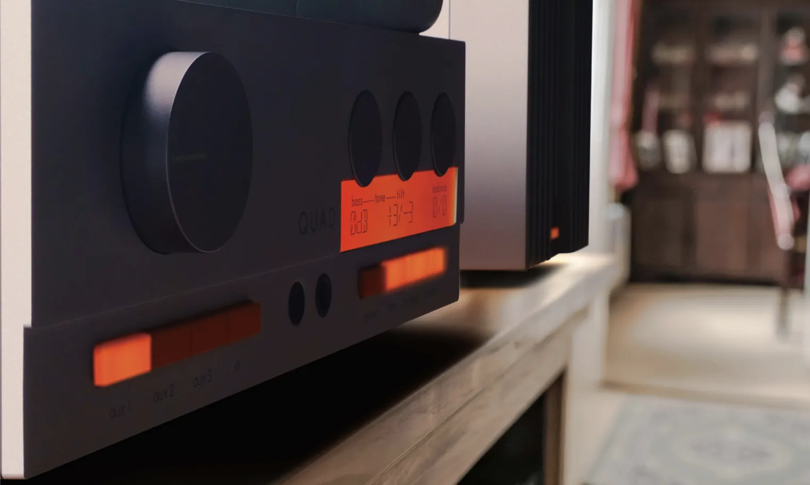
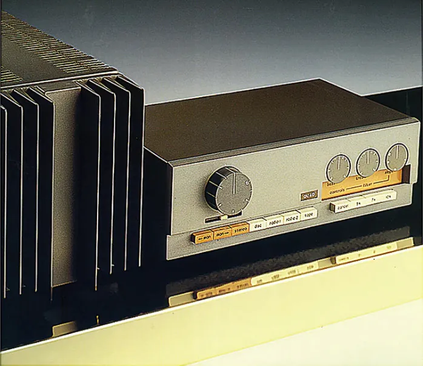
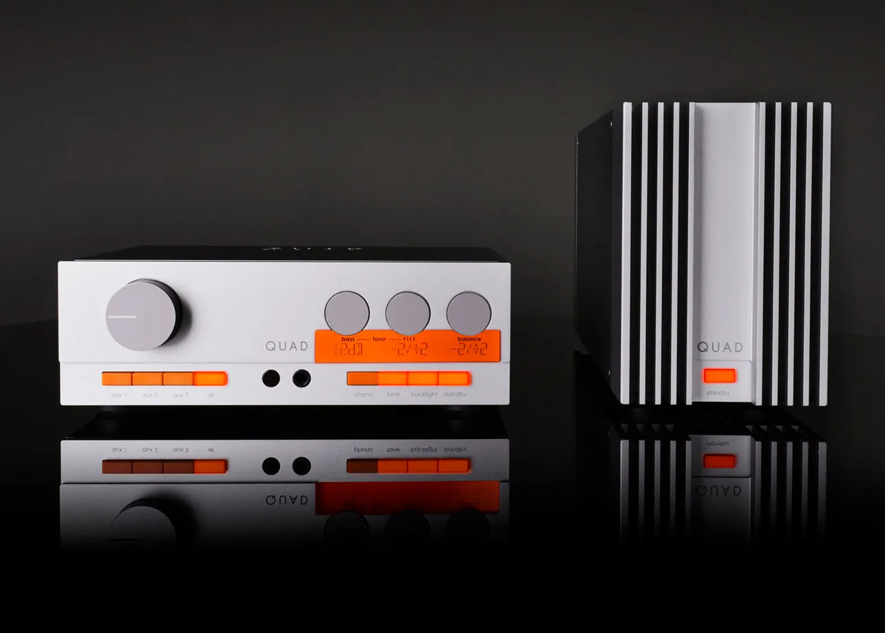
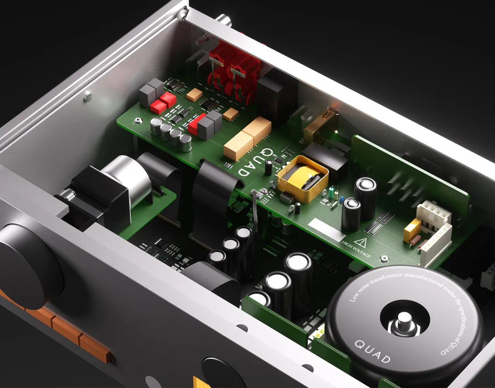

# The Quad 33 and 303: Peter Walker's transistor classic, and its return

In 1967 Quad went from valves to transistors with a pair: the 33 control unit, a compact
pre-amplifier, and the 303, a slim power amplifier with no switch at all. It became "one of the
best-selling pre/power amp combinations of all time", Hi-Fi News wrote in 2025: 120,000 33s sold up
to 1982, 94,000 303s up to 1985. They were among the first solid-state separates, admired for their
design, and voiced, in Ken Kessler's words, "first and foremost for the Quad 57 ESL". Originals are still sought after, and in 2024 Quad brought both names back. Here is what
made the pair a classic, what is known of how the originals sound, what reviewers heard from the new
ones, and how to use an original today.

Checked on 2026-11-02 against the reviews of Hi-Fi News (1968 and 2011, through its 2025 sidebar,
and 2025), Stereophile (2025) and The Absolute Sound (2025), Quad's instruction books for the 33 and
the 303, old and new, and the history of the firm Quad wrote in 1982.

*A Quad 33 of 2024, a 303 behind it. Photo: Quad.*

## What made it a classic

Quad is the brand of the Acoustical Manufacturing Company, which Peter Walker founded in London in
1936. The name came in 1951, with an amplifier: QUAD, for *Quality Unit Amplifier Domestic*. Then
came the Quad II valve amplifier, in 1953, and in 1957 the electrostatic loudspeaker known today as
the ESL-57.

The 33 and the 303 followed in 1967, Quad's "first all-transistorised" units, in its own words of
1982. Martin Colloms, in Stereophile, calls them "highly original, elegantly styled", and "among the
first solid state separates"; the 303 "may have been one of the first 'vertical' amplifiers".

*The original 33 and 303. Photo: Quad.*

- **The size.** "Compactness was the 33's greatest trend-setting move," Kessler writes. The 303 has
  no controls, not even a mains switch: it runs from an outlet on the 33, whose volume knob turns the
  whole system on, and Quad suggested it could sit out of sight, in a cabinet.
- **The Triples.** In the 1960s, Colloms explains, no PNP output transistor could be paired with an
  NPN one for low enough crossover distortion. Quad's answer, the output stage it called the
  *Triples*, used NPN power transistors only; Quad wrote that it also overcame the problem of keeping
  the output transistors' idle current steady as they warm up.
- **The design.** In 1969 the 33, the 303 and the FM3 tuner won a design award from the Council of
  Industrial Design. Colloms describes products "much admired for their modern industrial design",
  "enduring, widely feted successes" until they were discontinued.
- **The price.** A 33 and a 303 cost £98 in 1967, about £2,230 today, Hi-Fi News reckoned.

And they outlived their production: the 2024 versions were "apparently moved" by "the continuing hot
market for originals", Colloms writes.

## How the originals sound

Hi-Fi News reviewed the pair in April 1968 and tested "mint" originals again in July 2011. I could
not read either review; the magazine summed up both sets of measurements in 2025. The most direct
account I found of how an original pair sounds today is Kessler's, who played one beside the pair of
2024: "the
1960s pairing still sounds wonderfully warmer", but "lacks the ultimate precision, bass control and
extension at the frequency extremes". Consider what Walker "unleashed in 1967", he adds, "and you
accept that these were voiced first and foremost for the Quad 57 ESL — their most likely partner".

What the bench found, in 1968 and 2011:

- **The 33** had a gently falling treble, 0.4 dB down at 20 kHz, and a steep filter at the bottom of
  the audible range, 3 dB down at 20 Hz and 18 dB at 10 Hz; distortion from 0.014 to 0.075 %.
- **The 303** gave a full 50 W per channel into 8 ohms, more than Quad's 45, with distortion "impressively
  uniform at ~0.02%" through the upper bass and midrange. Its treble fell as the load dropped, from
  0.55 dB down at 20 kHz into 8 ohms to 1.8 dB into 2 ohms, and in short bursts it gave only 10 W
  into 1 ohm: "rather less capable of driving low impedances" than the 303 of 2024, Paul Miller
  concluded.

Its controls shaped the sound too. Besides bass, treble and balance, the 33 has a filter against
the surface noise of records, a slope knob with buttons at 5, 7 and 10 kHz, and a *Cancel* button
that takes the tone controls and filter out of the circuit, as a reference.

## The 33 and 303 of 2024

In 2024 Quad, now part of the IAG group, brought both names back: new circuits by engineers led by
Peter Comeau, in cases close to the originals. Kessler finds them "exactly how one would imagine the
33/303 might have evolved had they never ceased production".

*The 33 and the 303 of 2024. Image: Quad, from its
[QUAD 33 page](https://quad-hifi.co.uk/products/quad-33).*

**What reviewers heard.**

- **Hi-Fi News, January 2025.** Kessler: "Forget everything you know about the sound of the
  original 33/303." The new pair keeps "the smoothness of the originals but with added detail", a
  "blessedly wide soundstage", and sounds "'huge' in the literal sense" on the big stereo
  showpieces of the originals' era. Its phono stage is "easily worth" a £500 to £700 phono
  amplifier. "Peter Walker would be proud. I am buying a set as my mid-priced reference."
- **Stereophile, June 2025.** Colloms heard "an impressive neutrality — no fireworks but rather an
  easy refinement", "neutral, almost nostalgic", a little sweeter with the tone controls bypassed;
  and "the 303 comes to life in bridged configuration", with "tighter, more tuneful bass with better
  rhythmic patterning". His verdict: "a calm, almost relaxed musicality respectful of its legendary
  roots".
- **The Absolute Sound, June 2025.** Chris Kelly, who had lived with a Quad 44 and 405, found the
  music had "real rhythmic drive"; with two 303s bridged, "the same music positively leapt" from his
  Harbeths. Next to modern gear, the Quads are "slightly less analytical, perhaps a tad warmer".

All three heard more from two 303s bridged, one per channel: in Kessler's words, "not just the
available power" but "bass solidity, dynamic contrasts and speed".

**What changed.**

- **The 33** has no DIN sockets any more: three RCA line inputs and one XLR, a moving-magnet and
  moving-coil phono stage, a headphone socket, a remote control, a motorised volume control and a
  display. Among its tone controls is a tilt, which tips the response about 700 Hz; the original's
  manual lists bass, treble and the filter.
- **The 303** takes RCA or XLR, and gives 49.5 W into 8 ohms and 70 W into 4, by its manual; bridged,
  140 W into 8 ohms or 170 W into 4. Its output stage is now fully complementary, on two supply rails,
  with no output capacitor.
- **The price**: £1,199 each in the UK, by Hi-Fi News, and $1,599 each in the US, by Stereophile,
  which gives China as the place they are made.

*Inside the 33 of 2024. Its toroidal transformer reads "Low noise transformer manufactured under the
specifications of QUAD". Image: Quad, from its [QUAD 33 page](https://quad-hifi.co.uk/products/quad-33).*

## What to pair them with

- **The originals.** The Quad ESL-57 above all, the partner Kessler says they were voiced for.
  Quad's manual asks for a small modification to ESLs older than serial number 16800, of March 1966.
  The 303 accepts speakers of 4 to 25 ohms, and Hi-Fi News' measurements show it less at ease as the
  impedance falls.
- **The new pair.** Colloms advises "more efficient, higher-impedance speakers", even bridged.
  Kessler drove speakers of 4 to 15 ohms and 85 to 93 dB "and power was never an issue". Kelly's
  Harbeths and Wharfedale Super Lintons both suited them.

## Using an original today

- **The 33's inputs** are all on DIN sockets: a record player, two tuners, the second of which can be
  any other source at radio level, and a tape recorder. Two boards plug into its back and match its
  inputs to the equipment behind them: the **Disc Adaptor**, inserted by one of its four edges, for
  a low- or high-output magnetic cartridge, a ceramic one, or a spare position; the **Tape
  Adaptor**, with three levels for recording and three for replay, set by small screws on its
  underside.
- **A DAC** goes into **Tape Replay**, set to its highest level, H: it expects 1 V and takes up to
  10 V. Not into Radio, which expects 100 mV and takes 2 V at most, about what a DAC gives at full
  scale; and not into Disc, made for a cartridge's few millivolts. Quad's circuit diagram gives all
  the 33's inputs the same pins, left on 3, right on 5, ground on 2; Tape Replay shares its pins with
  Tape Record, so unplug any tape recorder from that socket. The cable, the pins and the volume are
  in [A streamer into an amplifier with DIN inputs](../guides/streamer-din-amplifier-inputs).
- **A 303 alone** has no volume control: it needs a pre-amplifier. Its input takes the left channel
  on pin 1 and the right on pin 3, with ground on pin 2 — not the scheme of the 33's inputs.

## The facts

From Quad's manuals for the originals:

| | Quad 33 |
|---|---|
| Disc | 2 or 5.6 mV magnetic, 100 mV ceramic |
| Radio 1 and 2 | 100 mV, 2 V at most; 100 kΩ |
| Tape replay | 100 mV, 400 mV or 1 V, set on its board |
| Output | 0.5 V, on a 4-pin DIN socket |
| Size, weight | 26 × 9.2 × 16.5 cm, 3 kg |

| | Quad 303 |
|---|---|
| Input | 4-pin DIN: 0.5 V, 22 kΩ |
| Power | 45 W into 8 Ω, 28 W into 16 Ω |
| Loudspeakers | 4 to 25 Ω |
| Output | 0.3 Ω, through a 2,000 µF capacitor |
| Size, weight | 12 × 15.9 × 32.4 cm, 8.2 kg |

Each 33 input's level is what drives it to its rated output, 0.5 V; its maximum is what it takes
before it overloads. The original 303's output stage runs from a single 67 V rail and reaches the
speakers through that capacitor. Stereophile writes that "it's said" Quad sold 100,000 303s.

## Sources

- Hi-Fi News: Ken Kessler and Paul Miller, ["Quad 33/303 Pre/power amplifier"](https://www.hifinews.com/content/quad-33303-prepower-amplifier),
  January 2025, for the sales, the 1967 price, the comparison with an original pair and the sound of
  the new one, and its sidebar ["The originals"](https://www.hifinews.com/content/quad-33303-prepower-amplifier-originals),
  for the measurements of April 1968 and July 2011; both read through the Internet Archive's copies
  of 2025, the site refusing automated reading.
- Stereophile, Martin Colloms, ["Quad 33 preamplifier & Quad 303 power amplifier"](https://www.stereophile.com/content/quad-33-preamplifier-quad-303-power-amplifier),
  2025-06-27, and its [page 2](https://www.stereophile.com/content/quad-33-preamplifier-quad-303-power-amplifier-page-2):
  the originals' place, the Triples, the 2024 versions, their sound and their prices.
- The Absolute Sound, Chris Kelly, ["Quad 33 preamplifier and 303 power amplifier"](https://www.theabsolutesound.com/?p=59556),
  2025-06-11.
- Quad, *33 Control Unit Instruction Book*, the edition marked 3K1078/3, and its Tape page in the
  edition marked 3/5/178; Quad 33 circuit diagram, for units above serial number 11500; Quad,
  *303 Power Amplifier* instruction book, ref. OI034EH: scans kept by the UK Hi-Fi History Society,
  [Quad 33 and 303 manuals and diagrams](https://ukhhsoc.torrens.org/makers/QUAD/Manuals_and_Diagrams/Amplifiers_33and303/index.html),
  read on 2026-10-31.
- The Acoustical Manufacturing Co. Ltd, [history of the company](https://dadaelectronics.com.au/doc/Audio/Quad/Production/QuadHistory1982.pdf),
  May 1982, and Quad, [*The First Fifty Years*](https://www.gerritspeek.nl/audio/quad/docu/quad_first-50-years.pdf),
  for the 1969 design award; both cited by Quad's own [Our story](https://quad-hifi.co.uk/pages/our-story).
- Quad, [*QUAD 33 User Manual*](https://quad-hifi.co.uk/cdn/shop/files/QUAD_33_User_Manual_Online_250217_R37.pdf?v=1739782101),
  online edition R37 of 2025-02-17, and [*QUAD 303 User Manual*](https://quad-hifi.co.uk/cdn/shop/files/QUAD_303_User_Manual_Online_241210_R29.pdf?v=1736738140),
  online edition R29 of 2024-12-10: the 2024 versions' inputs and power.
- The photograph of a 33 of 2024 at the head of this post: Quad.
- The photograph of the original 33 and 303: Quad; the copy used here is the one ON-mag published with Pierre Stemmelin's ["Quad 33 et 303 : retour d'un couple préampli/ampli Hifi iconique et radieusement vintage"](https://www.on-mag.fr/index.php/topaudio/actualites-news/26570-quad-33-et-303-retour-dun-couple-preampli-ampli-hifi-iconique-et-radieusement-vintage), 2024-10-25.
- The images of the 2024 33 and 303, and of the inside of the 33: Quad, on its pages for the
  [QUAD 33](https://quad-hifi.co.uk/products/quad-33) and the [QUAD 303](https://quad-hifi.co.uk/products/quad-303),
  read on 2026-10-31.
