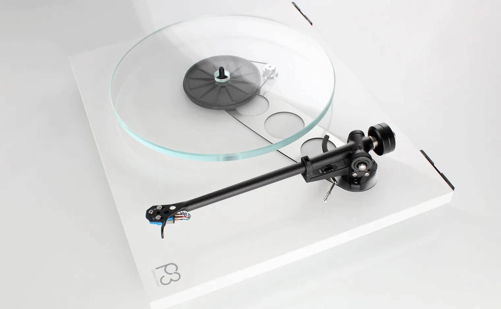

# The Rega Planar 3: the affordable turntable that set the standard

The Planar 3 is the belt-driven turntable Rega has made since 1976, through five generations,
around one idea: a light plinth made as rigid as possible, a glass platter and, from 1983, a tonearm
Rega casts itself. It became the deck others at its price are measured against. When it
came out, it "became the poor man's Linn Sondek LP12", Stereophile wrote; in 2002, the magazine
counted it among the hundred most important products in its history; for What Hi-Fi?, no other
product "has dominated its market sector with the authority of Rega's Planar 3", and in 2024 it
was "one of the industry's legends". Here is what reviewers heard from 1984 to 2024, where they
disagree, what each generation changed, and how a P3 of about 2005 plays here, into a NAIT 2 and a
pair of LS3/5A.

Checked on 2026-11-02 against the reviews of Stereophile (1984, 1985, 1996, 2008, 2012, 2017) and
What Hi-Fi? (2021, 2024, 2026), Roy Gandy's interview with What Hi-Fi? in 2020, and Rega's own
guide and timeline.

*A Planar 3 of today, in gloss white. Image: Rega, from its
[Planar 3 page](https://www.rega.co.uk/products/planar-3).*

## How it became the reference

Rega was founded in 1973 by Roy Gandy, an engineer, and Tony Relph, a hi-fi dealer. Its first deck,
the Planet, "sold because it looked different, rather than on sound quality", Gandy says. The
Planar 3 took a glass platter and an even lighter plinth: "I had long been convinced that a low mass
plinth and high rigidity were vital for good sound." When it arrived, Herb Reichert wrote in
Stereophile, it "opened a gateway of affordability to the exotic world of high-quality British
record players".

Its arm made its name as much as the deck. In 1983 Rega brought out the RB300, a one-piece arm cast
in aluminium alloy. Sam Tellig called it "truly an excellent arm" in 1985, "a triumph of
engineering" that also suited a Linn LP12, "a fact that has apparently caused Ivor Tiefenbrun no
small amount of grief". For Michael Fremer, in 1996, "the real stars of the show are the arms". By
2007 the mould had cast more than "300-and-something thousand" of them, Gandy told him.

What the press made of it:

- **Stereophile, 1985:** Tellig liked the arm far more than the deck — "the turntable is nowhere near
  as good as the arm".
- **Stereophile, 1996:** "the Regas are incredible bargains," wrote Fremer. "They sound and perform
  even better than I'd previously thought."
- **Stereophile, 2002:** John Atkinson ranked the P3 30th in the magazine's list of its hundred most
  important products of all time, Stephen Mejias recalled in 2008, along with what two colleagues
  had written of the early model. Art Dudley: "If this level of design and manufacturing ingenuity
  were ever applied to the rest of a system, it would be dangerous." Tellig: "Was ever so much
  produced for so little?"
- **Stereophile, 2008 and 2012:** the P3-24 was a "Joint Analog Source" and a "Joint Budget
  Component" of 2008; its successor, the RP3, the magazine's analogue source of the year for 2012,
  "far ahead of the competition".
- **What Hi-Fi?, 2024:** "that legendary model is back with a vengeance", winning its price class
  again, two years after the Pro-Ject Debut Pro had taken it.

## The sound

**Rhythm and drive.** This is the Rega signature, from the first reviews on. Tellig heard "a very
dynamic sound with powerful, punchy bass — the table conveys the music's excitement. (Ivor
Tiefenbrun would call it 'tuneful.')" For Fremer, "the Rega excelled at providing the rhythmic thrust
of the music, which I think the Brits pay more attention to than Americans do": on a blues record,
"a 'crack' to the snare and a meatiness to the bass" that reminded him of sitting close to the stage
in a club, "the excitement generated by the Rega was incredible". In 2008 he found the P3-24's
"snappy rhythm'n'pace" and "relaxing musical flow"; in 2017 Reichert's Planar 3 showed him "rhythms
and musical structures and the force of players playing".

**Tone.** "Extremely well balanced tonally — that was the biggest surprise," wrote Fremer in 1996,
expecting "a slight metallic hardness on top and some bloat on bottom"; it slightly brightened the
sound, with "a stiff, etched feel to cymbals, female voices". The P3-24, twelve years later, leant
the other way: "the tonal balance tended toward the rich, warm side", an "additive but exceedingly
well-balanced sonic signature" that held through every cartridge he tried.

**Bass.** Tellig, in 1985, found "too much emphasis of the mid- to upper-bass", and a bass "a little
muddy". Fremer, in 1996, heard "very tight, ballsy bass" that on blues and rock "worked better" in
some ways than on a $9,000 turntable; on the P3-24, "rich, tuneful, meaty bass", "the kind that will
probably go well with small, bass-shy, stand-mounted, two-way speakers". The RP3 kept that sound and
added "tighter and better-controlled low frequencies", Stereophile wrote in 2012.

**Space.** Fremer's Planar 3 of 1996 moved the soundstage forward, toward the speakers; his P3-24
gave "big, solid images on a soundstage of exuberant size".

**Its limits.** Set against far dearer decks, it gives some things up. On classical records Fremer,
in 1996, found the noise floor "somewhat audible, the strings somewhat harder, the overtones somewhat
squelched, and ambience and decay a bit truncated": "more like a recording and less like real life".
With an Elys 2, in 2008, an orchestra behind a solo violin became "somewhat indistinct, almost
blob-like". And it has no suspension: "a triumph of engineering over the laws of physics", as
someone once called it, Tellig recalled in 1984, which makes it sensitive to what it stands on.

**The cartridge matters.** The reviewers agree that the deck rises with its cartridge. Fremer found
the first Elys of "vivid tonal balance", but quick to show surface noise; on the P3-24, Rega's Exact 2
"more than doubled the sound quality". Reichert found the Elys 2 "hard and opaque" in the upper
octaves, the Exact "sweet, very open, and easy rolling"; What Hi-Fi? found the Nd3 of 2024 "better in
just about every area" than the Elys 2. They disagree on where to put the money. Fremer, in 1996:
"better to get a Rega 3 and an expensive cartridge than an expensive turntable with a cheap
cartridge". Atkinson, in a footnote to the same column: "dollar for dollar", a cheaper cartridge on
a better turntable sounds better than the other way round.

## Five names

Rega's timeline dates the first Planar 3 to 1976, as do Stereophile and What Hi-Fi?; some
histories, Wikipedia's among them, give 1977.

| Year | Name | Arm | What changed |
|---|---|---|---|
| 1976 | Planar 3 | R200, RB300 from 1983 | 12 mm glass platter, light plinth |
| 2000 | P3 | RB300 | |
| 2007 | P3-24 | RB301 | 24 V motor, slimmer plinth |
| 2011 | RP3 | RB303 | Brace from arm to bearing |
| 2016 | Planar 3 | RB330 | Redesigned throughout |

- **The P3-24** took the low-voltage motor of Rega's P5, P7 and P9, with a circuit that trims its
  coils to cut its vibration, and a slimmer plinth than the P3's; it kept the P3's drive, a brass
  bearing and a glass platter under a felt mat. The TT PSU power supply changed its speed with a
  button, but did not fit the P3, Fremer wrote.
- **The RP3** joined the arm mount to the bearing with a 4 mm brace of hard phenolic, above and below
  the plinth, and took a reworked arm.
- **The Planar 3 of 2016** was "truly a new turntable for 2016 carrying over just two components from
  the previous model", Gandy wrote: a new plinth, bearing, sub-platter, motor control and the RB330
  arm. Since then: the EBLT belt in 2021, a 50th Anniversary Edition in 2023, Rega's Nd3 and Nd5
  cartridges in place of the Elys 2 in 2024, and in November 2024 the **RS Edition**, with a plinth in
  the high-pressure laminate of Rega's dearer decks, an Nd5, the Neo PSU Mk2 supply and the Reference
  belt.

## Against its rivals

- **The Linn LP12.** The deck it was compared with from the start. Before the Planar 3, Reichert
  wrote, the LP12 "was conspicuously rhythmic and musical in a way no other record deck could match.
  Then, suddenly, the Planar 3 appeared — and seemed to out-boogie the pricier (more bourgeois) Linn
  decks." Though, he added, it gave up "a lot of the Sondek's rhythmic suppleness, deeper space, and
  'blacker' backgrounds" to do it.
- **1984:** Tellig set it against the Harman Kardon T60, which "seems to do everything right": "But
  the Rega sounds better. You explain it, I can't."
- **1996:** Fremer played the same record on a Planar 3 and on a $9,000 TNT turntable, each with an
  expensive cartridge. The differences were "not nearly as immense as I thought they'd be".
- **2024:** What Hi-Fi? found the Planar 3 with an Nd3 better than Technics' direct-drive SL-1500C, at
  a lower price.
- **2026:** for What Hi-Fi?, the RS Edition is bigger, more open and more detailed than a Planar 3
  with an Nd3; an Nd5, a Neo PSU and the Reference belt bring a standard deck closer, not level.

## Through a NAIT 2, into a pair of LS3/5A

Here, a green P3 from about 2005 plays through the phono input of a Naim NAIT 2 into a pair of
Rogers LS3/5A. It is of the generation made from 2000 to 2007: an RB300 arm, the motor before the
24 V one, no electronic speed change, and an Elys 2 cartridge, which Rega had brought out in 2004.

- **The pairing.** Fremer heard in the Rega's "rhythmic thrust" the same kind of "outstanding throb"
  as in Naim's CD-2 player of the time, and described the P3-24's bass as the kind that "will
  probably go well with small, bass-shy, stand-mounted, two-way speakers" — which the LS3/5A is.
  Stereophile's Tellig played his records on a NAIT 2 from a Rega RB300 arm.
- **The input.** The NAIT 2's phono stage is made for a moving-magnet cartridge such as the
  Elys 2, with the usual 47 kΩ load, on RCA sockets: the P3's leads plug straight in. Some NAIT 2s
  are "CD versions", whose RCA sockets are a line input in place of the phono stage: on one of
  those, the deck needs a phono stage of its own, plugged into those sockets.
- **The force.** 1.75 g for the Elys 2, the figure What Hi-Fi? set it to.
- **The speakers.** What a pair of 11-ohm Rogers asks of a NAIT 2 is in
  [The BBC LS3/5A](bbc-ls3-5a#valves-or-a-nait-2); the amplifier's story is in
  [The Naim NAIT 2](naim-audio-nait-2).

## Setting it up

From Rega's quick start guide for the current deck and its RB330 arm, and the reviewers' advice:

1. **A rigid, level surface, away from the speakers.** The deck has no suspension and no levelling
   feet. Rega suggests its own wall bracket; Fremer advises one too if footfalls make the stylus
   jump.
2. **The platter.** Check the belt is in place, take out the transport card from under the
   sub-platter, then lay the glass platter on the hub and the mat on it.
3. **The cartridge.** Rega's cartridges fix with three screws, which set their position. The guide
   has a protractor printed on it for aligning another make. Rega's arms have no height adjustment;
   for the P3-24's arm, Fremer wrote, Rega supplies shims to go under it if a cartridge tilts it.
4. **Balance, then force.** Set the tracking-force dial and the bias slider to zero, fit the
   counterweight, and push it along until the stylus floats 1 mm above the record. Then set the
   dial to the force the cartridge maker gives, at the top of its range, and the bias slider to the
   same number.
5. **For 45 rpm,** lift the platter off and move the belt to the larger step of the pulley.
6. **The dust cover.** Gandy asks owners to use it, for the sound as well as for the dust; Fremer,
   in 2008, found the felt mat a dust collector and advised wiping it often. Gandy also advises
   against wet-cleaning records. Fremer: "don't listen. Roy Gandy is crazy!"

## The Planar 3 today

From Rega's product page and quick start guide:

| | Planar 3 |
|---|---|
| Drive | Belt, from a 24 V motor |
| Speeds | 33⅓ and 45 rpm, changed by hand |
| Platter | 12 mm float glass, under a mat |
| Tonearm | RB330, hand assembled |
| Cartridge | None, or an Nd3 or Nd5 fitted at the factory |
| Phono stage | None: it needs a moving-magnet input |
| Power | 24 V AC, from Rega's supply; the Neo PSU is an option |
| Size, lid closed | 447 × 117 × 360 mm, 6.0 kg |
| Warranty | Lifetime, against manufacturing defects, not wear |

The Nd3 and Nd5 give 5 to 6 mV and track at 1.75 g; the Elys 2 and the Exact before them, 6.8 to
7.2 mV, Stereophile wrote. With an Nd3, the deck was £799 at its launch in 2024 and £840 since
February 2025; the RS Edition, £999 at its launch and £1,099 in 2026, What Hi-Fi? reported. In 1996
a Planar 3 cost $650 in the United States; in 2008 a P3-24 with an Elys 2, $1,095.

## Sources

- Stereophile: Sam Tellig, [January 1984 and August 1985](https://www.stereophile.com/turntables/184rega/index.html);
  Michael Fremer, [December 1996](https://www.stereophile.com/content/rega-planar-3-turntable-michael-fremer),
  the Planar 3 with several cartridges, and [July 2008](https://www.stereophile.com/turntables/708rega/index.html)
  with its [page 2](https://www.stereophile.com/content/rega-p3-24-rb301-amp-elys-2-turntable-tonearm-amp-phono-cartridge-page-2),
  the P3-24 and what it changed from the P3; Stephen Mejias,
  ["A Good Turntable"](https://www.stereophile.com/content/good-turntable), 2008-07-18, for the Hot 100
  ranking and the words of Dudley and Tellig;
  ["Analog Source Component of the Year"](https://www.stereophile.com/content/stereophiles-products-2012-analog-source-component-year),
  2012, on the RP3; Herb Reichert,
  ["Gramophone Dreams #14: Rega Planar 3"](https://www.stereophile.com/content/gramophone-dreams-14-rega-planar-3),
  2017-01-31.
- What Hi-Fi?: Ketan Bharadia,
  ["Rega's Roy Gandy: 'I don't think I've ever been interested in hi-fi'"](https://www.whathifi.com/features/regas-roy-gandy-i-dont-think-ive-ever-been-interested-in-hi-fi),
  2020; ["Rega Planar 3/Elys 2 review"](https://www.whathifi.com/rega/planar-3-elys-2/review), page
  dated 2021-10-04; ["Rega Planar 3/Nd3 review"](https://www.whathifi.com/reviews/rega-planar-3nd3),
  2024; Kashfia Kabir,
  ["What Hi-Fi? Awards 2024"](https://www.whathifi.com/news/what-hi-fi-awards-2024-legendary-rega-turntable-is-back-with-a-vengeance-as-vinyls-popularity-continues),
  2024-11-08; ["Rega Planar 3 RS Edition review"](https://www.whathifi.com/reviews/rega-planar-3-rs-edition),
  its prices updated on 2026-10-12.
- Rega Research, [*Planar 3 quick start guide*](https://www.rega.co.uk/download/planar-3-qsg-final.pdf)
  (PDF); its pages for the [Planar 3](https://www.rega.co.uk/products/planar-3), the
  [Planar 3 RS Edition](https://www.rega.co.uk/products/planar-3-rs-edition), the
  [Nd3](https://www.rega.co.uk/products/nd3) and [Nd5](https://www.rega.co.uk/products/nd5), and its
  [product timeline](https://www.rega.co.uk/about/timeline), read on 2026-11-02.
- Wikipedia, ["Rega Planar 3"](https://en.wikipedia.org/wiki/Rega_Planar_3), read on 2026-11-02,
  for the date of 1977.
- The NAIT 2's phono input: [The Naim NAIT 2](naim-audio-nait-2), from Naim's owner's manual and
  Stereophile.
- The image: Rega, from its [Planar 3 page](https://www.rega.co.uk/products/planar-3).
