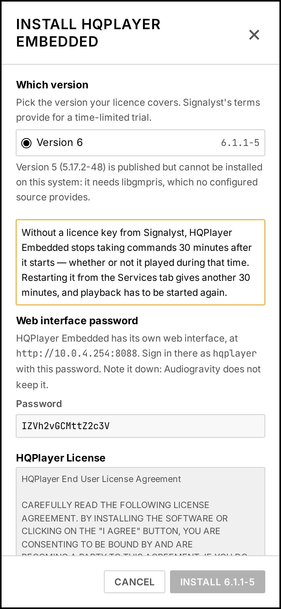
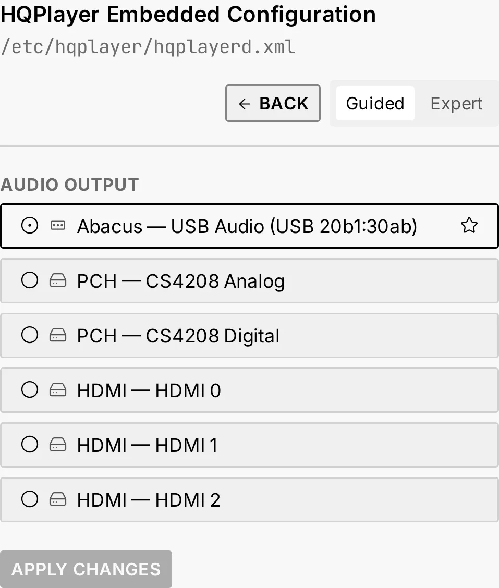

# HQPlayer Embedded on a Raspberry Pi 5

**Short answer:** yes, HQPlayer Embedded runs on a Raspberry Pi 5, and Signalyst publishes it
for that board in two forms. The Pi 5 is a capable host for stereo with sensible settings. It is
not one for multichannel, and its USB output has a known problem at the highest DSD rates.
Whichever way you install it, HQPlayer Embedded needs a licence from Signalyst; without one, it
runs for half an hour at a time.

This guide covers the two ways to install it, what a Pi 5 can and cannot do with it, and how
Audiogravity sets it up next to the rest of your music.

## Two ways to install it

Signalyst offers both on its download pages (checked on 2026-10-17):

- **A ready-made system image.** You write it to a microSD card and the Pi starts as an
  HQPlayer machine. The image replaces the Pi's whole system with one built for HQPlayer. The
  version 6 images exist for the Pi 5 only; the Pi 4 image stops at 5.17.2.
- **A Debian package** (`hqplayerd`, for Debian 13 on arm64, from 5.16 to 6.1.1). It installs
  on Raspberry Pi OS or Debian 13 like any other program, so HQPlayer sits beside your other
  players: MPD, Roon Bridge, AirPlay, a UPnP renderer.

The image is the simpler route if the Pi will do nothing else. The package is the route if the
Pi is also your streamer, and it is the one Audiogravity uses.

### What you meet with the package, by hand

Measured on my own test boxes:

- **Its web page has no password.** The package installs it without one, so the settings pages
  turn everybody away, and every refused sign-in is written to its log. Set a password with
  Signalyst's own command, `hqplayerd -s <user> <password>`, then restart the service: it reads
  the password only when it starts.
- **Its log has no size limit.** It writes to `/tmp`, which is memory on Debian 13, and never
  empties it. Most of the time that is a few lines. During one fault I saw it write 600 MB a
  minute.
- **The 5 line does not install on Debian 13.** Version 5.17.2 depends on `libgmpris`, which
  Debian does not publish (checked for arm64 on 2026-10-17). Version 6 does not need it. Install
  the line your licence covers.
- **The trial counts from the start of the service, not from the first note.** HQPlayer stops
  taking commands about 32 minutes after it starts, whether or not it played meanwhile. It writes
  nothing about it in its log; it just stops answering.
- **Nothing plays until you give it an output.** After installation it has none.

## What a Pi 5 can handle

Jussi Laako, who writes HQPlayer, has answered this on the Roon forum:

- **Stereo, yes; multichannel, no.** "Only quad-core, so not great for multichannel", since each
  channel typically takes one or two cores (September 2023). He added that the Pi 5 "would be
  already perfect" if it could run DSD256 with the ASDM7EC-light modulator: at the time, with
  HQPlayer 5, that combination was beyond it.
- **USB output above 44.1 kHz × 512.** "There are some hardware/OS issues with RPi5 and 48k x512
  and higher output rates" (March 2024). The problem is specific to USB output; up to
  44.1 kHz × 512 (DSD512 of the 44.1 kHz family) or 705.6 kHz PCM, it should work (May 2024).
  In November 2024 he still saw a problem with 48k × 512 DSD. I have not measured it.

I have not measured HQPlayer Embedded on a Pi 5 myself: the limits above are Signalyst's, with
their dates. The package is the same arm64 build for a Pi 4 and a Pi 5.

Two practical points:

- **Power it with the official 27 W supply.** With a weaker one, the Pi 5 limits the current
  its USB ports deliver, and a DAC powered from USB may not get enough.
- **Set the DSD rate limit before the first play.** HQPlayer Embedded comes set to DSD256. If
  your DAC stops lower, lower the limit on HQPlayer's web page, under **Configuration → SDM
  settings → Rate limit**. Some DACs accept a rate they cannot convert and hiss instead of
  playing.

## With Audiogravity

Audiogravity installs Signalyst's own package on a Raspberry Pi running Debian 13
(Trixie), DietPi or Raspberry Pi OS included, and takes care of what is listed above. HQPlayer
comes with the Pro edition; the 30-day trial includes it.

1. In **Audio Software**, click **INSTALL** on the **HQPlayer Embedded** card.
2. **Choose the version** your licence covers. A version your Pi cannot install is listed with
   the reason and cannot be chosen.
3. **Read Signalyst's licence** and accept it.
4. **Note down the password** for HQPlayer's web page, or type your own. Audiogravity
   sets it with Signalyst's command and restarts the service for you.
5. Click **Install**. HQPlayer Embedded starts, and starts again at every boot.
6. In **Config**, open the **HQPlayer Embedded** tile and choose the **audio output** your DAC
   is on.

From then on:

- **What you play goes through it.** Qobuz, Tidal, HIGHRESAUDIO, internet radio and UPnP
  media servers play through HQPlayer Embedded, straight to your DAC. Two profiles run it: the
  one that keeps MPD beside it plays your own library through it too.
- **Its log stays small.** Audiogravity moves it to 10 MB of memory of its own.
  When that is full, HQPlayer keeps running.
- **Updates keep your line.** A box on version 6 is never moved to another major version on
  its own.
- **Stop it, and the music goes back** to MPD, or to the HQPlayer you chose on your network.
- **Its own web page is one tap away**, from the HQPlayer card in **Library → Sources**, for
  its filters, modulators and DSD rate.

The details are in the manual:
[Outputs & engines → HQPlayer Embedded](../manual/06-outputs-engines#hqplayer-embedded), and
[Troubleshooting → HQPlayer Embedded stops after half an hour](../manual/09-troubleshooting#hqplayer-embedded-stops-after-half-an-hour).

## Sources

- Signalyst downloads, [signalyst.com](https://signalyst.com/), checked on 2026-10-17.
- Jussi Laako on the Pi 5 and multichannel: [HQPlayer Embedded Discussion, page 25](https://community.roonlabs.com/t/hqplayer-embedded-discussion/244327?page=25), Roon Community, September 2023.
- Jussi Laako on USB output: [HQPlayer NAA on Raspberry Pi 5](https://community.roonlabs.com/t/hqplayer-naa-on-raspberry-pi-5/269171), Roon Community, March to November 2024.
