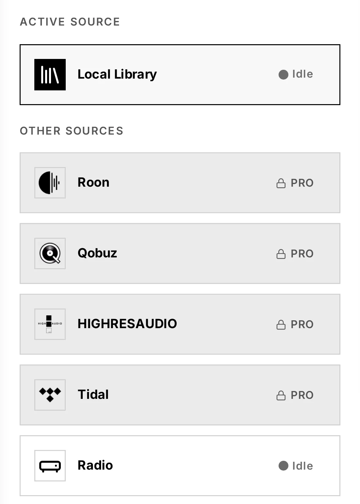

# 1. Introduction

## What Audiogravity is

Audiogravity is a **control app for your music streamer**. It runs on the small
Linux computer next to your hi-fi (a DietPi box, a Raspberry Pi, a NUC…) and gives
you a single, beautiful interface — in any browser, on your phone, tablet or
laptop — to run every part of your listening chain.

It plays your local library, streams Qobuz, Tidal and HIGHRESAUDIO, tunes internet
radio, drives HQPlayer, casts to network renderers, and even tunes the Linux kernel
underneath for bit-perfect, glitch-free playback — all from the same screen.

## What Audiogravity is *not*

Audiogravity does **not replace** the audio engines audiophiles already trust. It
**orchestrates** them. MPD, Roon Bridge, HQPlayer, AirPlay (shairport-sync), the
UPnP stack — Audiogravity installs, configures and drives these proven engines
rather than reinventing them. Your signal path stays exactly as pure as the tools
you already rely on; Audiogravity just gives you one place to conduct them.

## How it fits together

Think of your streaming setup as five layers. Audiogravity sits across all of them:

| Layer | What lives here | Audiogravity's role |
|-------|-----------------|---------------------|
| **Interface** | The screens you touch — browser, phone, tablet, installable app (PWA) | **It is the interface** |
| **Orchestration** | Switching sources, transport, volume, casting, monitoring | **It orchestrates** |
| **Content sources** | Your NAS, Qobuz, Tidal, HIGHRESAUDIO, internet radio, UPnP media servers | **It connects to them** |
| **Audio engine** | MPD, Roon Bridge, HQPlayer, AirPlay, UPnP renderers | **It installs, configures & drives them** |
| **OS / kernel** | Real-time scheduling, CPU pinning, ALSA | **It tunes it** |

You never have to touch a config file or a terminal to get any of this working —
though everything remains open and inspectable if you want to.

## What you can do with it

- **Play everything from one place** — local files, internet radio and, with Pro,
  Qobuz / Tidal / HIGHRESAUDIO and your UPnP/DLNA media servers, with unified transport,
  cover art and a live hi-fi readout (format, sample rate, bit depth, bitrate).
  Your iPhone, iPad or Mac can stream to the box over AirPlay too.
- **See what you listen to** — time listened, sources, sound quality and your most
  played, kept on the box (Pro).
- **Send music where you want** — your local DAC, a network UPnP renderer
  (Marantz, Linn, DLNA speakers) or HQPlayer's DSP engine (Pro).
- **Set up your audio stack in a few clicks** — a guided setup detects your DAC
  and music library and generates minimal, bit-perfect configurations for you.
- **Tune for sound quality** — real-time kernel scheduling, per-core CPU pinning,
  latency benchmarks, and a live view of your entire signal path (Pro).
- **Manage the box** — services, users with passkeys, config editing with backups,
  and one-click updates — no SSH required.

## Editions

| Edition | Price | What you get |
|---------|-------|--------------|
| **Trial** | Free · 30 days | Everything, including all Pro features |
| **Starter** | Free · forever | Running the box and playing the music on it — see the table below |
| **Pro** | €49 · lifetime, one machine | Everything, for good |

Pro is a **lifetime licence** — no subscription, no renewal. You can start on the
free 30-day trial; it activates automatically on first run.

What each edition opens — the trial opens everything:

| | Starter | Pro |
|---|:---:|:---:|
| **Profiles** — switch between audio scenarios in one tap | ✓ | ✓ |
| **Services** — watch and control the audio services | ✓ | ✓ |
| **Audio Software** — install, update and remove audio engines | ✓ | ✓ |
| **System** — the hardware and the audio devices at a glance | ✓ | ✓ |
| **Config** — each service's own settings, and the guided setup (administrators); HQPlayer Embedded's, the NAA's and Roon's come with Pro | ✓ | ✓ |
| **Admin** — users and passkeys, announcements, updates, the licence | ✓ | ✓ |
| **Push notifications** | ✓ | ✓ |
| **Now playing** — the track, its cover and its format, in the mini-player | ✓ | ✓ |
| **DSD at full volume** — the volume locked while a DSD track plays | ✓ | ✓ |
| **Library** — browse, search and queue the music on the box | ✓ | ✓ |
| **Internet radio** | ✓ | ✓ |
| **Playback controls** — play, pause, skip, seek, volume, and the full-screen player with its sleep timer | ✓ | ✓ |
| **Outputs** — the box's DAC, or a network renderer | ✓ | ✓ |
| **Streaming** — Qobuz, Tidal and HIGHRESAUDIO | — | ✓ |
| **UPnP media servers and Roon** — browse them, and control Roon's zones | — | ✓ |
| **HQPlayer** — as the output, its filter and noise shaper, HQPlayer Embedded and the NAA | — | ✓ |
| **Listening history** — what the box played: time, sources, sound quality, most played (on Starter, it can still be switched off and cleared) | — | ✓ |
| **Pipeline** — the live signal path, from the source to the DAC | — | ✓ |
| **Systemd** — real-time priorities and CPU pinning for the audio services | — | ✓ |
| **Performance** — CPU governors and the latency test | — | ✓ |

On Starter, what Pro adds stays in view with a padlock and a light tint of the theme's
colour — a tab, a Library source, a Config tile; tapping it takes you to the licence panel,
with the *License activation* window open (see
[7. Administration → Licence](07-administration.md#licence)). When the trial ends, streaming
tracks still in the queue no longer play; the music on the box plays on.

> **Note:** streaming from Qobuz, Tidal or HIGHRESAUDIO requires your own active
> subscription to each service. Audiogravity does not provide access to them.

## What you need

- A **Linux box** running **Debian 13 (Trixie) or later** — DietPi and Raspberry Pi OS
  included, in their Trixie release — on x86-64 or ARM/Raspberry Pi, next to your hi-fi
- A **DAC or audio output** the box can see (USB, HAT, HDMI, S/PDIF…)
- Your **home network**, and any device with a browser to control it

Ready? Head to **[2. Installation](02-installation.md)**.
