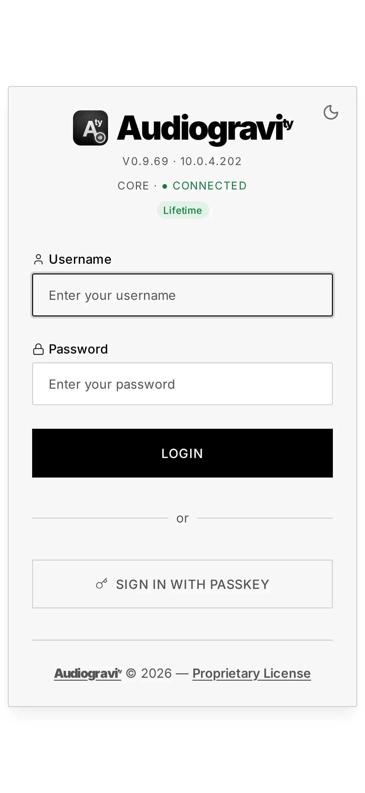
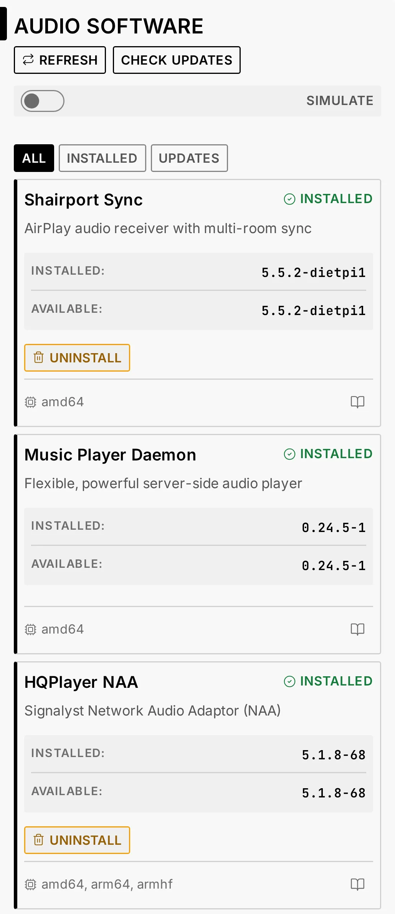
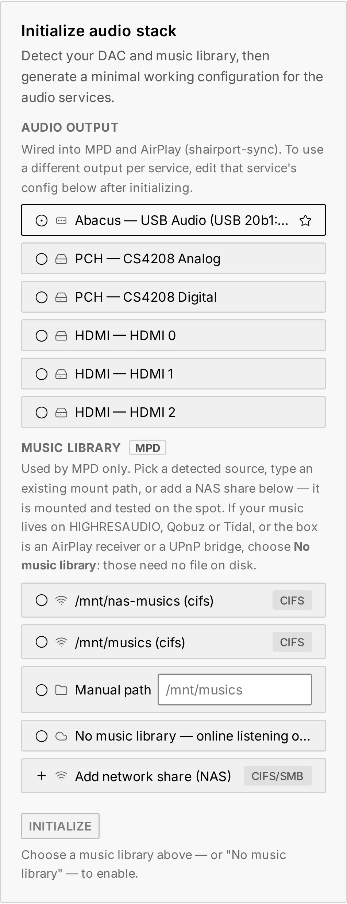
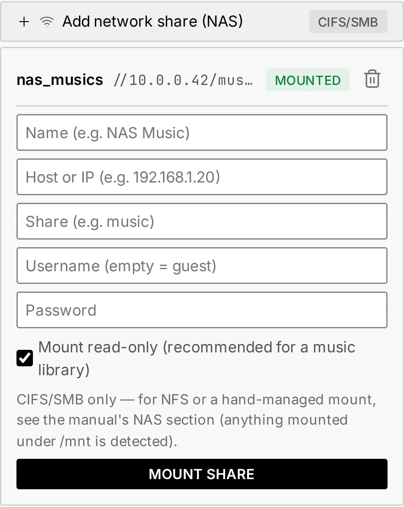
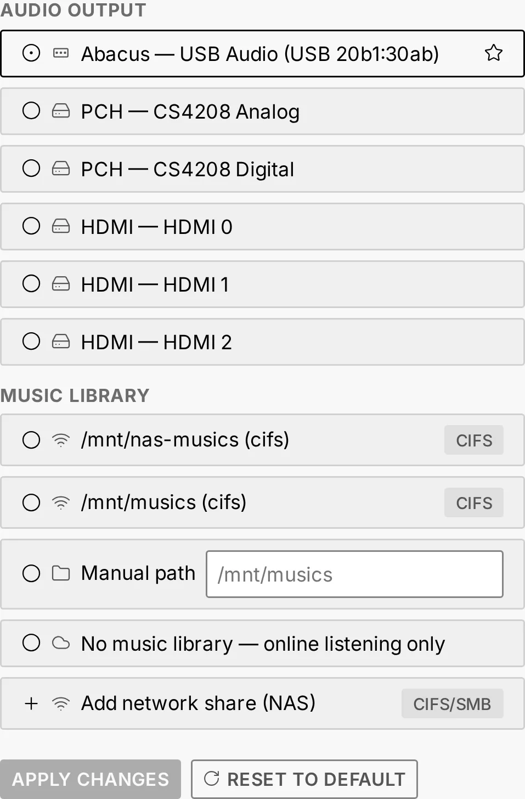
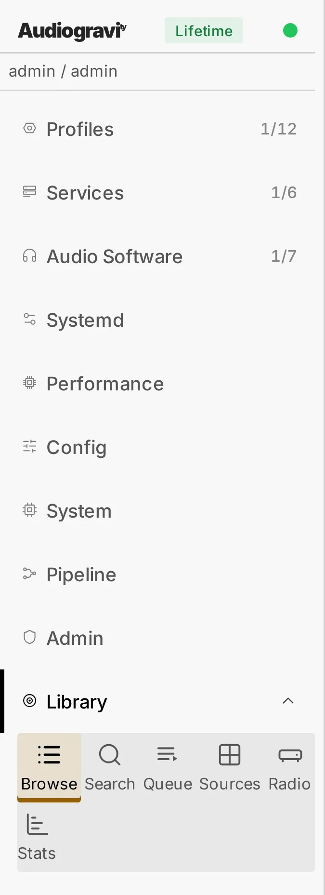
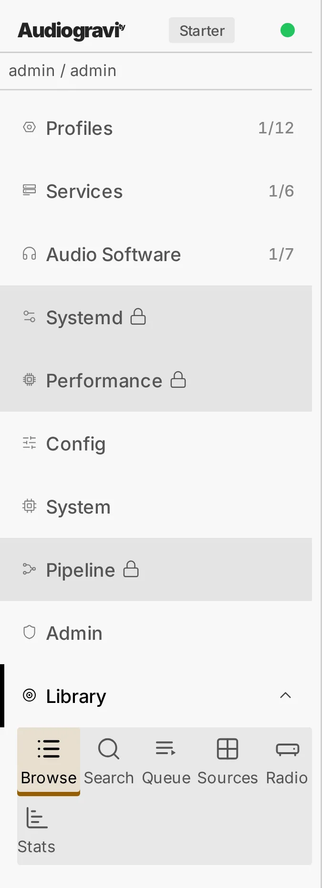

# 3. First run — guided audio setup

The first time you open Audiogravity, a few guided steps take you from a bare box to
music playing — without touching a config file.

## 1. Your trial activates automatically

A **30-day trial** — full access to every Pro feature — is activated on first run.
No action required, no card. When it ends you can keep using the free **Starter**
features or buy a **lifetime** licence (see [7. Administration → Licence](07-administration.md)).

## 2. Sign in — and secure your account

Audiogravity ships with one administrator account: username **`admin`**,
password **`admin123`**. Sign in with it, then **change the password right away**
(**Admin** tab → your user card) — the default is public knowledge.

After your first password login, Audiogravity offers to register a
**passkey** on the device — Face ID, Touch ID, a fingerprint or a hardware key.
Accept, and every later login becomes a tap: the login screen recognises the device
and asks for the passkey directly, with *Use password instead* as the fallback.
(Passkeys work from the box's **name**, never from its address — on an iPhone or iPad from
`https://<name>.local`, once the box's certificate is trusted on the device: see
[7. Trust the box's certificate](#7-trust-the-boxs-certificate-once-per-device).)

More accounts — family members, a guest who can only control what is playing — can be
added later from the **Admin** tab (see
[7. Administration](07-administration.md#users--access)).

**Light or dark, before you sign in.** The sign-in screen follows your device: light by
day, dark at night on a device that switches by itself. A small button in the corner of
the sign-in card switches the two — a moon when the page is light, a sun when it is dark;
the icon always shows where pressing it takes you — and this device then keeps your
choice instead of following its own; **Settings → Appearance → Automatic** gives it back
([7. Administration](07-administration.md#the-settings-panel)). It changes the
*appearance* only: which look you use — *Minimal*, *Slate* or *Gravity* — is chosen in
Settings too, and this button flips that look's palette. The appearance is applied before
the page is drawn, so a box you left in dark opens dark, with no white flash — which
matters on a box you start at night.

## 3. Install the audio engines

**MPD is already there.** The installer brings it, because Audiogravity
plays everything through it: your local library, the queue, internet radio, and
Qobuz, Tidal and HIGHRESAUDIO alike. Its card in **Audio Software** offers no
**UNINSTALL** button for that reason — a box without MPD has an interface and no
sound. If you use the box only as a Roon endpoint or an HQPlayer NAA, stop its
service from the **Services** tab and turn its **ENABLED** badge off there: a stopped
daemon costs nothing, and that badge is what keeps it stopped after a reboot.

> **Note.** Installing or updating Audiogravity starts MPD and sets it to
> start with the box — installing the software means guaranteeing what it plays
> through. An update therefore undoes both switches above; set them again if that
> is not what you want.

The other engines are yours to choose, from the **Audio Software** tab (see
[7. Administration → Audio Software](07-administration.md#audio-software)): each
has a card, with an **INSTALL** button until it is installed.

- **Shairport Sync** — to receive **AirPlay**.
- **UPnP Bridge** (upmpdcli) — to expose the box as a **UPnP renderer** other apps
  can cast to. It drives MPD, so it needs the player that is already there.
- **Roon Bridge / Roon Server / HQPlayer NAA** — only if you use Roon or HQPlayer.
- **HQPlayer Embedded** — HQPlayer itself, running on the box: see
  [6. Outputs & engines → HQPlayer Embedded](06-outputs-engines.md#hqplayer-embedded).

Install what you need now — you can always come back for the rest later.

## 4. Configure the audio stack (guided)

On a new box, the **Config** tab shows a **Set up your audio stack** banner
(administrators only). Its **Configure audio stack** button opens the **Initialize audio
stack** panel, which:

1. **Auto-detects** your DAC and your music library.
2. **Generates a minimal configuration** for the three audio services —
   **MPD** (local library) and **AirPlay** (shairport-sync) wired to the output you
   choose, and **UPnP** (upmpdcli), which plays through MPD.
3. Asks for your **admin password** before applying.

Once at least one service is set up, the banner disappears and each MPD / AirPlay /
UPnP tile shows a **CONFIGURED** badge.

> **Bit-perfect, at full volume.** MPD's configuration sends your music to the DAC
> without resampling or converting it: with the volume at 100, what your DAC receives
> is what the file contains — a 16-bit file padded to 24 or 32 bits, its values
> unchanged. Below 100, the volume recalculates every sample, at a level below your
> DAC's own noise; for strict bit-perfect playback, leave it at 100 and set your level
> on your amplifier. One exception: a DAC that accepts 16 bits only. The volume works
> on 24 bits, so even at 100 the music is brought back to 16 bits with a faint noise
> added (dither). AirPlay is not bit-perfect: to stay in time with the sender, it adds
> or drops a sample now and then.

> **Raspberry Pi with a HAT DAC?** A board stacked on the GPIO header is not detected
> until Linux is told it exists, so it will be missing from this panel. Declare it once
> at the OS level — see
> [9. Troubleshooting → My DAC is not in the output list](09-troubleshooting.md#my-dac-is-not-in-the-output-list-raspberry-pi-hat) —
> then come back here.

### The DAC stays put

Audiogravity knows each output by the **name of its sound card**, not by the number
Linux gives the card — a number that can change from one start of the box to the next.
So the output your services target never drifts, and nothing needs re-checking at
startup.

### Per-service outputs

Each service can target its **own** output. For example: MPD on your USB hi-res DAC,
AirPlay on the optical out. Change any service's output later from the **Guided**
editor (see below) in a couple of clicks.

### No music of your own? Say so

A box with no local music is an ordinary box: HIGHRESAUDIO, Qobuz and Tidal need no
file on disk, and neither does an AirPlay receiver or a UPnP bridge. The picker offers
**No music library — online listening only** as a choice in its own right. It is not
an empty field — it is an answer, and the box records it as one: MPD is configured
without a music folder rather than with a blank one, and everything else works
normally.

The choice is reversible in both directions. A box that started with no library can be
pointed at one later from the **Guided** editor, and one that has a library can be
released from it — with a confirmation first, since that takes something away.

A path you *do* give is checked before anything on the box is touched: it must be
absolute, exist, be a directory, and be **readable by the account MPD runs as** — a
folder you can read is not necessarily one MPD can, and that difference is invisible
once MPD is running. If a check fails you are told which one, and nothing has been
changed.

### Music on a NAS? Add the share from the picker

The **Music library** picker lists what the box can already see: **USB drives**
(ext4 / exFAT) and **existing mounts**. For a NAS share (CIFS/SMB — what
Synology, QNAP and every mainstream NAS speak), use **Add network share (NAS)**
at the bottom of the picker: give it a name, the NAS host, the share name and —
unless it's a guest share — its username and password. Audiogravity
**mounts and tests the share on the spot**: on success it appears in the list,
pre-selected; on failure you get the actual mount error (wrong password,
unreachable host) and nothing is left behind.

The share is mounted read-only by default, on demand rather than at startup, so a NAS
that is switched off when the box boots causes no trouble. Your credentials are stored
where only the system can read them.

Adding a share **mounts and selects it**, but does not yet make it MPD's
library on its own — that's the same two-step rule as any source: pick it in
the picker, then **confirm** — click **INITIALIZE** (in the panel) or **Apply**
(in the Guided editor) to actually point MPD at it. That confirm step also
**starts a library scan** so the new music is indexed and shows up in the
Library view (a large NAS keeps indexing in the background — give it a moment).
To **remove** a share,
reopen the panel: each one it created is listed with its state (mounted /
on-demand) and a **trash** button — removing one it isn't currently using takes
effect immediately; if the share is MPD's active library, it warns you first.

> **Prefer the terminal, or need NFS?** Any share you mount yourself at the OS
> level (CIFS or NFS) under `/mnt` is detected exactly the same way — see
> [9. Troubleshooting → Manual NAS mount](09-troubleshooting.md#manual-nas-mount-terminal)
> for the recipe. NFS is available from the terminal only.

## 5. Change output or library later (Guided mode)

For administrators, the Config editor of MPD, AirPlay and UPnP opens in a **Guided**
view. There you change the **audio output** — and, for MPD, the **music library**,
whether DSD leaves as DoP, and whether your DAC's volume goes to full during DSD — in a
couple of clicks; UPnP has nothing to choose, because it plays through MPD. Only the
setting you touch is rewritten — the rest of your config is preserved. A **Reset to
default** action regenerates a clean minimal config (admin password required; your
current file is backed up first).

## 6. Find your way around

The **tab bar** (across the top on a computer, a sidebar on a phone or a small tablet)
is the app's map:

- **Profiles · Services · Audio Software · Systemd · Performance · Config ·
  System** — running the box: audio scenarios, service control, engine installs,
  OS tuning, config files and monitoring (all covered in
  [7. Administration](07-administration.md)).
- **Pipeline** — the live signal-path view (Pro; see
  [6. Outputs & engines](06-outputs-engines.md)).
- **Admin** — users and access, announcements, updates and the licence.
- **Library** — browse, search, queue, sources and outputs: where you play
  music (the streaming services, the media servers and Roon come with Pro), and what the
  box has played. In the sidebar, a tap on it unfolds a row of icons — **Browse**,
  **Search**, **Queue**, **Sources**, **Radio** or **Stats** — and a tap on one opens that
  view; a second tap on Library folds them. Coming from another tab, the view you were on opens as you
  left it, an album or an artist still open. Across the top, a tap on Library opens the
  page, its views in a bar of their own.
- **Manual** — this manual, readable inside the app; it stands apart from the tabs, at
  the far end of the bar or the foot of the sidebar.

On a **Starter** licence, what Pro adds carries a padlock — the Pipeline, Systemd and
Performance tabs, Library's Pro sources — and tapping one takes you to the licence panel, with
the *License activation* window open. **Config stays open**: editing a service's configuration
file and the guided setup are available on every edition — configuring the machine is part of
owning it; only HQPlayer Embedded's, the NAA's and Roon's files come with Pro.

The sticky **Now Playing bar** sits above the footer whatever the tab, and the **gear** in the
top bar opens [Settings](07-administration.md#the-settings-panel).

**Messages** say how an action went — saved, added, refused. They appear at the top right on
a computer, just under the top bar on a phone, three at most. A success goes away on its own
after a few seconds, unless your pointer or your finger rests on it; a warning or an error
stays until you close it with its **×**. An action that takes a while first says it is under
way, and that same message then turns into the outcome.

## 7. Trust the box's certificate (once per device)

The box serves its interface over HTTPS, with a certificate it signed itself. Each phone,
tablet or computer has to trust it **once**: there is nothing to redo afterwards, not even
when the box changes address.

- **On an iPhone or iPad this is required**: until it is done, Safari does not open the
  interface at all.
- **On Android and on a computer** the interface opens after a warning, but the app does
  not install and notifications do not work until the certificate is trusted.

Below, `<name>.local` is your box's name, the address the installer prints at the end —
`musics.local` for a box called `musics`. No longer have it? See
[2. Installation → Find your box's name](02-installation.md#find-your-boxs-name). If the
name does not open on a device, use the box's address in its place, `192.168.1.30` for
instance.

### On an iPhone or iPad

1. **An Audiogravity icon is already on the Home Screen?** Remove it first —
   touch and hold it, then remove it. You add it again at the end.
2. In **Safari** — not another browser — open `http://<name>.local:8081/ca.crt`. Type
   `http://`, not `https://`: that address serves this one file.
3. Safari asks whether to allow a configuration profile: tap **Allow**. If it asks which
   device, choose this one. Then tap **Close**.
4. Open **Settings** right away and tap **Profile Downloaded**, near the top. Tap
   **Install**, enter your passcode, tap **Install** each time it is asked again, then
   **Done**. *No **Profile Downloaded** line? Look in **General → VPN & Device
   Management**; not there either, start again at step 2.*
5. In **Settings → General → About**, scroll to the very bottom and tap **Certificate Trust
   Settings**. Under **Enable full trust for root certificates**, turn on **Audiogravity
   Local CA**, followed in brackets by your box's hostname — the one it had at its first
   install, if it was renamed since. Then tap **Continue**. **This switch is the step that
   counts**: installing the profile alone changes nothing.
6. Check: in Safari, open `https://<name>.local`. The sign-in page opens, with no warning.
   Now add the app: [8. Install it as an app](#8-install-it-as-an-app-recommended-on-phones).

### On Android

1. The phone needs a **screen lock** — PIN, pattern or password: without one, Android
   refuses the certificate. Set one first if needed.
2. In **Chrome**, open `http://<name>.local:8081/ca.crt` — `http://`, not `https://`. The
   file `audiogravity-ca.crt` downloads; if Chrome asks, accept the download. Tapping the
   file does nothing: carry on.
3. Open **Settings**, tap the search field, type `CA certificate` and open
   **CA certificate**. On a Pixel, it is under **Security & privacy → More security
   settings → Encryption & credentials → Install a certificate**.
4. Tap **Install anyway**, confirm with your screen lock, then pick
   **audiogravity-ca.crt** in **Downloads**. Android warns that a third party could see
   your traffic: here, that third party is your own box.
5. Check: in Chrome, open `https://<name>.local`. It opens with no warning. Now add the
   app: [8. Install it as an app](#8-install-it-as-an-app-recommended-on-phones).

### On a Mac

1. Open `http://<name>.local:8081/ca.crt`: the file `audiogravity-ca.crt` lands in
   **Downloads**. If the browser asks, allow the download.
2. Double-click it. Keychain Access asks where to add it: choose **login**, then **Add**.
3. In Keychain Access, find **Audiogravity Local CA** with the search field, and
   double-click it.
4. Open **Trust** and set **When using this certificate** to **Always Trust**. Close the
   window and enter your Mac's password.

### On a Windows PC

1. Open `http://<name>.local:8081/ca.crt`: the file `audiogravity-ca.crt` lands in
   **Downloads**. If the browser asks, allow the download.
2. Double-click it, click **Install Certificate…**, choose **Current User**, then
   **Next**.
3. Choose **Place all certificates in the following store**, click **Browse…** and pick
   **Trusted Root Certification Authorities**, then **OK**, **Next** and **Finish**.
   Answer **Yes** to the security warning.
4. Close the browser, and open it again.

**Firefox**, on any computer, keeps a list of its own: **Settings → Privacy & Security →
Certificates → View Certificates… → Authorities → Import…**, pick the file, then tick
**Trust this CA to identify websites**.

> **Why not simply a real certificate?** Because a public authority will not certify a
> private address like `192.168.1.30`. If you would rather have a certificate every
> device trusts with no manual step — or the app, passkeys included, from another network
> than the box's — give the box a domain name and a real certificate: see
> [2. Installation → A real domain](02-installation.md#a-real-domain--optional).

## 8. Install it as an app (recommended on phones)

Added to the Home Screen, Audiogravity opens **fullscreen**, in its own window,
with its own icon — and on an iPhone or iPad, that is what lets it receive notifications.
**Do step 7 first on that device**: until the certificate is trusted, the app does not
install.

Add it from the box's **name**, `https://<name>.local` — the address the installer prints
first and puts in its QR code (lost it? see
[2. Installation → Find your box's name](02-installation.md#find-your-boxs-name)). An installed app
reopens for ever the address it was added from, with no address bar to correct it: one
added on the name follows the box when the router hands it a different address.

### On an iPhone

1. In **Safari**, open `https://<name>.local`.
2. Tap **⋯**, then **Share**. *With the tabs at the bottom or the top of the screen, tap
   **Share** directly.*
3. Scroll down the list and tap **Add to Home Screen**. *Not in the list? At its very
   bottom, tap **Edit Actions**, then add **Add to Home Screen**.*
4. Turn on **Open as Web App**.
5. Tap **Add**, then open Audiogravity from its new icon.

### On an iPad

1. In **Safari**, open `https://<name>.local`.
2. Tap **Share**, then **View More**, then **Add to Home Screen**.
3. Turn on **Open as Web App**, then tap **Add**.

### On Android

1. In **Chrome**, open `https://<name>.local`.
2. A bar says **Add Audiogravity to your home screen**: tap **Install**, then
   **Install** again. *No bar? Tap **⋮**, right of the address bar, then **Install and
   create shortcut**, then **Install**.*
3. Open Audiogravity from its new icon. The installed app also honours the
   [Portrait Lock](04-listening.md#portrait-lock).

### On a computer

Chrome and Edge show an install icon at the right of the address bar: click it, then
**Install** — handy for an always-open controller window.

**Notifications** on an iPhone or iPad (iOS 16.4 or later) reach the installed app, never a
Safari tab: turn them on from the app itself (see
[7. Administration → Push notifications](07-administration.md#push-notifications)).

> **Phone on another network** — a separate Wi-Fi or VLAN for phones and computers: there,
> the name usually does not open (unless your router relays it between networks). Add the
> app from the box's address, `https://<box-ip>`, and **reserve that address for the box**
> in your router — look for *DHCP reservation*, *static lease* or *address reservation*: an
> icon added on an address stops opening the day the address changes. See
> [9. Troubleshooting](09-troubleshooting.md#a-bookmark-or-the-home-screen-icon-opens-on-nothing).

## Next

Your box now plays. Head to **[4. Listening](04-listening.md)** to start playing
music, or **[5. Library & streaming](05-library-streaming.md)** to connect Qobuz,
Tidal, HIGHRESAUDIO and internet radio.
