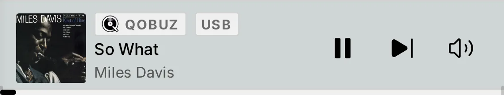
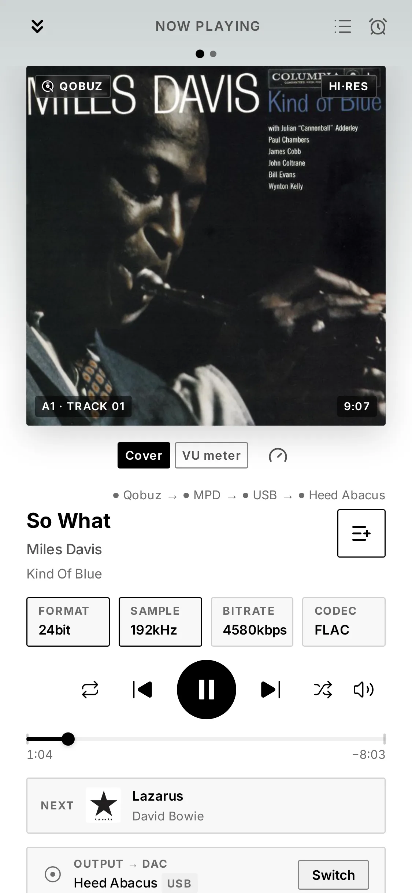
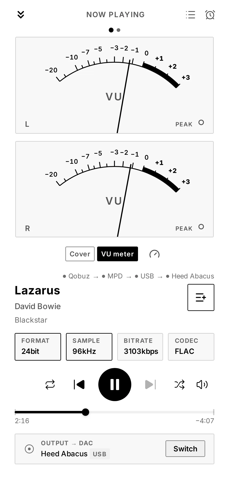
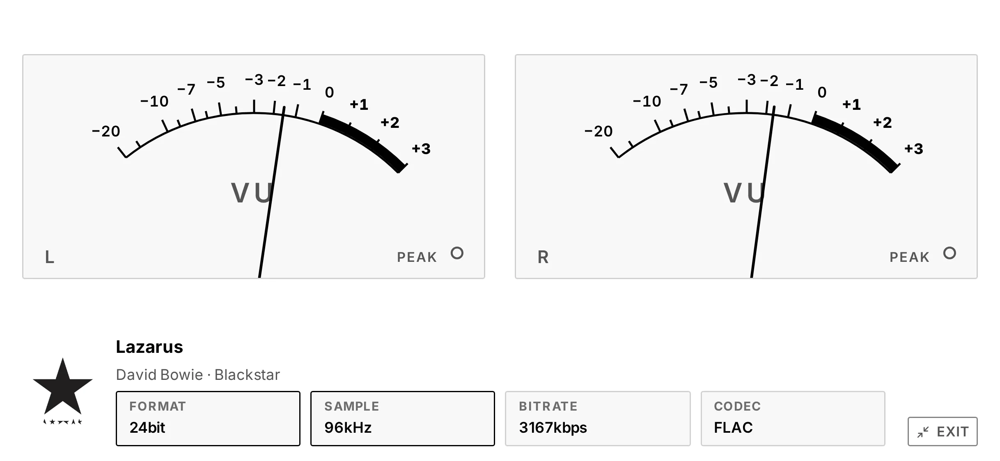
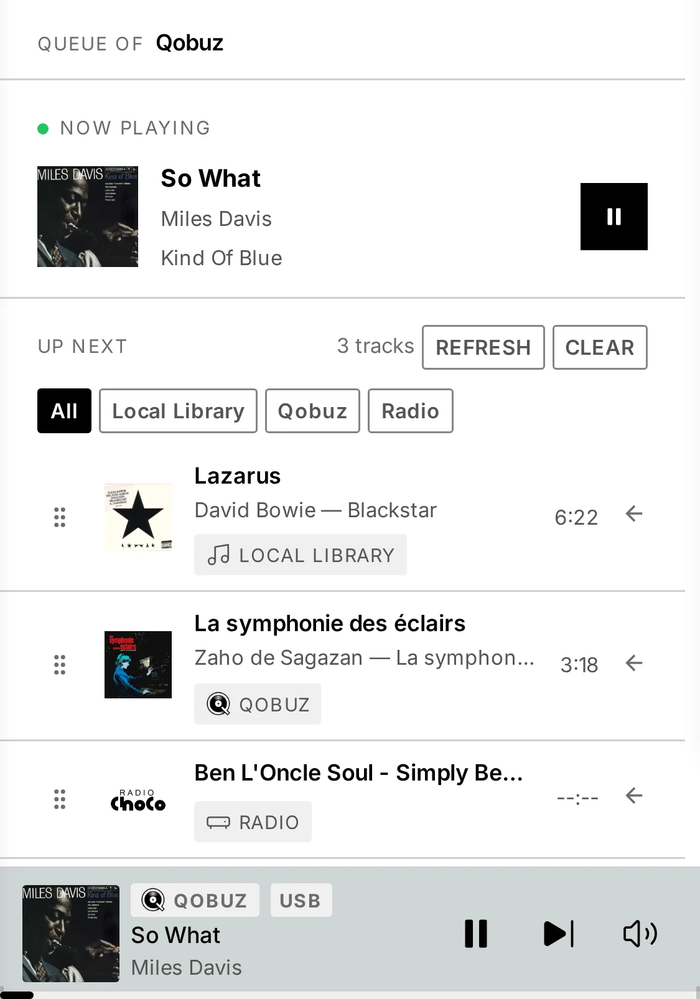
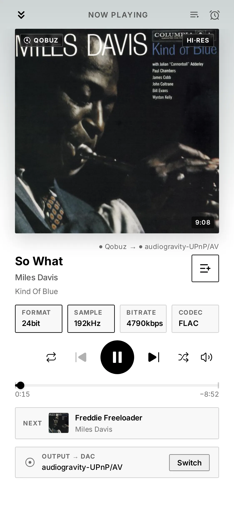
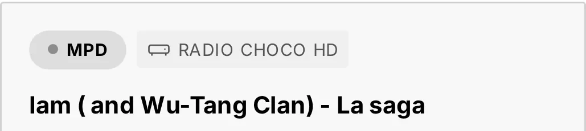

# 4. Listening

Once your box is set up, playing music is the same whatever the source — local files,
Qobuz, Tidal, HIGHRESAUDIO, internet radio or a UPnP server all flow through one set
of controls.

## The Now Playing bar

A sticky **Now Playing** bar sits above the footer and shows **all active audio
sources** at once, with quick transport — previous, play/pause, next, and volume.
Repeat and shuffle are in the fullscreen player — and on a phone, previous too: there
the bar gives its room to the title and the artist, a line each.

**Opening the fullscreen player.** There are three ways in, and tapping the bar
itself is not one of them:

- **On a computer** — the small tab at the top-right corner of the bar.
- **On a phone or tablet** — swipe **up** on the bar, starting from the track title
  rather than from the buttons, which keep the touch for themselves.
- **From the Library** — it opens by itself as soon as you start something playing.

Tapping the **cover art** does something else: it opens the album's details —
Album, Artist, Year, Genre, Format, Position, Source — and its tracklist.

## The fullscreen player

- **Cover art** with a dynamic background derived from it, a **seekable progress
  bar** — **Live** in its place for an internet radio station, which has no end — and
  full **transport**: repeat · previous · play/pause · next · shuffle. A button that
  would do nothing is greyed, never removed: next on the last track, and on a station
  played alone everything but play/pause — save a repeat or shuffle left on, which you
  can still turn off.
- **Album details** — Album, Artist, Format, Genre, Year, Position, Source and the
  full **Tracklist**.
- A **Queue** view for what's coming up (see below).
- Under the cover, a **Cover | VU meter** switch puts a pair of VU meters in the
  cover's place — see [The level meter](#the-level-meter).
- **On a phone held on its side** — with Portrait Lock off, see
  [Portrait lock](#portrait-lock) — the whole player fits on one screen, with nothing
  to scroll.
- On a Qobuz or HIGHRESAUDIO track, an **Add to playlist** button beside the title puts
  the track into one of your playlists on that service — see
  [5. Library & streaming](05-library-streaming.md#adding-to-your-playlists).
- **Swipe** between active sources; close with the back button or swipe-down.
- When playing to a network renderer, a **"Routed to UPnP renderer"** indicator makes
  the destination clear.

> **Controls tell you the truth.** Audiogravity waits for the player's answer
> before showing a command as done. If the player refuses one, the control returns to its
> real state rather than showing a change that never happened — a play/pause icon that
> flips back, or a volume slider that glides back to where it was, means the command was
> declined, not that your tap was missed. The commonest reason is an output with no volume
> control of its own. Queue actions say it in words, carrying the player's own reason.
> Jumping in a track is declined in three cases: a **live radio stream** has no end to
> jump to; the **first seconds** of a Tidal track's first listen, while its seekable copy
> is still arriving (wait a moment and try again); and a second jump asked for while the
> first is still being applied. See
> [9. Troubleshooting](09-troubleshooting.md).

## The level meter

*Pro.* While the box plays with its own player — your library, Qobuz, Tidal,
HIGHRESAUDIO or a radio station — the fullscreen player can show a pair of
**VU meters** in the cover's place: one needle per channel, moving with the music as
you hear it.

- Choose **VU meter** in the switch under the cover; **Cover** brings the artwork back.
  Each phone, tablet or computer keeps its own choice.
- The **gauge** button beside the switch opens the **showcase**: the meters and the
  track over the whole screen, for a tablet set beside your hi-fi. The screen stays
  awake while it is open, on browsers that allow it. Held on its side, a tablet or a
  phone shows the meters side by side; upright, one above the other. **Exit** brings
  the player back.
- **Reading the meters.** The needles swing like those of a studio VU meter. **0** is
  the reference level; the heavy band from 0 to +3, the loudest passages. The **PEAK**
  lamp lights when the music goes past the end of the scale — even for an instant
  too short for the needle to show.
- Music sent to the box from another app — AirPlay, Roon, HQPlayer, or casting to the
  box as a network speaker — keeps the cover: the meters follow the box's own player
  only.
- Without Pro, the switch shows a padlock that opens the licence panel.

## The Queue

The **Queue** view shows the current track and what's coming up — for every source,
including **Qobuz, Tidal and HIGHRESAUDIO** albums, with their real titles and artists
(they survive a restart of the box, too).

- The header names the **actual source** — playing internet radio reads "Radio" and
  shows the **station's logo**. The same holds when you **cast to a network speaker**:
  the badge names where the music comes from (**Qobuz**, **Library**, your media
  server's name), and the speaker appears as the **output** — because it is the
  destination, not the source.
- A badge reading **External** means the music was **started from another app**, not
  from Audiogravity. Your box also behaves as a speaker other apps can send
  music to, so a phone running JPLAY or BubbleUPnP can start playback without going
  through it. Music started at **HQPlayer's own remote** is badged **HQPlayer**. Either
  way you still see what is playing, and the badge tells you the queue is not one
  Audiogravity filled. When *you* send music to HQPlayer, the badge names the
  music — your library, Qobuz — not HQPlayer.
- When the queue **mixes sources** — say a radio station followed by a Qobuz album —
  each upcoming track carries a small **source badge** telling you where it comes
  from, and a **filter bar** lets you view one source at a time. Filtering only
  changes what you *see*: nothing moves or stops playing, and the current track
  always stays in view.
- Remove an upcoming track with its **Remove** button or a **left-swipe** — the same
  gesture used across the app's lists. **Clear** empties the queue, and respects the
  active filter. A Roon queue is changed from the Roon app: here it has no **Remove**
  button or swipe, and **Clear** is greyed out.
- The button beside the track playing plays and pauses it. The queue keeps up on its
  own: when a track ends, the list moves on. **Refresh** picks up changes made from
  another device.
- On **Starter**, a streaming service's track carries a padlock in place of its length:
  it will be skipped, since the streaming services come with Pro. A tap on the padlock
  opens the licence panel, and the track can still be removed.

Casting hands the audio over: what was playing on your DAC stops, and the speaker
becomes the output. A network speaker reports no format back: the hi-fi readout shows
what Audiogravity knows of the track it sent — codec, sample rate, bit depth,
bitrate —, and a dash where it knows nothing.

## The live hi-fi readout

On every track change, Audiogravity shows the format of the track playing:

- The **codec** (FLAC, ALAC, MP3, AAC, DSD…), **sample rate**, **bit depth** — *Lossy* for a
  compressed format such as MP3 or AAC, which has none — and instantaneous **bitrate**. A
  cell shows a dash when nothing tells its value.
- For a DSD track, a couple of seconds in, how it reaches your DAC when that is not as
  DSD: **DoP**, or **Converted to PCM** — see
  [6. Outputs & engines → DSD](06-outputs-engines.md#dsd-as-dsd-as-dop-or-converted-to-pcm).

This is your at-a-glance confirmation that a Hi-Res track really is playing at its
native resolution.

**DSD plays at full volume.** While a DSD track plays, the volume control gives way to a
padlock: the player's volume has no effect on DSD, so keep your listening level on the
amplifier. Your DAC's own volume is set to maximum too, and put back when the DSD ends —
some DACs play nothing, or noise, otherwise. This happens with the app closed too, and
for a DSD track started from another app. To leave the volume of a DAC that lowers DSD
properly as you set it, see
[6. Outputs & engines → DSD](06-outputs-engines.md#dsd-as-dsd-as-dop-or-converted-to-pcm).
Through HQPlayer, or on a network speaker, the volume stays yours to set.

On a box whose DAC does not take DSD — a HAT on a Raspberry Pi, for instance — the volume
control stays too, and works on DSD tracks as on any other: the DSD is converted to PCM
before the volume, and the player says **Converted to PCM**.

## The stream-origin badge

A badge in the player always tells you **where the audio is coming from** — Tidal,
Qobuz, HIGHRESAUDIO, your UPnP server (by name), a radio station (by name), a local
file, or AirPlay. You see it in the Now Playing bar, on the full-screen player and on
the **Pipeline** tab's Now Playing card. No guessing which source is live.

The transport pill on the left names the **engine** carrying the audio — here MPD.
On its own it would tell you nothing about the music: MPD plays local files, Qobuz,
Tidal, HIGHRESAUDIO and radio alike. The badge beside it names the **origin**, and
for a radio station or a UPnP server it gives the name of the station or the server.

## Profiles — switch whole chains in one tap

A **profile** is a ready-made scenario for your audio system, named after what it runs.
Switching one automatically **starts the services it needs and stops the conflicting
ones**, so the chain is always coherent. For example: *Roon Bridge +
HQPlayer NAA* for serious listening, *UPnP Renderer* to expose the box as a UPnP
renderer, *MPD* for your own music library. The profiles come with Audiogravity
(see [7. Administration](07-administration.md#audio-configuration-services--profiles)).

Each profile tile shows the services it starts/stops, the output they are set to play
to (e.g. `usb`, `toslink`), a live **health bar** of those services — running, stopped in
grey, failed in red — and when it was last switched on since
Audiogravity last started. Every switch asks for confirmation. The services to
stop are stopped first, then the others started. If an essential service cannot be
stopped, nothing is started; any other failure is named in a message, and the switch is
not undone.

If a service of the profile in use fails, its tile reads **FAILED** in red; tap
**Activate** on it to start again what failed. The other profiles keep their state,
with a small *failed* badge counting it.

**ALL / ACTIVE / IDLE** filters the tiles, the active profile first. Click a profile's
name for the full list of its services and the switches made from this browser; the
**HISTORY** panel beside the tiles lists those switches for every profile.

## Sleep timer

A built-in sleep timer pauses playback after a set duration — for falling asleep to
music without leaving the system running all night.

## Portrait lock

On phones and tablets, Audiogravity stays in **portrait** by default. A
**Portrait Lock** switch in **Settings** (the gear in the top bar) turns it off if
you prefer landscape — and on a device you can't rotate, the *Continue in landscape*
button on the rotate screen lets you carry on (it switches the lock off for you).
On a computer there is nothing to lock: the setting has no effect there, and the
interface follows your window whatever its shape.

## Where the audio goes

The output line at the bottom of the fullscreen player always names your
destination — your DAC or the speaker you selected — even when nothing is playing,
and marks it **Stopped** when it sits idle or **Unreachable** when it cannot be
contacted. Any reason the sound is not coming out appears on that same line.

Choosing **where** music plays — your local DAC, a network renderer or HQPlayer — is
covered in **[6. Outputs & engines](06-outputs-engines.md)**, and so is receiving AirPlay. Connecting
streaming services and browsing your library is in
**[5. Library & streaming](05-library-streaming.md)**.
